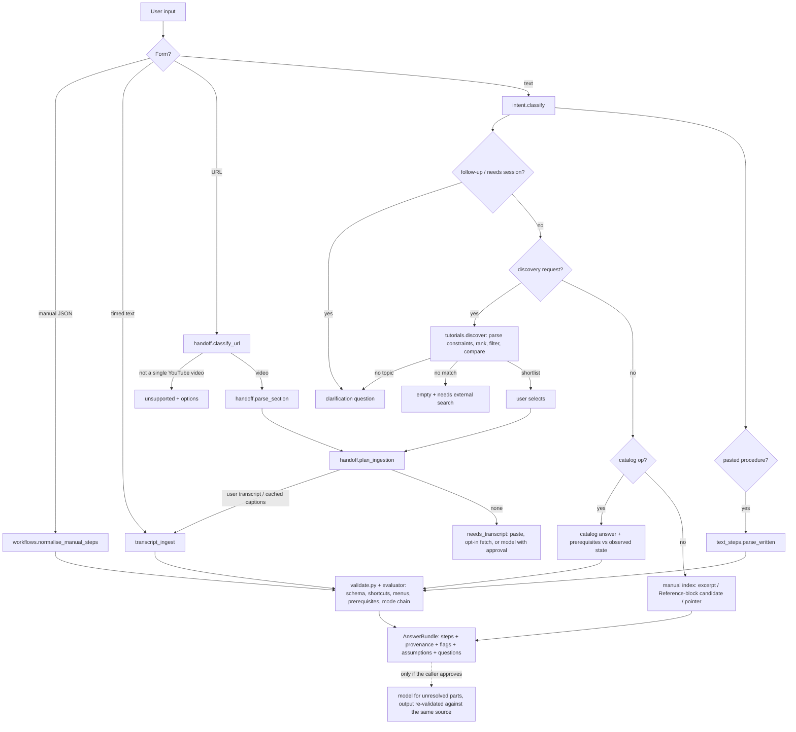

# Ingestion & Step Generation: Technical Plan

Owner: Ayesha Raza (`/ingestion`) · Status: **DRAFT v0.1 for review** · Written: 2026-10-10
Sources: `GuideWire_FYP_Proposal_Revised_v3.docx`, repo state at commit `7ae0e0f`, Google/YouTube docs fetched 2026-10-10.

Legend: **[V]** verified (proposal text, repo, or vendor doc read on the date above) · **[D]** proposed decision · **[A]** assumption needing an experiment.

---

## 1. My responsibilities (from Proposal §7, §10 and README)

| Area | Deliverable | Proposal date |
|---|---|---|
| Foundations | Lit review; requirements for task interpretation; joint grounding spike (with Umaima) | Aug 30 – Sep 13 |
| Spike | YouTube metadata/chapters + URL-based extraction spike | Sep 13 – 20 |
| Core | Workflow model (step records); step-generation pipeline | Sep 20 – Oct 4 / Oct 11 |
| Compliance | Written questions to YouTube/Google; choose fallback | Oct 11 – 25 |
| Scope | Workflow areas + representative tasks for Unity/Resolve (with Umaima) | Oct 11 – 25 |
| Integration | Connect step lists to guidance engine; basic automatic step progression (expected action/state logic) | Oct 25 – Nov 15 |
| FYP-1 | Written-instruction to workflow | Nov 22 – Dec 6 |
| FYP-2 | Request understanding and question routing; video ambiguity (semantic side); doc-grounded Q&A; accuracy refinement; semantic version comparison; two-stage ranking + fit check; chapter-by-chapter extraction; unify entry points; correctness and recommendation-quality evaluation | Jan 3 – Mar 21 |

**Out of my scope [V]:** screen capture, UI detection, grounding, overlay (Umaima); UI, accounts, session engine, data store, curated-index *content*, dashboard, BKT (Mehak).

**Ambiguities to settle (see §11):**
1. "Workflow model: step records" is listed for me, but "Design shared data model / Data model implementation" is Mehak's. Both own the same object.
2. "Basic automatic step progression" is mine, "Visual action verification" is Umaima's, both Nov 1–15. The boundary is undefined.
3. "Expected-state mapping, unverifiable-step marking, two-sided mismatch prompt" is shared (Feb 14–21).

## 2. Current state

**Repo [V]:** an empty skeleton. Every folder (`app`, `docs`, `ingestion`, `shared`, `tests`, `vision`) holds only `.gitkeep`. There is no code, no schema and no tests. `main` has two commits. `origin/mehak/step-format` exists but points at the same commit as `main`, so there is no step-format work to build on yet.

**Schedule reality [V]:** today is Oct 10. By the proposal's own dates the YouTube/URL-extraction spike (Sep 13–20) and the workflow model (Sep 20 – Oct 4) are already late, and the step-generation pipeline is due tomorrow. Nothing exists in the repo. This plan is deliberately sequenced to recover this: schema first, because it unblocks both teammates.

**Environment problems [V]:**
- `python` and `py` are not available in this machine's shell (Python 3.11 is required by the README). Install it before M0 code.
- `requirements.txt` lists `youtube-transcript-api`. That library works by fetching transcripts outside the official API (my knowledge, unverified here). Proposal §4.f forbids scraping third-party transcripts, so **remove it**.
- `requirements.txt` has no Google GenAI SDK and no HTTP or YouTube client. `.env.example` has a generic `LLM_API_KEY` and no `YOUTUBE_API_KEY`.
- The README's Blender version is still a placeholder. The gold set and predicate vocabulary depend on it.

## 3. The core problem, restated

The product value (checked progress) depends on one thing I produce: **step records whose expected state can be machine-checked**. Everything else (discovery, Q&A) is secondary.
A free-text `expected_state` ("the cube is now in Edit Mode") is useless to Umaima's verifier and to the adapter. If my output is not constrained to what the adapter or screen can report, the whole chain fails at the end. So the plan is organised around:

1. A **closed, small vocabulary of state predicates** (shared contract).
2. An extraction pipeline that **emits predicates only from that vocabulary**, and marks the step `unverifiable` otherwise.
3. **Deterministic validation** of every LLM output before it reaches anyone else.

## 4. Principal technical challenges

1. Predicate vocabulary: expressive enough for tutorials, small enough that Blender's Python API and vision can both check it.
2. Video extraction fidelity: invisible inputs, vague narration, hallucinated UI names, timestamp drift.
3. Honest confidence: the proposal says confidence is heuristic. It must still be useful for deciding which steps to flag.
4. Compliance: the entire YouTube route is contingent on Google's answers.
5. Cost and latency: time to first usable step, and evaluation cost.
6. Integration: three people building against an unwritten contract.

## 5. Recommended architecture

```
 input ─┬─ YouTube URL ──► MetadataClient (YouTube Data API: duration, chapters, embeddable, license)
        ├─ written text ─►                                  │
        └─ goal / Q   ──► (FYP-2: RequestRouter)            ▼
                                              Segmenter  (chapters → segments; else 1 segment)
                                                          │
                                          Extractor (provider interface)
                                            ├─ GeminiVideoExtractor (public URL + schema)   [video]
                                            └─ TextExtractor (LLM, text only)               [written]
                                                          │  raw JSON
                                                          ▼
                                       Validator (deterministic, no LLM)
                                        schema · timestamps · predicate vocab · UI-name lookup
                                                          │
                                       Confidencer (validator flags + optional 2nd-pass agreement)
                                                          ▼
                                          StepList  ──► shared/ contract ──► Mehak (review UI, store)
                                                                          └─► Umaima/guidance (StepEvaluator)
```

Modules (under `/ingestion`, importing contract types from `/shared`):
`providers/` (LLM interface + Gemini impl + fake for tests) · `youtube/` (metadata, chapter parsing from description) · `extract/` (prompts, segmenter, extractors) · `validate/` · `confidence/` · `eval/` (gold set, metrics, runner) · `cli.py` (`python -m ingestion.cli --url ...` for demos and experiments).

Rules:
- Network and model calls live only behind `providers/` and `youtube/` (the "AI Gateway" in the proposal). Everything else is pure and unit-testable.
- No media, audio or transcript is ever downloaded, cached or logged. Only structured results, keyed by video ID, with a `fetched_at` timestamp so the 30-day purge can be implemented.

## 6. Shared contract (proposed v0.1; goes in `/shared`)

```python
class StatePredicate(BaseModel):
    kind: Literal["mode","active_tool","workspace","selection_type","panel_open","property_equals"]
    target: str                # e.g. "EDIT_MESH", "builtin.extrude_region", "Shading"
    value: str | float | None  # for property_equals only
class Action(BaseModel):
    verb: Literal["click","select","press_keys","drag","set_value","open_menu","other"]
    ui_element: str | None     # name as shown in the UI, e.g. "Add > Mesh > Cube"
    keys: list[str] = []; value: str | None = None
class Step(BaseModel):
    id: str; order: int; goal: str; actions: list[Action]
    start_state: list[StatePredicate]; expected_state: list[StatePredicate]
    verifiable: bool           # False when expected_state is empty / unreadable
    video_start_s: float | None; video_end_s: float | None
    alternatives: list[str] = []; version_dependent: list[str] = []; common_mistakes: list[str] = []
    confidence: float          # 0..1 heuristic, not calibrated
    evidence: list[str]        # short quotes/observations backing the step
    review_status: Literal["drafted_automatically","reviewed","drafted_without_source"]
class StepList(BaseModel):
    schema_version: str; source_type: Literal["youtube","written","goal_draft"]
    video_id: str | None; app: str; app_version_tutorial: str | None
    steps: list[Step]; extracted_at: datetime; model_id: str
```

This covers every field Proposal §5 lists for a step record. **[D]** The predicate `kind` set is intentionally small and Blender-first. It is the main negotiation with Umaima and Mehak (§11). Unity and Resolve reuse the same kinds with their own `target` names via the app profile.

## 7. Technical decisions

### D1. Video to steps: URL-based video model (Gemini), behind a provider interface. Keep, with experiments
- **Evidence [V]:** Gemini accepts public YouTube URLs only, in preview. The free tier is capped at 8 h of YouTube video per day. Default sampling is 1 fps. Cost is about 100 tokens/s of video at low `media_resolution` and about 300 at high. Timestamps use `MM:SS`.
- **Not documented [V]:** `start_offset`/`end_offset` clipping with YouTube URLs. The docs show clipping only for uploaded files, and say clipping works only in `static` mode.
- **Alternatives:**
  - (a) Metadata and chapters only. Compliant but yields no real steps. Use it as baseline B0.
  - (b) User-pasted transcript or steps into a text LLM. Fully compliant. Use it as baseline B1 and as the fallback ladder rung.
  - (c) Download frames or audio and run Whisper or a local VLM. Prohibited by §4.f.
  - (d) Another provider with URL input. None verified. Keep the interface so one can be swapped in.
- **Why:** it is the only verified route that sees the screen and hears the narration without storing media. The proposal's design already depends on it.
- **Risks [A]:** (1) low-res frames may not make small Blender UI text legible, so test high resolution; (2) clip offsets may not work, so chapter segmentation would then need a prompt-level "analyse only 03:10–07:45" instruction, whose accuracy is unknown; (3) timestamp accuracy; (4) preview limits and pricing may change.

### D2. LLM vs deterministic, per subproblem
| Subproblem | Approach |
|---|---|
| Metadata, chapter parsing (`0:00 Intro` lines in description) | Deterministic (regex + API) |
| Step content from video | Video model, structured output |
| Step content from written text | Text LLM, same schema |
| Schema, timestamp, predicate checks | Deterministic |
| Is a UI name real? | Deterministic lookup against a per-app, per-version name list (see D4) |
| Tutorial vs installed version | Deterministic semver compare; LLM only to infer a version from description cues |
| Candidate ranking, stage 1 | Deterministic weighted score |
| Fit check, stage 2 | LLM on title, description and chapter titles first; add video minutes only if it measurably improves top-3 hit rate |
| Doc-grounded Q&A | Retrieval at query time + LLM, citing page and version |

### D3. Staged processing. **Two passes per segment**
Pass 1 gives an outline (step goals plus time ranges). Pass 2 fills in actions and predicates per step. Smaller outputs are easier to validate, and the segment loop makes chapter-by-chapter extraction a configuration flag instead of a rewrite. **[D]** Build the segment loop from day one (one segment = whole video). Whether chapter mode is kept stays an evidence-based decision, as the proposal says.

### D4. Hallucination control through a name list
Build a per-version list of real UI names (tool names and mode names from Blender's Python API, plus manual headings). The Validator downgrades any `ui_element` not found, via exact or fuzzy match, and shows it as "unrecognised UI name, please check". It is cheap, deterministic and directly attacks the most damaging failure (guiding the learner to something that does not exist). Gathering the Blender list may need a small script run inside Blender; coordinate with Umaima's adapter work.

### D5. Confidence = evidence, not model self-report
Combine: validator flags (unknown UI name, missing timestamp, unmapped predicate), agreement between two independent extraction runs for the same segment (a diff of step goals and predicates), and the model's self-rating as a weak signal. Evaluate by whether low-confidence flags actually capture wrong steps (§10). Do not describe it as calibrated, matching Proposal §4.c.

### D6. Written instructions first
Written to steps uses the same schema, with no video risk. It becomes the first milestone and unblocks teammates. It also is the demo fallback if the video route fails.

### D7. Model provider and cost **[V + estimate]**
Prices per 1M tokens (paid, Gemini pricing page): 2.5 Flash $0.30 in / $2.50 out; 3.5 Flash-Lite $0.30 / $2.50; 3.6 and 3.8 Flash $0.75 / $3.75 through 2026 and $1.50 / $7.50 from 2027. Estimated cost of a 15-minute video: 900 s × 100 tok/s = 90k input tokens ≈ $0.03 at $0.30/M (about $0.08 at 300 tok/s), plus a few thousand output tokens. So 50 videos × 3 configurations stays within roughly tens of dollars. Model names change quickly: pin the model ID in config and record it in every `StepList`. I have not verified free-tier rate limits (the page does not list them) or whether free-tier inputs are used to train models; since inputs are public videos this is acceptable, but check before sending anything private.

### D8. Out of my scope on purpose
No fine-tuned models, no local speech or vision models, no embeddings or vector DB in FYP-1, no agent frameworks. Each adds cost without addressing a verified need.

## 8. Pipeline details

1. **Input normalisation:** parse video ID from URL; reject non-YouTube; fetch metadata (`videos.list`, 1 quota unit). Reject if not embeddable, not public or too long (set a configurable cap).
2. **Segmentation:** chapters from description, else one segment. Merge chapters shorter than N seconds.
3. **Extraction:** schema-constrained call per segment, carrying a short summary of prior state ("end state of previous segment").
4. **Validation (hard fail → retry once with the error message; second failure → mark the segment failed, never silently dropped):** schema valid · timestamps monotonic and within duration · every predicate in the vocabulary · steps non-empty and ordered · action verbs known.
5. **Annotation:** UI-name lookup flags, unverifiable marking (no readable predicate), confidence.
6. **Output:** `StepList` JSON with `review_status="drafted_automatically"`.
7. **Failure modes handled explicitly:** private/unavailable video, API quota exhausted, model refusal or empty output, timeouts (retry with backoff, bounded), partial segment success (return partial list with a visible gap marker), tutorial not about a supported app (report as out of scope).

## 9. Milestones

| # | Window | Deliverable | Done when |
|---|---|---|---|
| M0 | Oct 10 – 14 | Python 3.11 env; `requirements.txt` cleaned; **send the three compliance questions**; draft `shared` contract v0.1 as a PR; fake-LLM provider | Contract PR open; email sent; `pytest` runs |
| M1 | Oct 12 – 18 | Written to `StepList` (text LLM) + Validator + 5 hand-written Blender fixtures (JSON) delivered to Mehak and Umaima | Fixtures load in Mehak's review UI and drive Umaima's overlay stub; validator unit tests pass |
| M2 (**gate**) | Oct 14 – 20 | **Spike S1** (see §12): URL extraction on 5 videos | Go or no-go on the video route recorded in `docs/` |
| M3 | Oct 20 – Nov 1 | YouTube pipeline: metadata, chapters, segment loop, two-pass extraction, validator, UI-name list, CLI | CLI on 3 unseen videos returns a valid `StepList` in under the target time |
| M4 | Oct 25 – Nov 15 | `StepEvaluator`: pure function `(Step, observed_state) → met / unmet / unverifiable`; hooked to guidance engine | Table-driven tests; runs against adapter-state fixtures |
| M5 | Nov 15 – 22 | Stabilise for Nov 22 demo: end-to-end Blender run on a written input and one video; honest limitations list | Demo script rehearsed; known failures documented |
| M6 | Nov 22 – Dec 6 | Written-instruction polish (messy real-world input) | Gold set for written input passes target |
| FYP-2 | Jan – Mar | Router, doc Q&A, ranking and fit check, version compare, accuracy refinement, evaluation (§10) | Per proposal §7, re-planned from M5 evidence |

**Defer / drop first if late (consistent with Proposal §8):** chapter mode evaluation → opening-minutes video fit check (use text fit check only) → Unity/Resolve depth. Never drop validation or the gold-set evaluation.

## 10. Testing and evaluation

**Tests**
- Unit: URL parsing, chapter parsing, each validator rule, semver compare, `StepEvaluator`.
- Contract: every fixture and every extractor output validates against `shared` schema; schema-version bump test.
- Integration: pipeline with the fake provider (recorded responses) so CI needs no network or keys; separate opt-in `-m live` tests.
- Failure injection: malformed JSON, empty steps, out-of-range timestamps, quota error, private video, timeout.
- End-to-end: CLI to JSON to Mehak's review model to Umaima's overlay stub.

**Gold set [D]:** 10 Blender tutorials, steps hand-annotated by me and independently by one teammate (check agreement on a subset). Include **3–5 screencasts we record ourselves** and upload as public videos. We then control the rights, can log exact ground truth state from Blender, and avoid third-party licence ambiguity. Add Creative Commons or first-party videos for realism. Size is small, so results are reported as directional (as the proposal already states).

**Metrics:** step recall and precision (match on goal and ±5 s window); action accuracy; predicate accuracy vs gold; verifiable-step rate; hallucinated-UI-name rate; schema-valid-first-try rate; time to first usable step; total latency and cost per video; whether low-confidence flags catch wrong steps (precision/recall of the flag).

**Baselines:** B0 chapters-only (one step per chapter); B1 text LLM on a user-supplied transcript (for videos where we own the captions); full pipeline variants: single-pass vs two-pass, low vs high `media_resolution`, whole-video vs chapter mode. Discovery (FYP-2): single recommendation vs top-3, as in the proposal.

## 11. Decisions that need your review

1. **Contract ownership.** I propose I draft `shared/` schema v0.1 this week as a PR to Mehak (who owns data storage), since I own the producer side and nothing exists yet. Agree with Mehak and Umaima, who must accept the predicate vocabulary. *This is the most urgent item and blocks everyone.*
2. **`StepEvaluator` boundary.** I propose pure logic (predicate comparison, advance/hold/unverifiable) is mine; getting the observed state (adapter, vision) is Umaima's, and the result type is shared.
3. **Remove `youtube-transcript-api`** from `requirements.txt` and add `google-genai`, `httpx`, `pydantic` (already there), `pytest`. Needs a PR to the team's repo.
4. **Billing.** Who holds a Gemini/YouTube API key, free tier vs a small paid budget (estimated tens of dollars for the whole evaluation)? Free-tier limits are not documented in what I fetched.
5. **Recording our own gold-set screencasts** (3–5, public YouTube) vs relying only on third-party videos. I recommend recording.
6. **Overdue work.** The schedule is already behind, so the Nov 22 demo should be scoped as: written to steps plus one video working end-to-end on Blender, nothing more.

## 12. Early feasibility experiments (run before building M3)

| ID | Question | Method | Kill / change condition |
|---|---|---|---|
| S1a | Do `start_offset`/`end_offset` work with YouTube URLs? | Same video, with and without offsets, compare token counts and output range | If not, segment by prompt instruction; if inaccurate, drop chapter mode |
| S1b | Can the model read Blender UI text at low vs high `media_resolution`? | 5 videos, count steps naming correct tool | If low fails and high is too costly, restrict to high-res and shorter videos |
| S1c | Is structured output reliable for long step lists with video? | 20 runs, schema-valid rate | If under ~90 percent first-try after prompt work, use outline + per-step pass only |
| S1d | Is extraction good enough to beat B0 and B1? | 5 gold videos, metrics above | If no better than B1, make the user-supplied-transcript/steps path primary |
| S2 | Run-to-run stability | Same video 3 times, step-goal agreement | If low, the agreement signal is meaningful for confidence; if high but wrong, it is not |
| S3 | Predicate coverage | Take 5 tutorials, hand-write steps; what fraction of expected states fit the vocabulary? | If under ~50 percent, the vocabulary is too narrow and "checked progress" is the weak point of the whole project; escalate to the team |
| S4 | Time to first usable step | Whole-video vs chapter 1 | Decides whether chapter mode stays |

S3 does not need any model and can start now.

## 13. Critical review: what I would change in the proposal

1. **Compliance questions sooner.** They are scheduled Oct 11–25 but block the architecture. Send them now, and design as if the answer might be no (fallback ladder is already built into D1 and D6).
2. **Text LLM first, video second.** The proposal sequences video extraction first. I reverse it so the schema and validator are proven without the riskiest dependency.
3. **Segment loop from the start.** The proposal treats chapter mode as a late conditional feature; the cheap way to keep it conditional is to build the loop now.
4. **Closed predicate vocabulary.** The proposal says "expected state" without defining its form. Without it, verification cannot be built in parallel.
5. **Fit check starts text-only.** Proposal §5 uses the opening minutes of the video; I begin with titles, descriptions and chapters, and add video only if it improves hit rate.
6. **Deterministic UI-name check** added; the proposal relies on confidence alone.
7. **Own recorded gold set** added for exact ground truth and licence safety.

**Skeptical review of this plan:** every module maps to a proposal deliverable; the only additions (name list, predicate vocabulary, own recordings) exist to make checked progress possible. The largest remaining risks are S1 (video route quality), S3 (vocabulary coverage), and Google's answers. Integration is most likely to fail on mismatched state naming between my predicates and Umaima's adapter, so M1 fixtures are consumed by both of them before any video work.

## 14. Status log

| Date | Update |
|---|---|
| 2026-10-10 | Plan drafted. No code written. Assumptions A in §7 and §12 are untested. |
| 2026-10-10 (later) | **M0 + M1 code implemented on branch `ayesha/ingestion-foundation`** (uncommitted). See "Implementation status" below. |

### Implementation status (actual, as of 2026-10-10)

**Decisions confirmed by Ayesha:** I draft `shared/` schema v0.1; step extraction, including deriving expected state from the video (resolving "click this" etc.), is entirely hers. Interpretation used: the pure `StepEvaluator` comparison logic lives in `ingestion/` and takes an observed-state dict; reading the *live* screen/adapter remains Umaima's, since it cannot be derived from the video.

**Built and tested offline (35 unit tests, all passing, Python 3.11.9):**
- `shared/step_record.py`: contract v0.1 (StepList, Step, Action, StatePredicate); `verifiable` is derived, never trusted from the model.
- `shared/examples/*.json`: 3 hand-written Blender step lists (labelled as hand-written) for Mehak's review UI and Umaima's overlay. Fewer than the 5 planned.
- `ingestion/profiles.py`: Blender vocabulary. **Written from memory, not yet checked against a real Blender install**; unknown names give warnings only.
- `ingestion/validate.py`: closed-vocabulary sanitising (out-of-vocabulary predicates dropped and flagged), fuzzy UI-name check, structural checks (order, duplicate ids, timestamps within duration and monotonic).
- `ingestion/evaluator.py`: `evaluate_step` returns met / unmet / unverifiable; a state that was not observed is never counted as a failure.
- `ingestion/extract.py`: written-text and video extraction with one error-informed retry, then a hard `ExtractionError`.
- `ingestion/youtube/metadata.py`: URL/ID parsing, chapter parsing, ISO duration, `videos.list` fetch (the fetch itself is untested).
- `ingestion/providers/`: provider interface, `ScriptedProvider` (tests only), `GeminiProvider`.
- `ingestion/cli.py`; `requirements.txt` (removed `youtube-transcript-api`; added `google-genai`, `httpx`, `pytest`); `.env.example`; `pytest.ini`.

**NOT verified (no API keys during development):** `GeminiProvider` was only checked to construct its request objects with SDK `google-genai 2.29.0`; no live call has been made. The prompt quality, JSON-schema acceptance by Gemini, YouTube URL input, timestamp accuracy and `fetch_metadata` are all untested. Experiments S1a–S1d (§12) are still to be run and are the next gate.

**Known limitations / not yet done:** segment (chapter) loop and two-pass extraction (M3); gold set and evaluation harness; Blender name list generated from a real install; Unity and Resolve profiles; written-input timestamps are nulled after validation rather than before; no confidence signal beyond model self-rating and validator penalties.

### Live integration results (2026-10-10, first contact with real APIs)

Keys are read from `.env` via `python-dotenv`; checked by presence and length only, never printed. `tests/test_live_smoke.py` (`pytest -m live -s`) repeats checks 1 and 3 below.

| # | Check | Result | Authentication only, or end-to-end? |
|---|---|---|---|
| 0 | Both keys load; `.env` is git-ignored | **Pass** | n/a |
| 1 | YouTube `videos.list` on a known public video | **Pass** (title, 214 s, embeddable, public) | Real data returned, so key and quota work |
| 2 | Gemini with the configured model `gemini-2.5-flash` | **Fail, 404**: model closed to new users. Default changed to `gemini-3.6-flash`. Models seen by this key include 3.5-flash(-lite), 3.6/3.7/3.8-flash, 3.1-pro-preview | Key authenticates; the old default was the problem |
| 3 | Structured output + written pipeline, `gemini-3.5-flash-lite` | **Pass after a fix**, 5 steps in ~6 s | End-to-end for text (see below) |
| 4 | Video extraction, 1 CC video (`34FBeC9mktE`, "Object and Edit Mode – Blender 2.80 Fundamentals", 188 s) | **Inconsistent.** See below | **Not established** |

**Check 3 findings.** The first live run exposed a real design bug: the model put the predicate kind into `target` and the name into `value`, so every predicate was rejected or dropped and every step came back unverifiable. Fix: a separate model-facing `DraftPredicate` (`kind`, `name`, `expected_value`) plus mode aliases (e.g. "Edit Mode" to `EDIT_MESH`) and an inline example. After the fix, a 5-step instruction gave 3 verifiable steps with correct mode, workspace, tool and selection predicates, and the aesthetic step ("make it look nice") stayed unverifiable. Weaknesses seen: confidence is 1.0 for almost everything (self-rated, so uninformative), and "delete the default cube" came back unverifiable. This is one hand-written input, so it demonstrates the mechanism, not accuracy.

**Check 4 findings (video, one 188 s video, not enough to claim anything):**
- The URL route is *accepted*: `generate_content` with the public YouTube URL returned a usable response (HTTP 200) and the model clearly saw the video (it identified the Blender 2.80 version, which is in the title, so this alone is weak evidence).
- `gemini-3.6-flash`: one run succeeded after one retry, giving 4 steps with plausible timestamps and one unrecognised-name flag. `gemini-3.5-flash-lite`: first run 2 steps; later runs 1 step, and a failure. `gemini-3.8-flash` and `gemini-3.5-flash`: HTTP 503 "high demand" on all attempts (transient).
- **Timestamp overrun is a systemic failure mode.** All 5 runs in which the model returned content (2 models) needed at least one retry, and every rejection message I saw was a timestamp past the end of the video (197–238 s on a 188 s video; I did not log the reason for every rejected attempt). Telling the model the duration in the prompt did not fix it for flash-lite. The structural validator caught every case and the retry sometimes recovered, which is the purpose of the validator, but it means timestamp trust is currently low.
- **Coverage looks sparse** (4 steps over 188 s, with gaps), and I have **not** checked any step against the actual video, so correctness is unknown. A human has to watch the video and compare before any accuracy claim.
- Token cost measured: about 18,000 prompt tokens for the 188 s video, roughly 96 tokens per second, i.e. the default (low) media resolution. At the listed price this is cents per video, but whether Blender's small UI text is legible at this resolution (S1b) is untested.
- Quota used: 1 `search.list` call (of 100 per day) to find candidates, plus a handful of `videos.list` calls.
- Nothing yet tests clip offsets (S1a) or high media resolution (S1b), and nothing has compared against baselines (S1d).

**Security incident.** During check 4 the HTTP client logged the full request URL, including the YouTube API key as a `?key=` query parameter, into the session output. Fixed: the key is now sent in the `x-goog-api-key` header, and `httpx`/Google SDK loggers are silenced in the CLI. **The YouTube key should be rotated** because it appeared in that output. The key itself is not recorded in any file.

**Consequences for the plan.** (1) Pin and record the model per run; model availability changes quickly and `gemini-2.5-flash` is already closed to new keys. (2) Timestamp reliability becomes an explicit S1 measurement. Candidate mitigations, none yet tested: clamp small overruns, ask for MM:SS, use chapter segments so each call has a short range, or use a stronger model. (3) The self-reported confidence is not usable alone, which supports the D5 plan to combine it with validator flags and run-to-run agreement. (4) Retry-on-503 with longer backoff is needed before batch experiments.

**Departures from the proposal so far:** `youtube-transcript-api` dropped (conflicts with §4.f); closed predicate vocabulary introduced; written-instruction path built before the video path. Rationale in §13.


---

# Part II: Cost audit, architecture evaluation and proposed experiment (2026-10-10)

No Gemini calls, code changes or paid calls were made for this part. The only new network use was free YouTube Data API metadata (`search.list` and `videos.list`, quota only) and reading official Google documentation. Evidence labels: **[M]** measured, **[C]** calculated from measured usage and published prices, **[E]** estimate on stated assumptions, **[U]** unknown.

## 15. Implementation status audit

| Item | Status | Evidence |
|---|---|---|
| Shared contract, validator, evaluator, YouTube parsing, extraction orchestration | Implemented | 36 offline tests pass (scripted provider, no network) |
| YouTube Data API auth and metadata | Works | live `videos.list` returned real data |
| Gemini auth | Works | model list, structured JSON and text generation returned HTTP 200 |
| Written-instruction extraction | Works on **one** hand-written 5-line input | 3 of 5 steps verifiable and plausible; not scored against a gold set |
| Video ingestion + structured output | **Partially works, unreliable.** Gemini accepts the public YouTube URL and returns schema-shaped JSON | 5 of 8 live runs returned content; 3 of those ended accepted after a retry (R1: 2 steps, R4: 4 steps, R7: 1 step) and 2 failed validation twice (R6, R8); the other 3 runs got only HTTP 503; see §16 |
| Video correctness vs the actual source | **Not verified.** No step has been compared with the video | no gold annotation exists |
| Raw model responses saved | **No.** Only the two *post-validation* outputs of R1 and R4 survive, in `%TEMP%\gw_out` (outside the repo) | rejected first attempts and 503 bodies exist only in session text |
| Per-attempt usage logging | Added late; only R7 and R8 have usage | R1–R6 ran before `GeminiProvider.usage` existed |
| Run log, cost ledger, HTTP status per attempt | **Missing** | needed for any defensible cost analysis |

**Missing measurements** (cannot be recovered without new calls): token usage for R1, R4, R6; raw first-attempt outputs and step counts before validation; thinking-token usage on `gemini-3.6-flash` (billed as output); per-call latency; the billing tier of the key; whether 503 responses are billed.

## 16. Every live video-extraction attempt

All runs used one video: **"Object and Edit Mode – Blender 2.80 Fundamentals"**, Blender channel, [https://www.youtube.com/watch?v=34FBeC9mktE](https://www.youtube.com/watch?v=34FBeC9mktE), 188 s. Licence `creativeCommon` (Data API `status.license`), public, embeddable, **captions: none** (`contentDetails.caption=false`), chapters: none. No other video was ever sent to Gemini. Config: default media resolution, default fps, temperature 0.2, JSON-schema output, up to 3 provider attempts per call, 2 extraction attempts (a retry feeds the validator error back).

| Run | Model | Prompt | Calls | HTTP | Tokens in / out per call | Outcome | Steps accepted (verifiable / not) | Timestamps | Cost |
|---|---|---|---|---|---|---|---|---|---|
| R1 | gemini-3.5-flash-lite | v1 (duration not stated) | 2 | 200, 200 | [U] | attempt 1 rejected: step s02 at 237 s > 188 s; attempt 2 accepted | 2 (1 / 1) | 0–32 s | ~$0.012–0.016 [E] |
| R2 | gemini-3.8-flash | v1 | 3 | 503 ×3 ("high demand") | none | failed, no output; wall time 262 s | 0 | n/a | $0 assumed [U] |
| R3 | gemini-3.5-flash | v1 | 3 | 503 ×3 | none | failed; wall 21 s | 0 | n/a | $0 assumed [U]; model has no entry on the pricing page, so its price is [U] |
| R4 | gemini-3.6-flash | v1 | 2 | 200, 200 | [U] | attempt 1 rejected: step s02 at 197 s > 188 s; attempt 2 accepted | 4 (3 / 1) | 18–187 s | ~$0.03 [E], plus unmeasured thinking tokens |
| R5 | gemini-3.6-flash | v2 | 3 | 503 ×3 | none | failed | 0 | n/a | $0 assumed [U] |
| R6 | gemini-3.5-flash-lite | v1 | 2 | 200, 200 (inferred: a validation error needs a response) | [U] | both rejected; last error: s03 at 238 s > 188 s | 0 | n/a | ~$0.013–0.015 [E] |
| R7 | gemini-3.5-flash-lite | v2 (+ "video is exactly 188 s") | 2 | 200 ×2 (inferred) | 17,956 / 823 then 17,994 / 205 [M] | attempt 1 rejected (reason not captured); attempt 2 accepted | **1** | not recorded | **$0.01336 [C]** |
| R8 | gemini-3.5-flash-lite | v2 | 2 | 200 ×2 (inferred) | 17,956 / 676 then 17,994 / 965 [M] | both rejected; last error: s05 at 236 s > 188 s | 0 (the model returned at least 5 steps) | n/a | **$0.01489 [C]** |

For the four measured calls `total = prompt + candidates`, so flash-lite used no billed thinking tokens [M]. Unmeasured for 3.6-flash.

Manually checked against the video: **none.** Total of all video runs that got a response (R1, R4, R6, R7, R8): about **$0.09 ± 50%** (two runs measured, three estimated). Text-only smoke tests: under $0.01 [E]. Which tier was billed is [U]: on the free tier the charge would be $0 but quota is consumed and content may be used to improve Google's products (per the pricing page).

### What the two surviving outputs show
Only the accepted outputs of R1 and R4 exist. Raw responses were not saved, and I am not reconstructing any.

- **R1 (flash-lite), 2 steps, 0–32 s.** s01 "Explain Object Mode" has no action and no expected state, with confidence 1.0 (an explanation, not an instruction). s02 clicks "Object Mode" then "Edit Mode" and expects `mode=EDIT_MESH`, which is sensible. Coverage is 32 s of 188 s (17%).
- **R4 (3.6-flash), 4 steps, 18–187 s.** Coverage 62 s of 188 s (33%; an earlier draft of this document wrongly said 81 s / 43%, corrected after the validator computed it). Uncovered: 0–18 s (intro, skipped by the prompt), 31–117 s (86 s), 132–152 s (20 s). Weak expected states: s02 "Edit multiple mesh objects" expects the same `EDIT_MESH` as s01, so it cannot be told apart. s03 "Join" expects `mode=OBJECT`, which was already true before the step and verifies nothing. Self-rated confidence is 0.85–1.0 throughout, so it does not separate good steps from weak ones. s04's `Mesh > Separate > Selection` was flagged "unrecognised" only because my starter vocabulary lacks it: a validator false positive, not a model error.
- The `evidence` fields contain quote-like text. The video has no captions, so I cannot check the quotes, and they might be paraphrase or invention. They are **unverified**.

### Where the problems originate
| Problem | Model | Prompt | Validator | Timestamp conversion | Strategy |
|---|---|---|---|---|---|
| Timestamps past the end (every content-returning run needed at least one retry; every rejection reason I saw was this) | **Yes**: 197–238 s on a 188 s video | Partly: v1 did not state the duration; v2 did, and it still happened | No: the rule is correct | None exists (we ask for seconds and use them as is). Whether the model mixed MM:SS and seconds is [U], because raw output was not saved | Plausible: one long call over the whole video |
| Sparse coverage (17%, 33%) | Yes | Yes: no coverage or density requirement | No | n/a | Possibly |
| Weak or redundant expected states | Yes | Partly: nothing asks for a state that *changes* | No: nothing checks expected state against start state | n/a | n/a |
| False "unrecognised UI name" | n/a | n/a | **Yes**: incomplete vocabulary | n/a | n/a |
| 503 on larger models | Provider capacity (transient) | n/a | n/a | n/a | Short backoff (2 s, 4 s), no fallback model |

## 17. Pricing and cost model

USD per 1M tokens, Standard paid tier, from the [Gemini pricing page](https://ai.google.dev/gemini-api/docs/pricing) fetched 2026-10-10:

| Model | Input | Output (incl. thinking) | Batch (50% off) | Cached input | Notes |
|---|---|---|---|---|---|
| 3.5 Flash-Lite | 0.30 | 2.50 | 0.15 / 1.25 | 0.03 (+$1.00/h storage) | no 2027 change listed |
| 3.6 Flash | 0.75 | 3.75 | 0.375 / 1.875 | 0.075 (+$0.50/h) | **doubles on 2027-01-01**, which falls inside the FYP-2 evaluation window |
| 3.8 Flash | same as 3.6 | same | same | same | same |
| 3.5 Flash | not on the page | | | | price [U] |

Free tier: input and output are free for these models, and content is used to improve Google's products. The paid tier does not use content that way. The pricing page lists no free-tier rate numbers. **Consequence:** participant screen captures (FYP-2) and private user text must go through a paid-tier key. YouTube-URL input is a free preview feature capped at 8 h of video per day on the free tier, with no length limit on the paid tier. Whether our key is paid or free is [U].

**Measured** [C from M]: flash-lite cost $0.0074, $0.0059, $0.0071 and $0.0078 per 188 s call. A run is two calls at today's retry rate, so about **$0.013–0.015 per run**, whether it succeeds or fails. Failed attempts are not free: R8 cost about as much as R7 and produced nothing usable.

**Cost per correct, usable step: [U].** No step is verified. If all 4 steps of R4 were correct it would be about $0.008 per step (~$0.033 / 4). That is only a lower bound that illustrates the metric.

### Projections (single pass, low media resolution) [E]
Assumptions: 96 tokens/s all-in for the video, measured on this one video (about 87 if the ~1.5k tokens of system prompt and schema are subtracted; the docs say ~98); 3,000 fixed tokens per call; output 250 tokens per minute of video (range 100–350, from four calls on one video, so weak); retry factor 2× as observed; no thinking tokens; 3.6-flash 2026 prices.

| Video | Input tokens | Output (mid) | flash-lite, 1 call | 3.6-flash, 1 call | 3.6-flash at 2027 price | ×2 attempts (lite / 3.6) | One call feasible? |
|---|---|---|---|---|---|---|---|
| 3 min | 20k | ~750 | $0.008 | $0.018 | $0.036 | $0.016 / $0.036 | yes |
| 30 min | 176k | ~7.5k | $0.071 | $0.160 | $0.32 | $0.14 / $0.32 | yes |
| 2 h | 694k | ~30k | $0.28 | $0.63 | $1.27 | $0.57 / $1.27 | borderline: near the 1M context |
| 8 h | 2.77M | ~120k | $1.13 | $2.53 | $5.05 | $2.26 / $5.05 | **no**: over the 1M context (docs: ~3 h at low resolution) and the 65k output limit |

**Dollars are not the constraint; correctness and reliability are.** Even 8 hours is a few dollars, but whole-video calls cannot run above roughly 2.5–3 hours, and I have no accuracy evidence beyond a 3-minute video. The 5.7 h candidate [VWmMNPuhdqc](https://www.youtube.com/watch?v=VWmMNPuhdqc) would need about 2M tokens and cannot be sent whole.

## 18. Architecture alternatives

**A. Whole-video Gemini (baseline, kept).** Works end to end only after a retry, on a 3-minute video. Timestamp overruns in every content-returning run, sparse coverage, no accuracy evidence, and a context limit that rules out courses. Cost is fine.

**B. Chapter or segment processing.** Chapters come from description lines (`parse_chapters` is implemented and unit-tested). Of the 16 candidate videos whose metadata I fetched today, only 3 have chapters (the 188 s baseline has none), so the **fallback must be fixed windows** (3–5 min) with a small overlap, de-duplicated by timestamp and goal. **Critical dependency:** clip offsets for YouTube URLs are *undocumented* (Google's docs show clipping only for uploaded files). If offsets are ignored, every segment call re-ingests the whole video, cost multiplies by the segment count, and nothing is saved. So B has value only if S1a shows offsets are honoured. Also unknown: whether returned timestamps are clip-relative or absolute (the pipeline must add the segment start if relative). A retry then affects one segment, not the whole video. Context between segments is a compact carry-over (last end state, open assumptions), as the plan already proposes.

**C. Transcript-first.** **Rejected as the primary path.** `captions.download` requires permission to edit the video and costs 200 quota units, so captions of other people's videos are not available through the API, and scraping or downloading audio is prohibited by the proposal's own §4.f. Captions are also often absent: 10 of the 16 videos I looked up have `caption=false`, including the baseline. A transcript also cannot show which tool is on screen. It stays useful in two permitted forms: a transcript the *user* pastes (the written path takes it as a hint), and captions on videos we own. When no transcript exists the video route is the fallback.

**D. One-time indexing and cache.** **Recommended and cheap.** Key = `(video_id, schema_version, prompt_version, model_id)`; value = the validated `StepList` plus run metadata (attempts, usage, status). Invalidate on key change, on a change in the video's `publishedAt` or duration, and at **30 days** (the proposal's cache limit until Google answers). Store in SQLite (a `StepList` is a few KB). Concurrency: a unique key plus a `status` column (`pending/running/done/failed`) so one worker extracts and others wait. Failed or partial jobs are stored with their status and never served as results. Reusable tutorial content is cached; user edits, version warnings and progress are separate per-user rows. Savings: per-user cost is indexing cost divided by users. A curated index of ~100 videos at ~$0.10 each is a one-time **~$10**, then about $0 per learner, and a monthly refresh costs the same again. With ~10 study participants on a few shared tutorials, cache hits would be the norm.

**E. Task-oriented retrieval.** For "bevel in an 8-hour course": (1) match the request against chapter titles and description text (free); (2) if a chapter matches, extract only that chapter (needs offsets, otherwise unaffordable and unreliable); (3) check sufficiency: at least one step whose goal matches the request, else widen to neighbouring chapters; (4) with no chapters, say "could not locate a section" instead of processing 8 hours. This is a different need from "give me the complete navigable tutorial", which uses full segmented indexing in the background. **Defer to FYP-2**; it depends on B.

**F. Model routing.** Text-only jobs (written instructions, request understanding, fit check) suit flash-lite (2.5× cheaper input and 1.5× cheaper output than 3.6-flash). Video evidence so far: flash-lite gave 2, 0, 1 and 0 accepted steps on four runs versus 4 for 3.6-flash on one run. That is far too thin to choose a winner, so the 3.6-flash default stays, and flash-lite is compared on the same videos in the experiment. The 2027 doubling of 3.6/3.8 matters for FYP-2 budgeting. An escalation rule (cheap model first, stronger only for rejected segments) is plausible but untested.

**Other levers to test:** `count_tokens` on the YouTube URL may report input tokens without generating (documented as free; unverified for YouTube URLs). `fps` below 1 and low media resolution may cut tokens (fps for YouTube URLs undocumented). Explicit context caching (cached input is 10% of input price) might make repeated passes cheap, but whether a YouTube URL can be cached is [U].

## 19. Decision matrix

"Expected" entries are hypotheses, not results. + good, ○ uncertain, − poor.

| Criterion | A. whole video | B. segments | C. transcript-first | D. cache | E. task retrieval | F. routing |
|---|---|---|---|---|---|---|
| Cost per correct step | ○ unknown | ○ same tokens if offsets work, N× if not | + cheap but mostly unavailable | + amortised | + for partial use | + for text jobs |
| Timestamp accuracy | − measured poor | + expected better (short ranges) | ○ good where captions exist | n/a | ○ | n/a |
| Coverage | − 17–33% | + expected | − text only | n/a | partial by design | ○ |
| Blender UI grounding | ○ unverified | ○ | − cannot see the screen | n/a | ○ | ○ |
| Reliability / retries | − every run retried | + retry per segment | n/a | + removes repeat work | ○ | ○ |
| Latency | ○ 20–40 s for 3 min | + first segment early | + | + instant on hit | + | ○ |
| Long videos | − impossible above ~3 h | + | + | + | + | n/a |
| Needs transcripts | no | no | **yes, often unavailable** | no | no | no |
| Implementation effort | done | medium | medium | low | medium | low |
| Compliance risk | as proposal | same | high if scraped (excluded) | 30-day limit applies | same | paid tier for private data |
| FYP fit | baseline | core if S1a passes | optional | do now | FYP-2 | partly now |

## 20. Recommendation

**Hybrid:** keep A as the baseline and default for videos up to ~10 min; add segmenting (B) only if offsets work; add a cache (D); add logging and a cost ledger; use routing (F) for text jobs now.

| Class | Items |
|---|---|
| **Immediate, low-risk (after your approval)** | (1) JSONL run log per attempt: model, config, prompt version, HTTP status, usage, latency, raw response (local, git-ignored, secrets redacted); (2) cost ledger with a hard stop and a `count_tokens` pre-flight; (3) `max_output_tokens` cap; (4) longer 503 backoff plus an optional fallback model; (5) validator flag for steps whose expected state equals their start state; (6) vocabulary additions (e.g. `Separate`); (7) a prompt variant asking for MM:SS timestamps and stating a coverage expectation, tested on the same video; (8) SQLite cache keyed as in D. All are logging, validation or storage changes; none replaces the working pipeline. |
| **Needs experimental validation** | clip offsets and their timestamp frame of reference (S1a); fixed-window segmentation and merge; media resolution and fps effects (S1b); flash-lite vs 3.6-flash on video; explicit caching of YouTube URLs; thinking-token cost on 3.6-flash |
| **Defer** | task-oriented retrieval over long courses; escalation routing; second annotator and larger gold set; multi-language |

## 21. Proposed experiment (not run; needs your approval)

### 21.1 Videos
Metadata verified today through the free YouTube Data API. Only video 1 has ever been sent to Gemini.

| # | Title | URL | Duration | Licence | Captions | Chapters | Why |
|---|---|---|---|---|---|---|---|
| 1 | Object and Edit Mode – Blender 2.80 Fundamentals (Blender) | [34FBeC9mktE](https://www.youtube.com/watch?v=34FBeC9mktE) | 188 s | CC | none | none | continuity with all earlier runs; no-caption case |
| 2 | Select & Transform – Blender 2.80 Fundamentals (Blender) | [hTL6AKR8YDs](https://www.youtube.com/watch?v=hTL6AKR8YDs) | 666 s | CC | yes | none | mid-length, clear tool and UI actions; tests fixed-window segmentation |
| 3 | In-Depth Floor Plan Tutorial Part 1 [UPDATED 2025] (Dude Blender) | [94kAIpRnhcY](https://www.youtube.com/watch?v=94kAIpRnhcY) | 1,383 s | CC | yes | **29** | long tutorial with real chapters: tests chapter segmentation and carry-over (architectural modelling, so less basic than 1–2) |
| 4 (optional) | your own 3–4 min Blender screencast, uploaded **public**, with some deliberately vague "click this" moments | to be recorded | ~200 s | yours | optional | none | exact ground truth, ambiguous narration, no licence question |

Not proposed: [VWmMNPuhdqc](https://www.youtube.com/watch?v=VWmMNPuhdqc) (5.7 h): too large for the baseline and not annotatable in the time available; it stays a documented infeasible case. The set is small by necessity, so results are directional.

### 21.2 Ground truth
Annotated by a human before any model output is seen, never from Gemini. You annotate videos 1 and 2 fully and the first three chapters of video 3; Umaima independently annotates video 1 to check agreement. Each gold step: `order`, `goal`, `t_start` (the second the action begins), `action` (verb and UI element as shown on screen), `expected_state` as shared-contract predicates, `verifiable_from_state` (yes/no), `importance` (core if the tutorial's result depends on it, else optional). Tolerance: ±5 s for videos up to 10 min, ±10 s for longer. Scoring is **blind**: outputs are anonymised and shuffled across arms before matching. Estimated annotation time is 1.5–2 h.

### 21.3 Metrics (from the gold list and the run log)
- **Step match:** a predicted step matches a gold step if |Δt_start| is within tolerance and a human judges the goal and action the same (one-to-one). **Precision** = matched / predicted. **Core recall** = matched core gold / core gold. A step with the right action and a wrong timestamp counts as an action match and a timestamp miss.
- **Timestamp accuracy** = matched steps within tolerance / matched steps; also the count of timestamps past the video end.
- **Unsupported or incorrect rate** = predicted steps with no matching action in the video, or with a wrong tool or mode, / predicted steps.
- **Verifiable %** = steps with at least one predicate; **predicate correctness** = predicates on matched steps that agree with gold.
- **Coverage** = core gold steps recalled; also uncovered seconds.
- **Retry rate** = extraction attempts beyond the first; **validation failure rate**; **provider error rate** by HTTP status.
- **Latency** = wall time to an accepted result, and time to first usable step for segmented arms.
- **Cost** = every call, failed ones included, from recorded usage × published prices. **Cost per correct usable step** = total cost / matched steps with the correct action and a timestamp within tolerance.

### 21.4 Design
- **Stage 0 (gate, S1a, near-zero cost).** `count_tokens` on video 1 with and without `start_offset`/`end_offset`, one variant with `fps=0.5` and one with high media resolution, to see whether they change input tokens. `count_tokens` is documented as not billed; if it rejects YouTube URLs I fall back to one `generate_content` per variant with `max_output_tokens=20` (at most 4 calls, about $0.06 on 3.6-flash). One more call on a 60 s clip asks for timestamps, to learn whether they are clip-relative or absolute.
- **Stage 1, only if offsets are honoured.** Three arms on videos 1–3 (and 4 if recorded):
  - **Arm A (baseline):** the current pipeline, `gemini-3.6-flash`, whole video, at most 2 attempts.
  - **Arm B (segmented):** chapters where present, else 4-minute windows with 10 s overlap; at most 2 attempts per segment; same model; carry-over summary; merge with de-duplication.
  - **Arm C (routing probe):** same segments as B on `gemini-3.5-flash-lite`.
  Each arm runs once per video, so run-to-run variance is not measured and is stated as a limitation. If offsets are *not* honoured, Stage 1 runs arms A and C on videos 1 and 2 only, and arm B is dropped.

### 21.5 Cost cap
Worst case at 3.6-flash 2026 prices, using the measured 96 tokens/s, 1.5k fixed tokens per call and the output caps below (thinking tokens count inside the cap):

| Arm | Worst-case calls | Input tokens | Output tokens (cap) | Worst-case cost |
|---|---|---|---|---|
| A, videos 1–3 | 3 videos × 2 = 6 | 2 × (18k + 64k + 133k) = 430k | 6 × 16k = 96k | 0.32 + 0.36 = **$0.68** |
| B, videos 1–3 | 10 segments × 2 = 20 | 430k + 20 × 1.5k = 460k | 20 × 6k = 120k | 0.35 + 0.45 = **$0.80** |
| C (flash-lite) | same 20 calls | 460k | 120k | 0.14 + 0.30 = **$0.44** |
| Stage 0 | up to 5 | up to 90k | up to 100 | **$0.07** |
| Optional video 4 (~200 s) | up to 6 | ~110k | 36k | ~**$0.25** |
| **Total worst case** | | | | **≈ $2.24** |

**Proposed hard cap: $3.00.** Expected spend is probably $0.8–1.2, because observed outputs were at most about 1k tokens per call. The one quantity I cannot bound from evidence is thinking-token usage on 3.6-flash; the output cap contains it, so the worst case above assumes the cap is fully used. The cap counts failed calls that return usage.

Limits: at most 4 videos; at most 3 model configurations; at most 2 attempts per segment; `max_output_tokens` of 16k (whole video) and 6k (segment); a per-call `count_tokens` pre-flight that aborts if the projected input exceeds 250k tokens; a ledger updated after every call from `usage_metadata`.

**Immediate stop** if: cumulative cost reaches $3.00, or reaches $2.00 before arm C starts (then I ask first); two consecutive HTTP 429; any 4xx other than 429; the pre-flight count exceeds the limit; or a free-tier key would exceed 8 h of video in a day. 503s are retried at most twice with backoff and logged. If Stage 0 shows `count_tokens` does not work and the fallback calls cost more than expected, I stop and report.

## 22. Open questions and decisions needed from you
1. **Approve the experiment and the $3.00 cap**, or lower it, and accept one run per arm per video.
2. **Is your Gemini key on the paid or the free tier?** (Google AI Studio shows this.) It decides whether spend is real, which quota applies, and whether content is used to improve Google's products.
3. **Annotation:** can you annotate videos 1, 2 and the first three chapters of 3, and can Umaima double-annotate video 1?
4. **Record video 4?** I recommend it for exact ground truth, but it costs your time.
5. **Approve the low-risk items in §20** (logging, ledger, cache) before the experiment. I will not touch the working pipeline until you do.
6. Google's answers to the three compliance questions are still pending; the 30-day cache limit is the safe assumption.

## 23. Status log (continued)
| Date | Update |
|---|---|
| 2026-10-10 | Cost audit and architecture comparison written. No code or live-call changes. Experiment proposed, awaiting approval. |


---

# Part III: Accuracy-first diagnosis, offline improvements, transcript feasibility, evaluation (2026-10-10)

Scope of this part: code analysis, existing evidence, official documentation, and offline changes. **No Gemini calls were made.** Free YouTube Data API lookups were not repeated. Labels: **[DONE]** implemented and unit-tested offline; **[PROPOSED]** not built; **[HYPOTHESIS]** needs live evidence; **[VERIFIED-DOC]** read in official documentation on 2026-10-10.

A correction to Part II: the R4 output covers **62 s of 188 s (33%)**, not 81 s (43%) as first written. The new coverage check computed the figure from the saved output and exposed my arithmetic error. Part II has been corrected in place.

## 24. Diagnosis: what is wrong, why, and what kind of fix it needs

Evidence base: R1 and R4 accepted outputs (saved), the recorded error messages and token counts of R6–R8, and code inspection. Raw responses and rejected first attempts were not saved, so several causes cannot be separated yet. The run log added in §25 closes that gap for future runs.

| # | Problem | Evidence | Likely cause(s) | Kind of fix | Status |
|---|---|---|---|---|---|
| 1 | Timestamps past the video end | 5 of 5 content-returning runs needed a retry; rejections saw 197, 236, 237, 238 s on a 188 s video; one accepted step ends at 187 s, one second before the end | H-T1: the model's temporal grounding on YouTube-URL input is imprecise (1 fps frames; Google makes no accuracy claim). H-T2: we asked for float seconds while Google's docs use `MM:SS`, so the model may convert badly. H-T3: steps are filled in from prior knowledge of the topic past what the video shows. H-T4: the model misjudges total duration | T2: prompt/schema (v3). T1, T3, T4: model or processing strategy, not fixable by wording. Detection: deterministic | Detection **[DONE]** (all violations listed, nothing clamped). v3 `MM:SS` **[DONE offline]**, effect **[HYPOTHESIS]** |
| 2 | Sparse coverage (17%, 33%) | R1 32 s, R4 62 s of 188 s | No coverage requirement in v2 prompt; whole-video single pass; smaller model stops early (flash-lite gave 2, 0, 1, 0 accepted steps) | Prompt (v3 coverage rule) + processing (segments) + model | Detection **[DONE]**. Prompt effect **[HYPOTHESIS]** |
| 3 | Vague, repeated, unsupported steps | R1 s01 "Explain Object Mode" (no action). R4 s01/s02 have identical start and expected state. Quote-like `evidence` cannot be checked (video has no captions) | Schema lets an explanation be a step; no "support" distinction; model paraphrases evidence | Schema (`support` field) + deterministic checks + independent reference text | `support`, duplicate/overlap/identical-state flags **[DONE]**. Evidence check against a user-supplied transcript **[DONE]**. Unsupported rate needs human labels |
| 4 | Expected state wrong or unchanged | R4 s03 "Join" expects `mode=OBJECT` and starts in `OBJECT` | Prompt asked for conditions "certain after the step", not conditions that *change*; no check | Prompt rule + deterministic check | Check **[DONE]**: such a step is marked `verifiable=false`, predicates kept. Prompt rule **[DONE v3]** |
| 5 | Overconfident self-rating | confidence 0.85–1.0 on every step, including a non-action and a vacuous state | LLM self-report is not calibrated; the task rewards fluent output | Do not trust it alone | Composite confidence **[DONE]**: min(model rating, cap by `support`) × penalties; caps and penalties are **uncalibrated priors**. Calibration is an E1 measurement |
| 6 | Wrong Blender names | None observed so far, which is not evidence of correctness: no gold exists | Model priors; version drift (tutorial is 2.80) | Real vocabulary for the pinned version | Starter list widened **[DONE]**; generation script `scripts/dump_blender_vocab.py` written but **not run** (no Blender installed) |
| 7 | False-positive vocabulary warnings | `Mesh > Separate > Selection` flagged although real | My starter list was incomplete | Vocabulary coverage | Fixed for observed case **[DONE]**; message now says the name "may be real but missing from the list". The widened list weakens detection of invented names, so the real dump matters |
| 8 | Passes structure, still wrong | all accepted outputs | JSON validity says nothing about content | Human gold + metrics; semantic checks only catch some classes | Metrics module **[DONE]**; gold needs human work |
| 9 | Inconsistent across models and retries | flash-lite 2/0/1/0 steps; 3.6-flash 4; each retry differs | Sampling variance (temperature 0.2), model capability, 503 capacity | Repeat runs; compare on same videos | **[HYPOTHESIS]**, measured in E1 with n = 3 |

**Which problems the prompt cannot fix:** #1 (T1, T3, T4), most of #2, #8, #9. These need better evidence (a reference transcript or human gold), a different processing strategy (short segments), or a different model.

## 25. Offline improvements implemented (all unit-tested, no API calls)

71 tests pass (`pytest`); the 36 earlier tests were kept, one assertion was changed on purpose (confidence is now capped by support).

| Change | Files | What it does | Principle |
|---|---|---|---|
| All structural errors reported with codes (`TS_BEYOND_END`, `TS_NOT_MONOTONIC`, `BAD_ORDER`, `DUP_ID`, `EMPTY_STEP`) | `ingestion/validate.py` | One retry prompt lists **every** violation, not just the first | Detect, do not repair |
| No clamping. Failed extraction raises `ExtractionError` carrying the last parsed list (`.partial`) and `.issues` | `ingestion/extract.py` | A reviewer sees exactly what the model said (timestamps preserved) | Never invent or move a value to make it pass |
| Retry text says: do not change unlisted steps; use `null` instead of guessing | `extract.py` | Discourages "fixing" by fabrication | |
| Timestamp parser for `MM:SS`, `H:MM:SS`, numbers | `ingestion/timecode.py` | **Format conversion only.** `03:30` on a 188 s video is still an error | Formatting correction is separate from content change |
| Prompt `v3` (candidate) next to unchanged `v2` (baseline) | `extract.py` | MM:SS timestamps, explicit duration, coverage rule, "state must change something", `support` and honest-evidence rules, null over guessing | `v2` stays the default until live evidence says otherwise |
| `support` field (`demonstrated / narrated / inferred / unknown`) and `model_confidence` kept alongside the composite `confidence` | `shared/step_record.py` (schema 0.2, additive) | Directly evidenced vs inferred, as the annotation protocol needs | |
| Composite confidence | `validate.py` | `min(model rating, cap by support) × penalties` (unknown UI name, dropped predicate, uninformative state, claimed support without evidence, duplicate goal, missing time, overlap) | Heuristic, uncalibrated, documented as such |
| Semantic checks: expected state already true (step becomes `verifiable=false`); identical start+expected state to an earlier step; near-duplicate goals; overlaps; coverage gaps (> max(30 s, 15% of video)); coverage below 50% | `validate.py`, `StepList.warnings` | Catches content problems that valid JSON hides | Flags, never rewrites |
| `StepEvaluator` honours `verifiable` | `ingestion/evaluator.py` | A vacuous step is never reported as "met" | |
| Opt-in JSONL run log (raw response, usage, issues, accepted) | `ingestion/runlog.py`, CLI `--run-log`, `runs/` git-ignored | Future runs keep the evidence this audit lacked | |
| Widened Blender vocabulary + overlay loader + `dump_blender_vocab.py` | `ingestion/profiles.py`, `scripts/` | | The dump script is **untested** |
| User-supplied SRT/WebVTT parser and deterministic evidence-quote check | `ingestion/transcript.py` | Flags quotes absent from the supplied transcript or mistimed against it | Reference text comes from the user, never fetched |
| Evaluation module: gold format and metrics | `ingestion/eval/gold.py`, `metrics.py` | Precision, core recall, timestamp accuracy, coverage, state precision/recall, duplicates, order inversions, unsupported rate, cost per correct usable step | Tests use **synthetic** data, labelled as such |
| Regression fixtures | `tests/fixtures/real_runs/` | The two real accepted outputs; the tests lock in the findings above | Rejected attempts and raw outputs were never saved and are **not** reconstructed |
| CLI `--prompt-version`, `--run-log` | `ingestion/cli.py` | | |

**Not done and not claimed:** none of the v3 changes is shown to improve accuracy. They are testable hypotheses.

## 26. Transcripts, captions and scraping: feasibility

I am not a lawyer; this is a technical and policy reading of the primary texts, and "uncertain" is flagged where it applies.

**Policy texts read on 2026-10-10 [VERIFIED-DOC]:**
- YouTube Terms of Service, "Permissions and Restrictions", item 3: no access to the Service "using any automated means (such as robots, botnets or scrapers)" except public search engines following robots.txt, or with YouTube's prior written permission. Item 1: no accessing, reproducing or downloading Content unless the Service expressly authorizes it or with prior written permission. The ToS do not mention AI/ML training.
- YouTube API Services Developer Policies: III.E.6 (no scraping YouTube applications), III.I.14 (no technology other than the API Services to retrieve API Data), III.D.7 (access only through documented means), III.E.4.c (delete or refresh stored data after 30 days), III.E.4.h (no new derived data or metrics from API Data). The policies do not mention AI.
- `captions.download`: requires an OAuth scope and **permission to edit the video**, costs 200 quota units. I did not read the `captions.list` page, so its exact rules for third-party videos are [U]; in practice captions access is tied to OAuth and ownership.

| Method | What it gets | Limits | Cost | Accuracy | Compliance |
|---|---|---|---|---|---|
| Official `captions.download` | Caption track for videos **we own / may edit** | Not for other creators' videos | 200 quota units | Creator-quality | Compliant, but only for our own videos |
| `youtube-transcript-api` (MIT, 8.4k stars, README) | Timed transcript of any public video with captions | Uses "an undocumented part of the YouTube API ... called by the YouTube web-client"; cloud IPs are blocked; README recommends rotating residential proxies; may break at any time | Free, but proxies cost money | Only as good as the captions; auto-captions are error-prone, especially for UI names | **High risk.** Automated access outside the documented API conflicts with my reading of ToS item 3 and Developer Policies III.D.7, III.I.14, III.E.6. Using proxies to evade blocking makes it worse. The README has no ToS disclaimer. **Do not use in the product or the study** |
| User-supplied SRT/VTT or pasted transcript | Whatever the learner supplies | Learner must obtain it; some videos have none | Free | Same as the source | Lowest risk for GuideWire (the user supplies material; the proposal already lists it). How the learner obtained it is their act. **Recommended** |
| Captions on our own videos | Exact owner captions | Only our content | Free | High | Compliant |
| Audio transcription (e.g. Whisper) of YouTube audio | Needs the audio file | Requires downloading or separating audio | Compute | Good speech accuracy, no screen info | **Prohibited**: ToS item 1 and the proposal's own reading of III.I.7 |
| Local Whisper on **our own recorded screencast** | Transcript of audio we own | Only our content | Free | Good | Compliant; useful for annotation and the controlled test |
| Gemini URL input (audio + frames) with the model asked for a **timestamped narration transcript** as an intermediate field | Model's own transcript, `MM:SS` supported per Gemini audio docs [VERIFIED-DOC]; audio costs 32 tokens/s, already inside the ~96 tokens/s measured | Hallucination possible; not independent evidence; timestamps unverified | A few hundred output tokens per minute | Unknown | Same route and same open compliance questions as step extraction |
| Visual-only | Frames only | Misses narration-only steps | n/a | Strong for on-screen tools; weak for vague "click this" | n/a |

**Recommendation for the FYP.**
1. **Do not reintroduce scraping.** The exclusion in Proposal §4.f should stay. The evidence supports it. Optionally add a fourth question to the Google/YouTube letter: whether retrieving public captions through the web client is permitted for educational research. Until a written yes, the answer is no.
2. **Make user-supplied captions a first-class optional input** (already parsed and verified in code). When present they give an independent reference for what was said, a deterministic check of `evidence` quotes (flags fabricated or mistimed quotes), and a hint to the model.
3. **Gold-set ground truth never depends on captions.** Humans watch the video.
4. **Try the in-model transcript as an intermediate** only if E1 shows that narration-vs-action confusion is a major error class. It is not independent evidence and adds output tokens.
5. For our **own screencast** use local Whisper or the editor's captions to help annotate (permitted).

Approval and checks needed: written replies from YouTube/Google on the three existing questions (pending), plus the optional fourth. Until then, derived data stays under the 30-day cache rule.

## 27. Long videos: strategy comparison

Offsets for YouTube URLs are **[HYPOTHESIS]**: Google documents clipping only for uploaded files, and the token-counting page shows only uploaded files. A request containing `start_offset` proves nothing; the test is whether input tokens and content change.

| Approach | Global timestamps | No chapters / no captions | Boundary actions | Repeats | Visual-only actions | "Click this" | Coverage / unsupported content | Retries & cache |
|---|---|---|---|---|---|---|---|---|
| Whole video (baseline) | Native, but unreliable (§24) | Works | n/a | Rare | Seen if legible at low resolution | Model uses frames | Sparse; hallucination risk past the end | Retry = whole video; cache per video |
| Chapters | Needs offset + conversion (clip-relative or absolute: unknown) | Falls back to windows; chapters exist for only 3 of 16 candidates | Chapters usually clean | Carry-over summary | Same as above | Local context helps | Better focus; chapter titles are weak evidence | Per-segment retry and cache |
| Fixed overlapping windows | Same | Always available | Overlap + de-duplicate by time and goal | Needs dedupe (implemented flags) | Same | Same | Dedupe errors possible | Per-segment |
| Transcript-first + targeted vision | From cues if captions exist | Fails without captions | Cue boundaries | Transcript shows repeats | Needs vision pass | Transcript can't resolve it | Text-only misses silent actions | Cheap text pass, targeted frames |
| Audio transcription first | Good timings | Needs audio, which we cannot obtain legitimately | | | | | | **Rejected** |
| Task retrieval over an index | Via stored global times | Needs chapters or an index | | | | | Only the asked task | Cache is the point |
| Hybrid routing | Per segment | | | | Escalate low-agreement segments | Escalate | | Cheap model first, stronger on rejects |

**If offsets do not work**, a prompt-level range ("analyse only 10:00–14:00") still ingests the whole video: cost multiplies by the number of segments (a 2 h video in 30 segments at 3.6-flash prices is about 30 × 0.69M tokens × $0.75/M ≈ $15) and accuracy is unproven. Then the honest options are: URL route for videos up to roughly 10–20 minutes, learner-chosen chapter ranges with the cost shown, or user-supplied steps/transcripts for long courses. That would be a documented limitation, not a failure to hide.

**Recommended design (accuracy first):**
1. Keep whole-video as the default **only** for short tutorials and only after E1 shows the accuracy criteria are met.
2. Build the segment loop and the cache regardless (they are offline work), but enable segmentation only if E0 shows offsets change token counts and timestamps are interpretable.
3. Use the deterministic validators on every segment; retry only the failed segment; keep rejected raw outputs in the run log.
4. User-supplied captions as an optional accuracy booster.
5. Model routing only after two models have been scored on the same gold videos.

## 28. Ground truth and evaluation

### 28.1 Manual annotation (the reference)
A human watches the video and writes `GoldSet` JSON (`ingestion/eval/gold.py`). Per step: `order`, `goal`, `t_start` (second the action begins) and `tol_s` (acceptable ± error), `actions` (verb, UI element exactly as seen), `expected_state` as shared predicates, `evidence_kind` (`directly_evidenced` / `inferred` / `unverifiable`), `importance` (`core` if the tutorial result depends on it, else `optional`), `verifiable_from_state`. Rules: annotate from the video, never from model output; one entry per distinct learner action; mark narration-only steps `inferred` or `unverifiable`; tolerance 5 s for videos up to 10 min, 10 s for longer. Time: about 15–25 min for the 188 s video, about 1 h for the 11 min video.

### 28.2 Double annotation
A second person (Umaima) annotates the same video independently. Value: it measures how subjective "one step" and "core" are, which bounds what any model score can mean (a model cannot reliably beat human disagreement). Disagreements are resolved by watching together; the adjudicated version becomes the gold and both originals are kept; agreement is reported as step-level F1 between annotators plus median start-time difference. **Smallest useful subset:** the 188 s video only (or its first ten steps). It is **not a blocker**: do it before scoring E1, not before further development.

### 28.3 Controlled screencast
A 3–4 minute Blender screencast that we record with a written action script (12–15 actions: keyboard-only, menu paths, tool changes, a mode switch, a workspace switch, one deliberately vague "click this", one place where narration and screen disagree). The script is written **before** recording; after recording, timestamps come from the recording itself, and Blender's own operator log can confirm which operators ran. It gives exact ground truth, a known Blender version, and no licensing question; it needs uploading as a **public** video for URL input.
It does **not** show how the system behaves on other creators' videos (different accents, edits, music, cuts, themes, versions, add-ons). We write both the script and the prompts, so there is overfitting risk. Use it as a precision instrument and regression set, not as the headline accuracy.
**Recommendation: record one now** (about 30–45 min including the script and the annotation). It is the only source of exact, independent ground truth and the cheapest of the three activities. Defer a second screencast.

### 28.4 Metrics and what can be computed where
| Metric | Definition | Offline (existing outputs, no model) | Needs live model output |
|---|---|---|---|
| Step precision | matched predicted steps / predicted steps | code **[DONE]** | needs outputs + gold |
| Core recall | matched core gold steps / core gold steps | **[DONE]** | same |
| Timestamp accuracy | matched steps with start within tolerance / matched steps with a time; count of times past the end | **[DONE]** | same |
| Important-action coverage | core gold steps whose start falls inside a predicted span | **[DONE]** | same |
| Unsupported / incorrect rate | human-labelled predicted steps not supported by the video / labelled steps | formula **[DONE]**, labels are manual | same |
| Expected-state correctness | predicates on matched steps also in gold (precision) and gold predicates recalled | **[DONE]** | same |
| Verifiability | share of steps with an informative expected state | **[DONE]** | same |
| Duplicates, ordering | near-duplicate predicted steps; inversions among matched pairs | **[DONE]** | same |
| Cost per correct usable step | total cost of all calls (failed ones included) / matched steps with correct action and time within tolerance | **[DONE]** | needs real usage |
| First-attempt validity, retry rate, latency | from the run log | logging **[DONE]** | needs runs |
| Confidence usefulness | do low-confidence steps contain the incorrect ones (e.g. AUROC of confidence vs correctness) | not yet coded **[PROPOSED]** | needs gold + outputs |

Matching is automatic only as a first pass (time window plus word overlap, then action-only overlap); the human can override matches. This subjectivity is one reason for double annotation.

## 29. Revised experiment (not run; needs your explicit approval)

**Question.** Does a changed prompt/schema (v3) reduce timestamp failures and raise coverage without raising unsupported steps, compared with the recorded baseline (v2)? Long videos and segmentation are deliberately **not** in this experiment: there is no point optimising cost for long videos before short-video accuracy is shown.

**Videos** (all public, Creative Commons; metadata verified):
| # | Title | URL | Duration | Why |
|---|---|---|---|---|
| 1 | Object and Edit Mode – Blender 2.80 Fundamentals | [34FBeC9mktE](https://www.youtube.com/watch?v=34FBeC9mktE) | 188 s | baseline video with 8 recorded runs; no captions |
| 2 | Select & Transform – Blender 2.80 Fundamentals | [hTL6AKR8YDs](https://www.youtube.com/watch?v=hTL6AKR8YDs) | 666 s | 11 min, clear selection/transform actions; same channel as video 1, so little diversity of speaking style (accepted limitation); it has captions, but they are not used unless you supply a transcript yourself |
| S | your controlled screencast (to be recorded) | to be uploaded | ~200 s | exact ground truth |

**Stage E0 (decides the long-video design; cheap):** `count_tokens` on video 1 with and without clip offsets. The docs show video counting only for uploaded files and do not say whether `count_tokens` is billed. If it rejects YouTube URLs or its billing is unclear, use at most four `generate_content` calls with `max_output_tokens=20` (about $0.014 each on 3.6-flash for 18k input tokens).

**Stage E1:** same model for both arms (`gemini-3.6-flash`), whole video, default resolution, max 2 attempts, run log on.
| Arm | Prompt | Runs |
|---|---|---|
| A (baseline) | `v2`, current code path | video 1 ×3, video 2 ×1, S ×2 |
| B | `v3` | video 1 ×3, video 2 ×1, S ×2 |
A single model avoids confounding. The cheap-model question (flash-lite vs 3.6-flash) is deferred until the metrics exist, as you asked.

**Annotation needed first:** gold for video 1 (required), S (required, from the script), video 2 (optional, skip if time is short and score only validity/timestamps). Umaima's double annotation of video 1 is useful but does not block.

**Acceptance criteria — adopt v3 as the default only if all hold on video 1 and S, and are not contradicted on video 2:**
1. First-attempt structural validity in at least 2 of 3 runs (v2 baseline: 0 of 5 recorded content-returning runs).
2. No timestamp beyond the video end in accepted outputs, and at most one violation per rejected attempt.
3. Core recall at least 15 points above arm A and at least 0.6.
4. Unsupported/incorrect rate no higher than arm A and at most 15%.
5. Timestamp accuracy within tolerance on at least 70% of matched steps.
6. Cost per correct usable step no more than 1.25× arm A.

**Reject v3 (keep v2, change approach) if:** first-attempt validity does not improve (then timestamps are a model-grounding problem, not a format problem, and the next candidates are shorter segments, a different model, or user-supplied transcripts); or recall rises but the unsupported rate rises by more than 10 points (coverage bought with invention). **Stop and rethink** if both arms have core recall below 0.5 or timestamp accuracy below 50% on video 1: the URL route is then not accurate enough as it stands and no cost work is justified.
n = 3 per cell: results are directional; variance will be reported, not hidden.

**Budget (3.6-flash, 2026 prices, measured 96 tokens/s, output capped 8k per call incl. thinking):**
| Item | Worst-case calls | Input | Output cap | Worst-case cost |
|---|---|---|---|---|
| Video 1, 6 runs × 2 attempts | 12 | 12 × 18k = 216k | 12 × 8k = 96k | 0.162 + 0.360 = **$0.52** |
| Video 2, 2 runs × 2 attempts | 4 | 4 × 64k = 256k | 4 × 8k = 32k | 0.192 + 0.120 = **$0.31** |
| S (~200 s), 4 runs × 2 attempts | 8 | 8 × 19k = 152k | 8 × 8k = 64k | 0.114 + 0.240 = **$0.35** |
| E0 fallback | 4 | 72k | ~0 | **$0.06** |
| **Worst case** | | | | **≈ $1.25** |
**Hard cap $1.50.** Expected spend probably $0.4–0.7, since observed outputs were below 1k tokens. Thinking-token usage on 3.6-flash is unmeasured; the output cap bounds it and the worst case already assumes the cap is fully used.
**Stop conditions:** cumulative cost ≥ $1.50; any 4xx other than 429; two consecutive 429s; a pre-flight input estimate above 100k tokens; more than 4 consecutive 503s (pause, do not hammer); any attempt for which usage metadata is missing (stop and fix the ledger first). Free-tier vs paid-tier status must be known before starting (free tier: content is used to improve Google's products and an 8 h/day video cap applies).
Before running I will build (offline, tested) the small runner that enforces the ledger, the caps and the run log, and I will show you the exact commands.

## 30. Revised milestones
| Milestone | Status | Notes |
|---|---|---|
| M0/M1 contract, validator, evaluator, written path, fixtures | **done** | 71 offline tests |
| M2a offline accuracy hardening (§25) | **done this session** | v3 prompt is a candidate, not an improvement |
| M2b gold annotation of video 1; record + annotate screencast S | **you** | ~1.5 h; gates E1 |
| M2c experiment runner with ledger/caps/run log | proposed, offline | needs your approval of §29 first |
| E0 + E1 | **awaiting approval** | cap $1.50 |
| M3 SQLite cache keyed `(video_id, schema, prompt, model)` with status column and 30-day expiry | proposed, offline | independent of experiment results |
| M3b segment loop + merge | proposed | only if E0 shows offsets work |
| M3c transcript-assisted input in the UI (upload `.srt/.vtt`) | backend **done**, UI is Mehak's | |
| M4 connect step lists to guidance engine; `StepEvaluator` against adapter state | proposed | needs Umaima's observed-state format |
| FYP-2 | unchanged in intent | re-planned after E1 |

## 31. Remaining uncertainties and decisions needed
1. **Approve E0/E1 and the $1.50 cap**, or change the design.
2. **Free or paid tier?** Required before any run (§29).
3. **Annotation and screencast:** will you annotate video 1 and record the screencast first? Can Umaima double-annotate video 1 later?
4. **Compliance:** send the three pending questions; optionally add the fourth about public captions.
5. **Blender version** to pin, so the vocabulary dump can be run on that exact version (the script is untested).
6. Unknowns that only live evidence can settle: whether v3 helps; where the timestamp errors come from (T1–T4); whether clip offsets work for YouTube URLs; thinking-token cost; whether the key is paid.

## 32. Status log (continued)
| Date | Update |
|---|---|
| 2026-10-10 | Part III written. Offline accuracy hardening, transcript parser and evidence check, and the evaluation module implemented; 71 tests pass. No live calls. Experiment E0/E1 proposed. |


---

# Part IV: Free tier, user-supplied transcript, first offline check against an independent reference (2026-10-10)

No Gemini calls. New inputs from Ayesha: the Gemini key is on the **free tier** (stated by the user, not verified by me), and a timestamped transcript of video 1 (obtained by the user with a third-party browser tool). Compliance questions: approved for sending; draft in [docs/compliance/google_youtube_questions.md](compliance/google_youtube_questions.md) (**not sent**; I cannot send it, and I could not verify the right policy-question channel).

## 33. What the free tier changes

| Item | Consequence |
|---|---|
| Charges | Real charge for all runs so far and for E1 would be **$0**. The dollar figures in Parts II–III become *notional* (what a paid key would cost) and stay useful as a ledger and for planning |
| Quota | Rate limits and daily request limits are not published on the pages I read (the rate-limit page says to check AI Studio) [U]. The runner must treat 429 as a hard stop. Free-tier YouTube video input is capped at 8 hours/day [VERIFIED-DOC]; the revised E1 uses at most about 1.8 h |
| Data use | Free-tier content **is used to improve Google's products** [VERIFIED-DOC]. Fine for public tutorial URLs; **never send participant screen captures or private text through this key**. FYP-2 participant data needs a paid key |
| Reliability | Larger models returned 503 "high demand" in 3 of 8 runs; free-tier capacity is likely lower priority, so retries and pauses are expected |
| Model availability | Free-tier input and output are listed as free for 3.5-Flash-Lite, 3.6-Flash and 3.8-Flash [VERIFIED-DOC]. Eligibility may change |

## 34. The user-supplied transcript

- Provenance: auto-caption text, with times, for video 1, produced by the user with a third-party web tool. I treat it as user-supplied material. GuideWire code never fetches captions (§26). It is stored only in `local_data/` (git-ignored), converted to WebVTT for the parser, and used **only to evaluate our own outputs and to help annotation**. The product does not depend on it. How the user obtained it is the user's act; the report should say so openly. Question 4 of the draft letter covers this situation.
- Limits as a reference: it is the captioner's text, so it records what is **said**, not what is **shown**. It ends at 3:04.7 while the video is 3:08.

## 35. First offline checks against the independent reference (zero cost)

**(a) Were the model's evidence quotes real?** The deterministic check (`check_evidence`) compared every `evidence` quote in the saved R1 and R4 outputs with the transcript. **No quote was flagged**: all occur in the transcript near the claimed times. This resolves the earlier worry that the quotes might be invented (for these two outputs; the check is lenient, requiring at least 80% of words and at least 3 words). It also shows that Gemini did use the audio of the URL input.

**(b) Are the accepted timestamps accurate?** Against the narration:
| R4 step | Output range | Narration | Verdict |
|---|---|---|---|
| s01 toggle Object/Edit | 18–31 s | 17.8–31.0 s | matches |
| s02 edit multiple objects | 117–132 s | 117.6–133 s | matches |
| s03 join | 152–169 s | 154.9–166 s | within ~3 s |
| s04 separate | 170–187 s | 169.3–184.7 s | within ~2 s |

So the **accepted** outputs are well aligned with the speech. This weakens H-T1 (global timing grounding is generally poor) and points toward the overruns being **extra content past the real end** (H-T3) or a wrong sense of video length (H-T4). It is still not proven, because the rejected first attempts were never saved. The next run with the run log will settle it.

**(c) First look at completeness.** I drafted a gold list (`eval_data/gold/34FBeC9mktE.DRAFT.gold.json`, 14 steps, 9 core) from the transcript. It is labelled **DRAFT: derived from the transcript by me, not yet checked against the video by a human**. It is not Gemini output, but it is not human ground truth either, and the transcript cannot show on-screen state. Run offline through `ingestion/eval/metrics.py`:
| Output | Core steps whose start falls inside a predicted span | Core recall (auto-match) | Timestamp accuracy (auto-match) |
|---|---|---|---|
| R1 (flash-lite, 2 steps) | 2 of 9 | 0.22 | 0.5 |
| R4 (3.6-flash, 4 steps) | 6 of 9 | 0.33 | 0.33 |

**Treat these numbers as indicative only.** The automatic matcher is crude, and three effects are visible: R4's s01 merges the drop-down and the Tab alternatives into one step, so it matches only one gold step; R4's "Join" step starts 5.9 s before my chosen gold start (my choice of "when the action begins" is itself subjective, which is exactly why tolerance and double annotation exist); R1's "Explain Object Mode" matches a gold step spuriously. I will not quote 0.33 as an accuracy.

What is robust is the pattern of what was missed. The core steps no accepted output covers are the instructor's **on-screen demonstration** (about 58–85 s: transform tools on the vertices, Tab back to Object Mode, Ctrl+Z). Both outputs concentrate on narrated explanations and skip the demonstrated part. **[HYPOTHESIS]** The model summarises speech better than it tracks actions on screen, or the prompt rewards "learner goals" over demonstrated actions. This matters because demonstrated actions are exactly what GuideWire must highlight, and it is a different problem from timestamps.

## 36. Consequences for the experiment (§29), still not run

1. **Gold:** you verify the draft by watching the video at the listed times (about 20 min) and correct it; then it becomes the gold for video 1. Please keep the original draft file; record your corrections. This is faster than annotating from scratch and keeps the annotation independent of Gemini, but it is anchored on the transcript, so checking it against the *picture* is the point of your review.
2. **New metric:** report recall separately for **demonstrated** gold steps (`evidence_kind=directly_evidenced` where the action is visible) and for **narrated-only** steps, since the demonstration gap is the largest observed weakness.
3. **Budget framing:** same call/token caps; the dollar cap becomes a notional ledger. Added hard limits for the free tier: at most 30 calls in total, at most 2.5 h of video, stop on the first 429.
4. **Prompt v3 candidate:** the coverage instruction should say explicitly "include actions the instructor performs on screen even when little is said". This is a prompt edit for `v3` that I will make only when you approve E1, so the tested prompt is frozen in the run log.
5. The risk that the instructor demonstrates actions the model skips cannot be fixed by timestamps or transcripts; if E1 shows it persists in `v3`, the next candidates are shorter segments (so the model attends to each part), a different model, or a two-pass design (outline pass, then a pass that asks "what did the instructor do on screen between t0 and t1"), all of which need live evidence.

## 37. Status log (continued)
| Date | Update |
|---|---|
| 2026-10-10 | Free tier recorded. Transcript saved locally (git-ignored). Draft gold written and loaded by a test. Offline check: evidence quotes real, accepted timestamps aligned, demonstration segment missed. Compliance letter drafted, not sent. 72 offline tests pass. Awaiting explicit approval of E0/E1. |


---

# Part V: Demonstration-coverage fix and controlled experiment E1 (2026-10-10)

Status in one line: reference frozen, evaluator and runner built and tested (102 offline tests pass), prompt `v3` rewritten, experiment **run but interrupted by the free-tier daily quota (HTTP 429) after 6 of the planned cells**. The result is a small, directional, partly-complete comparison and is reported as such. Real charge: **$0** (free tier). Notional cost of everything run: **$0.121** of the $3.00 hard cap.

Corrections to earlier parts, found this session:
- Part IV's transcript-derived draft reference and my statement that the demonstration is "about 58–85 s" were **incomplete**. Watching the video shows the on-screen demonstration starts around **38 s**, and includes an earlier undo sequence (about 38–61 s) that the transcript never mentions.
- The "narrated-versus-demonstrated metrics", "experiment cache", "cost ledger" and a demonstration clause in `v3` were described as available but **did not exist in the repository**. They were built this session.
- The Part II statement that flash-lite used no billed thinking tokens does not carry over to the other model: `gemini-3.6-flash` bills **0.7–2.3k thinking tokens per call** (measured), so earlier cost estimates for that model were low.

## 38. Repository state found before changing anything
| Item | Found |
|---|---|
| Prompts | `v2` (baseline, used in all live runs). `v3` had never been run live. It had a generic `support` instruction but **no instruction to read on-screen actions** |
| Schema | `support` was single-valued (`demonstrated / narrated / inferred / unknown`); no `visual_evidence`; times were per step only |
| Validator | Never removes steps (verified by reading `sanitize_and_annotate` and by test); it can only reject a whole output |
| Evaluator | one-to-one word-overlap matching, no narrated/demonstrated split |
| Cache, runner, ledger | none |
| Provider | retried every error including 4xx; wrapped 429 as a generic failure |
| Tests | 72 offline tests |

## 39. Root cause of the demonstration gap

**Confirmed by evidence**
1. **The baseline prompt never asked for visible operations.** `v2` asks for "learner goals" and falls back to the screen only for vague phrases like "click this". Its accepted outputs contain 3–4 steps, all in stretches where the narration states a procedure (multi-object editing, join, separate).
2. **The retry deletes content instead of correcting times.** In baseline run A1, attempt 1 had 4 steps with times 197–304 s (after the 188 s video ended). Attempt 2, told the times were impossible, returned **3 steps: the "edit multiple objects" step disappeared**. The validator did not drop it; the model did, to satisfy the error message. Raw first attempts exist this time (run log), so this is observed, not inferred.
3. **The baseline's timestamps are systematically displaced, not random.** A1's attempt 1 put three real steps at 197, 232 and 250 s; the true positions are about 117, 152 and 170 s, so each was **exactly 80 s late**. A3's attempt 1 had a 121 s step right and later ones about 40–80 s late. After being told the video length, A1's retry gave 152 s and 170 s (correct). Seven of seven baseline runs that returned content were rejected on the first attempt (this includes the five earlier runs R1, R4, R6, R7 and R8; the reason for R7 was not captured).
4. **The model can read the on-screen overlays.** Arm B read "Ctrl + Z x28" (verified at 91.5 s), "Shift + A", "E" and "E x2" on the armature (verified at 98.5–107.5 s), "Ctrl + J" (166 s) and "F" (170 s). So at the default 1 fps, brief key presses are legible in this video, and **sampling rate is not the limiting factor here** (not tested at other rates).
5. **The validator and evaluator did not hide demonstrated steps.** Nothing in the pipeline removed or merged steps after generation.

**Hypotheses not settled**
- H1: Whole-video attention favours narration over visible events. Supported only weakly: one `v3` run (B1) covered 62% of the demonstration window and the other (B2) covered 0%, so instruction alone is not enough.
- H2: A shorter window would improve coverage. Untested. Clip offsets for YouTube URLs are still undocumented. The fallback is a prompt-level range, which re-sends the whole video each call.
- H3: Thinking budget affects coverage (B1 used 2,260 thinking tokens and 3,320 output tokens; B2 used 1,694 and 1,049). Not tested.

## 40. Reference annotation (frozen before any experiment output was examined)
- File: `eval_data/gold/34FBeC9mktE.reference.v1.json`, SHA-256 `f4cbd54e…c466`, frozen before the prompt change and before any run (the `.sha256` file records the time). A test fails if the file changes; the scorer refuses a changed file.
- Method: the video was played in a normal browser tab at 720p, paused and seeked to **39 specific seconds**, and each frame was read (listed in the file). The video draws key and mouse overlays in the lower-left, which were used as evidence. Narration timing comes from the user-supplied transcript.
- 24 steps: 21 **verified** (visually checked at medium or high confidence), 3 **unverified** (R05, R14, R20, low confidence: the transition or menu was not visible in any sampled frame). Unverified steps are never counted as misses.
- Evidence types: 2 narrated-only (R03, R21), 2 demonstrated-only (R14, which is unverified, and R16, the duplicate cube) and 20 both. Preconditions, before/after states, prerequisite links and annotator-defined match terms are in the file.
- **Verification status: assistant-read frames only; no human has checked it.** Limits: 2–7 s between frames (gaps at 91–95, 101–111, 131–138, 164–167), so times are accurate to about ±2–3 s and brief actions between frames may be missing. The frames were read by an AI model.
- **Known defects found after freezing** (post-hoc, from the extra frames at 91.5, 98.5, 102.5, 105, 107.5, 110, 166, 170): R14 and R15 (armature) were under-specified (really "Shift+A", then Tab, "E", "E x2", Tab, at about 98–110 s); R21 (Ctrl+J) was wrongly marked narrated-only (an overlay shows it at 166 s); a step "press F after joining" (about 170 s) was missing. These are corrected in `34FBeC9mktE.reference.v2.posthoc.json` (hash `2fa16cdf…dcde`), clearly labelled post-hoc because the checks were prompted by claims in the outputs. **v1 is the primary, pre-registered scorer; v2 is a secondary analysis.**

## 41. Changes made
| Area | Change |
|---|---|
| Prompt `v3` (rewritten; never run before) | Two sources of instruction (said and visibly done); read on-screen key/mouse overlays; "a spoken explanation must NEVER replace a concrete operation you can see"; scan in time order; group repeated identical presses; do not make steps out of hovers or incidental UI changes; `support` now `demonstrated / narrated / both / inferred`; `visual_evidence` required for demonstrated/both; "never invent a step to cover more of the video"; null instead of a guessed timestamp; `MM:SS` times; duration stated; user prompt asks "did the instructor perform an operation here?". `v2` is **byte-identical** to before (hash-locked by a test) |
| Schema 0.3 (additive) | `support` gains `both`; `Step.visual_evidence` |
| Validator | flags demonstrated/both steps with no `visual_evidence`; `both` capped like `demonstrated` |
| Evaluator (`ingestion/eval/coverage.py`, new) | deterministic matching (time overlap + annotator match terms); lenient (merged/split allowed) and strict (one-to-one) coverage; demonstrated, narrated, overall, demonstrated-only and narrated-only recall; precision; unmatched, untimed, beyond-end, broad and duplicate steps listed; expected-state recall and wrong rate; ordering and prerequisite violations; visual-claim honesty; demonstration-gap detector |
| Runner (`ingestion/experiment.py`, new) | cache keyed on prompt text, model, video, repeat and settings; cost ledger; hard cap refuses anything above $3.00; stops on 429, other 4xx, repeated 503, and call/video-second/dollar limits; frozen-reference check; cells cut short by 503/429 are kept in `runs/incomplete/` and re-run on resume |
| Provider | no retry on 4xx/429; every HTTP attempt and its status recorded; thinking tokens recorded; invalid/truncated JSON passes up so the retry counts as an attempt |
| Bug found by the new tests | a 429 was wrapped as a generic provider failure by the extraction layer, which would have made the "stop on quota" safeguard ineffective. Fixed and tested |

## 42. Offline tests
`pytest`: **102 passed** (72 before). New: reference well-formedness and hash, matching by meaning, the demonstration-gap case (narration covered, 38–92 s missed: detected; covered: not flagged), merged/split/duplicate/broad steps, unverifiable steps kept apart, visual-claim honesty, state correctness and prerequisite order, determinism, `v2` hash lock, `v3` content, cache hit makes no call, failed calls are paid for, budget/call/video-second stops, quota stop, 503 handling, no secret written to any artifact, scoring refuses a modified reference.

## 43. Experiment E1: what actually ran
Video [34FBeC9mktE](https://www.youtube.com/watch?v=34FBeC9mktE) (188 s, 187.6 s by the player). Model `gemini-3.6-flash`, same for both arms. Arm **A** = `v2` (baseline), arm **B** = `v3`. Identical video, schema, validation, token cap (16,384) and temperature (0.2). Planned: 3 repeats per arm. **Executed:**

| Cell | HTTP statuses | Extraction attempts | Result |
|---|---|---|---|
| A1 | 503, 200, 200 | 2 (first rejected: times past the end) | accepted, 3 steps |
| A2 | 503, 503, connection reset | none completed | no usable response; not cached |
| A3 | 200, 503, 503, 503 | 1 response (rejected: times past the end), then only 503s | incomplete |
| B1 | 200 | 1 | accepted, 12 steps |
| B2 | 503, 503, 200 | 1 | accepted, 5 steps |
| B3 | 429 | 0 | **stopped by quota** |

After B3 a single tiny probe over a minute later was also refused with 429, so this is almost certainly the **daily** free-tier limit (the message text I stored was truncated, so the exact quota is [U]). I stopped. Nothing was retried in a loop. The 3 interrupted cells are re-run on resume; completed cells are cached and cost nothing to re-score.

**Sample size: arm A has 1 completed run (+1 rejected first attempt), arm B has 2 completed runs. This is far too small to support any general claim.**

## 44. Results against the frozen reference (v1, primary)
Denominators: 21 verified reference steps (19 demonstrated-or-both, 20 narrated-or-both, 1 demonstrated-only, 2 narrated-only). "Lenient" lets one generated step cover several reference steps; "strict" is one-to-one. Window = 38–92 s (the demonstration).

| Metric | A1 (v2) | B1 (v3) | B2 (v3) |
|---|---|---|---|
| Steps returned (accepted) | 3 | 12 | 5 |
| Demonstrated-step recall, lenient (strict) | 0.21 (0.05) | 0.68 (0.53) | 0.37 (0.16) |
| Narrated-step recall, lenient (strict) | 0.25 (0.10) | 0.65 (0.45) | 0.35 (0.10) |
| Overall recall, lenient (strict) | 0.24 (0.10) | 0.67 (0.48) | 0.38 (0.14) |
| Demonstrated-only recall (1 step) / narrated-only recall (2 steps) | 0 / 0.5 | 1.0 / 0.5 | 1.0 / 0.5 |
| Recall inside the 38–92 s demonstration | **0.00** | **0.62** | **0.00** |
| Precision, lenient (strict) | 1.00 (1.00) | 0.92 (0.92) | 1.00 (1.00) |
| Unmatched generated steps | 0 | 1 (s10, untimed) | 0 |
| Timestamp within tolerance (median abs error) | 0.33 (5.0 s) | 0.73 (2.0 s) | 0.80 (2.0 s) |
| Expected-state recall / wrong rate (matched steps with predicates) | n/a | 0.43 / 0.50 | 1.0 / 0.0 |
| Order inversions / prerequisite violations | 0 / n/a | 0 / 0 | 0 / n/a |
| Verifiable steps | 3 of 3 | 9 of 12 | 5 of 5 |
| Broad (≥ 3 reference steps) generated steps | 1 | 2 | 1 |
| Unverified reference steps covered (reported apart) | 1 of 3 | 2 of 3 | 2 of 3 |
| First-attempt valid | **no** | **yes** | **yes** |
| Rejected extraction attempts | 1 (+ A3: 1) | 0 | 0 |
| Latency | 29 s | 25 s | 50 s |
| Tokens (prompt / output / thinking) | 36.2k / 1.5k / 1.7k (2 calls) | 18.6k / 3.3k / 2.3k | 18.6k / 1.0k / 1.7k |
| Notional cost (all calls of the cell, failed ones included) | $0.039 | $0.035 | $0.024 |
| Approx. cost per correct usable step\* | $0.039 | $0.0044 | $0.0061 |

\* matched one-to-one **and** start within tolerance; rounded from shares; the matching is automatic.
Against the post-hoc v2 reference the picture is the same (demonstrated recall A1 0.18, B1 0.68, B2 0.36; B1's "F after joining" step now matches). Files: `eval_data/results/34FBeC9mktE.e1-partial.scored-v1.json` and `...scored-v2-posthoc.json` (metrics only; raw outputs are not in the repository).

### Merged, split, unmatched and "both" steps
A step covering several reference steps (B1's s04 covers R09, R10 and R11) earns lenient credit for each and one strict credit; it is also listed as broad. Two generated steps for one reference step earn one recall credit (the second is listed as a duplicate). An unmatched generated step is **not** counted as a hallucination automatically. Steps that are both narrated and demonstrated count in both recalls; the demonstrated-only and narrated-only rows exist because "both" dilutes each. Generated steps without timestamps (B1's s10) cover nothing.

### Hallucination and correctness: hand labels
After scoring, I labelled every accepted generated step against the frames (assistant-read, post hoc, so weaker than a frozen reference). *Supported* = the action is visibly in the video at about that time; *partly* = the core action is real but a stated detail is unverified or contradicted; *unsupported* = the action does not occur.
| Run | Supported | Partly supported | Unsupported |
|---|---|---|---|
| A1 | 1 (separate) | 2 (A1's s01 says Tab is pressed, but the overlay at about 28 s reads "Left Mouse"; s02 says Object > Join is clicked, only Ctrl+J is visible) | 0 |
| B1 | 8 (s04–s10, s12; s10 is real but untimed) | 4 (s01, s02, s03: dropdown/face-selection details; s11: F after the join is real, but "connected with an edge" is not visible, and B1 missed the **failing** F demonstration at 136–157 s) | 0 |
| B2 | 3 | 2 | 0 |
So **no step of either arm was found to be an invented action**. The baseline's invention was in *time*: its rejected first attempts placed real steps after the end of the video. The hand labels are not a hallucination rate: the reference has gaps, and claims inside unsampled gaps were checked only where an output made a specific claim.

## 45. Is the 00:58–01:25 demonstration now covered?
The demonstration actually spans about **38–91 s**.
| Reference step | Time | A1 | B1 | B2 |
|---|---|---|---|---|
| R04 move (G) in Edit Mode | 38–47 | no | **s02/s03** (32–44) | no |
| R06 Ctrl+Z ×2 restores the cube | 49–53 | no | **no** | no |
| R07 Tab to Object Mode | 54–56.5 | no | **no** | no |
| R08 Ctrl+Z back into Edit Mode | 56.5–61 | no | **no** | no |
| R09 select vertices, move/rotate | 62–72 | no | **s04** (60–77, merged) | no |
| R10 Tab to Object Mode | 72–74.5 | no | **s04** (merged) | no |
| R11 rotate in Object Mode | 74.5–83 | no | **s04** (merged) | no |
| R12 Ctrl+Z repeatedly (×28) | 83–91 | no | **s05** (82–88) | no |
Answer: **partly, in one of two `v3` runs.** B1 recovered 5 of 8 of these (R09–R11 only as one merged step), including the Ctrl+Z ×28 undo, but missed the 49–61 s undo/Tab/undo sequence. B2 skipped the entire window; the baseline skipped it too. Whether a step covers its reference was decided by the deterministic rules, not by me.

## 46. New problems and regressions
- **`v3` is not consistent.** Same prompt and model: 12 steps and 62% window coverage in B1, 5 steps and 0% in B2. That variance is as large as the effect being measured.
- **`support` carries no information.** Every step of both arms (v3 and v2) says `both`, including steps nobody mentions in speech (Shift+D duplicate, armature). The composite confidence is therefore capped at 0.9 for all of them and still does not separate good from weak steps.
- **Expected-state quality is weak.** B1's undo step expects `OBJECT` where the reference says `EDIT_MESH` (flagged as non-informative by the validator), and two steps share identical start/expected states. State wrong-rate on B1's matched steps was 0.50 (a few predicates).
- **An untimed step** (B1 s10) is unusable for seeking the player; this is the intended "null instead of guess", but it makes the step unmatched.
- **Cost per run is similar, tokens are not.** `v3` spent more output and thinking tokens in B1 but less in B2; both cost about the same as the baseline's two-call run.
- **The reference had defects** (see §40), found only because outputs made claims in unsampled gaps. A frozen reference built from sparse frames can under-count real actions and so understate precision.

## 47. Cost, actual versus estimated
| Item | Value |
|---|---|
| Real charge | **$0** (free tier) |
| Notional cost of E1 as run (from recorded usage × listed prices; thinking tokens included) | **$0.121** (A1 $0.039, A3's one response $0.023, B1 $0.035, B2 $0.024; 429 and 503-only calls $0) |
| Calls | 15 HTTP attempts, 940 video-seconds |
| Budget used | 4% of the $3.00 hard cap (the run's own cap was $2.50 notional) |
| Pre-run worst-case estimate for these 6 cells | about $0.93 (16,384-token output cap) |
| Not measured | whether 503/429 responses are billed on a paid key; the exact free-tier quota that was exceeded |

## 48. Does the evidence support keeping the improved approach?
**Not yet adopted, but worth keeping as the working candidate.** Evidence for: first-attempt validity 2 of 2 (v3) against 0 of 7 recorded v2 runs that returned content; timestamps within tolerance 0.73–0.80 against 0.33; far more demonstrated actions recovered in B1; no invented action found among 20 hand-labelled steps; similar cost. Evidence against adopting: n = 1 vs 2; recall variance as large as the gain; B2 missed the whole demonstration, so the pre-set criterion "core recall ≥ 0.6" was met by 1 of 2 runs; `support` does not discriminate. The causal story (what exactly fixed the timestamps) is untested: `v3` changed the time format, the duration phrasing, the null-instead-of-guess rule and the coverage instructions together, so I cannot attribute the gain to any one of them.

## 49. Limitations
One video; 3 completed cells; the reference is assistant-read and unverified by a human; the reference has sampling gaps and known defects; matching terms are mine and were fixed before the run but are crude; hand labels are post hoc; no run-to-run variance estimate for arm A; free-tier capacity and quota limited the experiment; the second video and a segment arm were not run.

## 50. Next experiment (needs the quota back; ≤ about $0.5 notional)
1. **Resume** the same command after the daily quota resets: `python -m ingestion.experiment run --video 34FBeC9mktE --arms A,B --repeats 3`. Completed cells are cached; it re-runs A2, A3, B3 only (about 3 cells, about $0.12 notional) and stops on any 429.
2. **Then add arm C: window prompting on top of `v3`** (e.g. four 60 s windows with the exact range in the prompt) to test H2 and the B2 failure. Each window call re-sends the whole video (about 18k tokens), so a run costs about 4 × $0.03 notional; offsets for YouTube URLs remain unverified, and this is the cheapest way to test them.
3. **A human check of the reference** (about 20 minutes, with frames at the sampling gaps) before scoring more outputs; then score everything against a v3 reference built by a person.
4. A second video with a reference (the 11-minute [hTL6AKR8YDs](https://www.youtube.com/watch?v=hTL6AKR8YDs) is the candidate) only after step 1 gives at least 3 completed cells per arm.
If billing is enabled the quota problem goes away; that is your decision, and it changes how participant data may be handled (§33).

## 51. Status log (continued)
| Date | Update |
|---|---|
| 2026-10-10 | Reference v1 frozen; evaluator, runner, v3 prompt and schema 0.3 built; 102 offline tests pass. E1 run interrupted by the free-tier daily quota after 6 cells (3 completed). Partial, directional results recorded. Reference v2 (post-hoc) created. Resume pending quota. |

## 52. Resume attempt and the exact free-tier limit (2026-10-10, later)
- A tiny probe passed, so I cleared the ledger's quota stop (recorded in `runs/ledger.json` history) and re-ran the same command. Cached cells A1 and B1 were reused with no call. The first new cell (A2) was refused with HTTP 429, so nothing new completed and the experiment results in §44 are unchanged.
- I then made one direct request to capture the full error text (a refused call costs nothing). It names the quota: **`GenerateRequestsPerDayPerProjectPerModel-FreeTier`, limit 20 requests per day per model, for `gemini-3.6-flash`**, with a retry delay of about 5 h 29 min. The earlier tiny probe was not representative: the limit counts requests, not tokens, and 503 responses very likely count towards it (E1 made 15 HTTP attempts, 8 of them 503s, 1 a connection reset).
- Consequences: (1) the daily budget for this model is about 20 requests, so a full 3 × 3 comparison with the current 503 rate needs more than one day; (2) the runner's `--max-calls` should be kept at or below 18 per day on a free key; (3) changing to another model to escape the limit would change the variable under test and is not done; (4) enabling billing removes this limit (the user will do so later).
- Resume (after the reset, around 5.5 h after this entry): `python -m ingestion.experiment run --video 34FBeC9mktE --arms A,B --repeats 3 --max-calls 18`. Only A2, A3 and B3 are missing; the ledger stop must be cleared once after the reset (see history entry).


---

# Part VI: No-Gemini input paths, documentation-backed knowledge layer, transcript-only evaluation (2026-10-11)

Scope: no Gemini or other paid or quota-consuming call was made. Billing, keys and quota safeguards were not touched. Labels: **[MEASURED]** produced by a run in this repository; **[REVIEWED]** my reading of a source or output, not an automated result; **[HYPOTHESIS]** untested; **[DONE]** implemented and unit-tested; **[PROPOSED]** not built.

## 53. Input-method inventory (what actually exists)

| # | Input path | Status | Model needed? | Reliably produces | Cannot establish | Constraints | Offline tests |
|---|---|---|---|---|---|---|---|
| 1 | Written instructions, pasted | **[DONE]** `ingestion/text_steps.py` via `route()`; the Gemini route `extract_from_text` also exists | none (rules); Gemini only as an explicit fallback | ordered steps for clauses in the catalog, user wording kept, shortcut/menu/version/prerequisite checks | meaning of prose outside the catalog (kept as unvalidated steps) | none | corpus: 17 cases routed to the written parser |
| 2 | Direct questions | **[DONE]** `ingestion/intent.py` + `router.py` | none | how-to steps, concepts, shortcut lookups, troubleshooting for the 13 catalog procedures and 1 troubleshooting entry; clarification when vague | anything outside the catalog (returns `fallback_required`, calls nothing) | none | corpus: 15 answered from the catalog, 3 clarifications, 3 explicit declines |
| 3 | SRT / WebVTT supplied by the user | **[DONE]** parser existed; step generation added in `transcript_ingest.py` | none | narrated candidate steps with cue times and verbatim evidence | what was done on screen | caption text is YouTube-derived: keep local | 11 tests + synthetic VTT |
| 4 | Plain / pasted timestamped transcript | **[DONE]** same module (`00:00:12.340 text`, `1:23 text`, `[83s] text`, markdown bullets) | none | same as 3 | same | same | included in the 11 |
| 5 | Manually entered step list (JSON) | **[DONE]** `workflows.normalise_manual_steps`, `route(input_type="manual_steps")` | none | schema validation, vocabulary restriction, flags; nothing repaired | whether the steps are correct | none | 2 tests |
| 6 | Saved / reviewed workflows | **[DONE]** `ReviewedWorkflowStore`; **the store is empty** (the hand-written examples are fixtures, not reviewed) | none | reuse of an approved workflow, only if a named reviewer approved it and the Blender version is known and in range | that it still fits a given scene | none | 3 tests |
| 7 | Blender application state | **[DONE]** the observed-state dict is used by the router (`mode`, `selected_objects`) and by the existing `StepEvaluator`. **No component produces it yet** (Umaima's adapter) | none | prerequisite checks, a context step when state breaks a prerequisite, completion checks | anything not in the dict (reported unknown) | needs the adapter | 4 tests |
| 8 | Screenshots (local) | **[PROPOSED]** not implemented | none if local OCR | **[HYPOTHESIS]** the mode label in the viewport header could be read by OCR | layout-dependent, untested | RAM/CPU (see §58) | none |
| 9 | User-supplied video file | **[PROPOSED]** not implemented | none if local | **[HYPOTHESIS]** local frame extraction (OpenCV is already a dependency) and local speech-to-text on our own recordings | untested | RAM/CPU; own recordings only | none |
| 10 | YouTube URL, metadata, chapters | **[DONE]** metadata + chapter parsing; understanding is Gemini-only | Gemini for understanding | duration, licence, embeddability, chapters | tutorial content (metadata is not understanding) | quota; free tier 20 requests/day/model | existing 36 + live smoke |
| — | Video understanding via Gemini | **[DONE, partly evaluated]** Part V | Gemini | see Part V | | | |

## 54. Transcript-only evaluation (local transcript of video 34FBeC9mktE, frozen reference v1; zero cost)

The transcript is a **local fixture** (`local_data/`, git-ignored, YouTube caption text supplied by the user). The version-controlled corpus uses a short synthetic VTT written for this repository. Command: `python -m ingestion.eval.transcript_eval --transcript local_data/34FBeC9mktE.transcript.txt --reference eval_data/gold/34FBeC9mktE.reference.v1.json --duration 188`.

**Important caveat: the rules were developed while looking at this transcript, so these numbers are optimistic. There is no held-out transcript yet.**

| Metric [MEASURED] | Denominator | Transcript-only | Notes |
|---|---|---|---|
| Narrated-step recall, lenient (strict) | 20 verified reference steps that are narrated or both | **0.55 (0.45)** | v2 post-hoc reference: 0.52 (0.43) |
| Narrated-only recall | 2 steps (R03, R21) | 0.50 (1 of 2) | v2: 1.0 (R21 became "both"; 1 step) |
| Precision, lenient (strict) | 16 generated steps | **0.81 (0.62)** | unmatched: s03 (a general statement "toggle back into Object Mode to move the object as a whole"), s11 and s12 (real actions the reference's match terms do not cover [REVIEWED]) |
| Demonstrated recall, **visual claim** | 19 verified demonstrated-or-both steps | **0.00 by construction** (0 steps claim visual evidence) | never counts a narrated step as seen |
| Demonstrated **content coverage** (narration describes the demonstrated action) | same 19 | 0.53 | a ceiling for what narration alone can cover, not a visual result |
| Demonstrated-only reference steps | R16 (v2: R14, R16) | **not applicable** | nothing is said, so a transcript cannot contain them; not counted as misses |
| Unsupported claims | 16 steps | 0 evidence quotes missing from the transcript; 0 false visual claims; 0 timestamps past the end | |
| Timestamps | matched steps | within the ±3 s tolerance 0.80; median error 1.8 s | spans are the cues that contain the instruction, not the key press |
| Expected-state correctness vs reference | matched steps with predicates | recall 0.25; wrong rate 0.0 | states come from the catalog (the transcript rarely states them) |
| Ordering / prerequisites | matched pairs | inversions 0.0; prerequisite violations 0.0 | |
| Reference steps a transcript cannot reach | R06, R07, R08 (the 49–61 s undo/Tab/undo demonstration) | not covered (tested) | the demonstration gap of Part V is visible here as a limit of the input, not of the parser |

**Before and after one change [MEASURED].** First version used the whole grouped unit as each step's time span; it was replaced by the span of the cues that contain the instruction (a synthetic-corpus test showed a step starting at 2 s instead of 14 s). Timestamps within tolerance 0.55 → 0.80 and median error 2.5 → 1.8 s; narrated recall unchanged lenient 0.55, strict 0.50 → 0.45; precision lenient 0.88 → 0.81, strict 0.69 → 0.62. It is a trade: better timing, lower precision.

**Fair baselines on the same reference [MEASURED, tiny n].** Gemini whole-video v2 (A1): narrated recall 0.25 (0.10 strict); Gemini v3 (B1, B2): 0.65 and 0.35. Transcript-only (0.55) therefore sits between them, at zero cost, no quota, and without any visual claim. These are not matched conditions (one video, 1 + 2 runs), so no ranking is claimed.

## 55. Written instructions and direct questions (39-case offline corpus)

`tests/corpus/cases.json`, run by `python -m ingestion.eval.offline_report` and by pytest. Expectations are properties (route, kind, ordered operations, forbidden operations, flags, assumptions, links), not exact wording. **The cases were written by me alongside the rules, so the pass rate is a regression measure, not accuracy on unseen requests.**

| Metric [MEASURED] | Result |
|---|---|
| Cases passed | 39 of 39 |
| Schema validation (every bundle round-trips through the shared schema) | 100% |
| Supported requests answered with no model | 32 of 32 |
| Declined with an explicit `fallback_required` (nothing called) | 3 (bevel, sculpt, render) |
| Clarification questions instead of an answer | 3 (vague requests) |
| Cases where part of the request needs a model (reported, not called) | 6 |
| Model calls made | 0 |
| Model calls a model-only pipeline would have made (one per case) | 39; avoided: 36 |
| Prerequisite handling visible (assumption, flag, question, context step or observed check) | 7 of 7 cases that require it |
| Latency | mean 0.7 ms, max 3.2 ms |

Categories covered: short and multi-step procedures; how-to, concept, shortcut, troubleshooting and mixed questions; ambiguous and unsupported requests; missing prerequisites and wrong order; conflicting shortcut, menu path and version; duplicates and incomplete lists; uncheckable expected results; one long multi-topic transcript. **Negative tests** include: a how-to about joining must not produce undo or separate steps; "Delete the cube by selecting it" must not be reduced to a Select step; "separate objects" in speech must not become a Separate step; an incomplete list must not grow extra steps.

**Defects these tests exposed and I fixed (hand-reviewed):** stemmer never produced "cube" from "cubes"; "Choose Object > Join" compared with "Choose" included; transcript pattern did not accept "select **a** vertex"; "Edit Mode … the object" matched "object mode" as loose words; the redo shortcut was stored un-normalised; a "Delete …" clause was mapped to Select; unit spans were too broad.

**Comparison with the Gemini-backed written route [REVIEWED, one historical case].** The only live written-instruction result is the 5-line input of 2026-10-10 (Gemini: 5 steps in about 6 s, 3 verifiable, plausible). The rule parser on the same input: 5 steps in 3 ms, of which 2 are catalog-backed (1 verifiable) and 3 are kept as unvalidated steps (UV sphere, Sculpting workspace, "make it look nice") with `fallback_reason` naming them. It also exposed a fault that is now fixed (the "Delete…" clause). So the rules are fast and honest about coverage but cannot do open prose; a model is still needed for that.

## 56. Documentation-backed knowledge layer

**Sources assessed.**
| Source | Use | Licence / terms [VERIFIED 2026-10-11] | Decision |
|---|---|---|---|
| Blender manual (source files on `main`, currently the 5.2 LTS manual) | facts: shortcuts, menu paths, prerequisites, caveats | CC-BY-SA 4.0, credit "Blender Documentation Team" with a link; logos, trademarks, icons, code excluded | **Used.** Short paraphrases and facts only, never copied pages; credit and link in every `SourceRef`. No bulk download |
| Blender manual for 2.80 | version-specific check | same licence | **Not verified**: the 2.80 branch path returned 404. All entries are reported as "documented for the current manual; this version unverified" |
| Tutorial video 34FBeC9mktE (2.80) | confirms behaviour visible in 2.80 | YouTube licence field creativeCommon | cited per operation, from the assistant-read reference |
| Project documents and examples | none reusable | n/a | `shared/examples` are hand-written fixtures, not reviewed workflows |
| Reviewed GuideWire workflows | reuse | project-owned | store implemented, **empty** |

**Design decision.** A structured operation registry (`ingestion/catalog.py`), not a documentation index, embedding model or vector store: 13 procedures and 1 troubleshooting entry are fully testable, auditable and cheap, and no retrieval infrastructure was justified. Each entry carries aliases, prerequisites (some checkable against observed state), applicable object types, shortcuts, menu paths, caveats, sources, a minimum version and an explicit `unverified` list.

**Initial operations (14 entries: 13 procedures and 1 troubleshooting).** Enter Edit Mode; return to Object Mode; switch between modes; select an object; select vertices/edges/faces; move; rotate; scale; undo; redo; join objects; separate geometry; edit several objects at once; and the troubleshooting entry "vertices of two objects cannot be connected" (remedy: join first). The catalog does **not** claim to answer arbitrary Blender questions.

**Source-of-truth policy.** Documented procedure (the catalog) ≠ context-validated (version and prerequisites checked) ≠ observed state (what the application reports). Documentation never counts as observation: with no observed state a prerequisite is **unknown** and becomes an assumption plus a clarification question; with observed state it is met, unmet (a context step is prepended, or the user is told) or unknown. Every step records `provenance` (`catalog_template`, `catalog_context`, `user_text`, `transcript_rules`, `reviewed_workflow`) and `source_refs`; catalog steps have `support="unknown"` and are never narrated or demonstrated. Tested: `test_documentation_does_not_count_as_observation`, `test_provenance_and_sources_on_every_catalog_step`.

**Version compatibility.** `version_status` returns incompatible (below the operation's minimum), unknown (no version given) or unverified. It never returns "verified" for a version whose manual was not read. **Updating:** edit the entry, re-read the manual file, update `verified_on`; the tests fail if an entry lacks a source, licence or date. Expand using `scripts/dump_blender_vocab.py` when Blender is available (written, never run).

**Routing policy (`ingestion/router.py`).**
1. Manual step list and timestamped transcripts have their own routes and bypass question logic (they are not questions).
2. A person-reviewed workflow, if the version is known and in range.
3. A deterministic catalog answer (how-to, concept, shortcut, troubleshooting).
4. Offline parsing of a pasted procedure.
5. A clarification question when the request is vague or a material prerequisite is unknown.
6. Otherwise `fallback_required`. **The router has no way to call a model** (a test checks that importing it loads no network or model library). Whether to spend quota is the caller's explicit decision, so nothing falls back silently.
Bypass rules: a concept or shortcut question skips steps, state and screenshots entirely; a transcript or manual list is never classified as a question; screenshot or live-state use (not built) would only be asked for when a prerequisite is unknown and material.

**Implemented now vs proposed.** Implemented: catalog, intent classification, router, written parser, transcript ingestion, reviewed store, manual-step validation, offline CLI (`ask`, `transcript`, `validate`). Proposed: version-specific verification against a 2.80 manual, real vocabulary dump, OCR-based observed state, local speech-to-text on our own recordings, a reviewed-workflow editing UI.

## 57. API calls avoided and fallbacks (offline, [MEASURED])
36 of 39 corpus requests need no model; 3 are declined explicitly and 3 ask a question; 6 contain a part that only a model could handle, and that part is named, not sent. Latency is milliseconds instead of the 25–50 s of a Gemini video call. Free-tier quota is 20 requests per day per model [VERIFIED, §52], so each avoided call matters.

## 58. Local hardware and what is justified [MEASURED hardware; the rest HYPOTHESIS]
This laptop: Intel Core i7-6600U (2 cores, 4 threads), 7.9 GB RAM, Intel HD 520 (no usable GPU for ML), 59 GB free disk. **Recommendation: no local LLM.** Everything added runs in plain Python in milliseconds. If local speech-to-text is wanted for our own screencasts, the smallest models of a CPU-only Whisper port (tens to a few hundred MB, int8) are the only plausible candidates; install size and real-time factor on a 2-core CPU are **unmeasured**, so a 5-minute trial on our own recording must precede any decision. For screenshots, a small ONNX OCR (read the mode label in the header) is cheaper than any vision model; accuracy on Blender's UI is untested. Nothing was installed.

## 59. Schema and integration changes for Mehak and Umaima
- **Schema 0.4 (additive)**: `Step.provenance`, `Step.source_refs`, `Step.assumptions`; new `StepList.source_type` values `transcript`, `catalog`, `manual`. Earlier files still validate.
- **New `shared/answer.py` (`AnswerBundle`)**: explanations stay separate from steps; carries `route`, `clarification`, `assumptions`, `caveats`, `sources`, `unmet_prerequisites`, `fallback_reason`, `api_calls`. The review UI should show assumptions and the clarification question; the session engine should treat `needs_model` / `fallback_required` as a decision for the user or developer, not an error.
- **Observed-state keys** the router and evaluator read: `mode`, `selection_types`, `selected_objects` (list of object types, new), `active_tool`, `workspace`, `open_panels`, `properties`. Umaima's adapter should supply `selected_objects` if Join/Move prerequisites are to be checked.
- `StepEvaluator` now returns "unverifiable" for steps whose expected state already held before the step.
- Needs review: provenance names, the `selected_objects` key, and whether `AnswerBundle` fits the UI.

## 60. Commands
```
python -m pytest -q                                   # 171 offline tests (the transcript fixture tests skip if local_data/ is absent)
python -m ingestion.eval.offline_report               # 39-case corpus, writes runs/results/offline_report.json
python -m ingestion.eval.transcript_eval --transcript local_data/34FBeC9mktE.transcript.txt --reference eval_data/gold/34FBeC9mktE.reference.v1.json --duration 188
python -m ingestion.cli ask "How do I join two mesh objects?" --version 2.80 --mode EDIT_MESH --selected MESH
python -m ingestion.cli transcript tests/corpus/transcript_synthetic.vtt --duration 100 --version 2.80
python -m ingestion.cli validate shared/examples/blender_cube_extrude.json --version 2.80
```
Sanitized result files: `eval_data/results/*transcript-only*.json`, `eval_data/results/offline_corpus_report.json`.

## 61. Limitations and unresolved assumptions
- The transcript results are on the development video; no held-out transcript exists. The corpus is author-written.
- The catalog covers 14 entries; coverage of real user questions is unknown and not claimed.
- 2.80 behaviour is confirmed only by the tutorial video, not by a 2.80 manual; shortcut cancel/confirm details for rotate and scale were not on the pages read.
- Shift+click extending a selection is visible in the video but not stated on the manual page read.
- Mode state names follow this app's vocabulary (`EDIT_MESH` is mesh-only).
- The reference annotation is assistant-read and unverified by a human (Part V).

## 62. Next steps for when the API quota resets (prioritised)
1. Resume experiment E1 with `--max-calls 18` (A2, A3, B3).
2. Test a transcript-assisted video call: pass the user-supplied transcript as a hint and check evidence deterministically, against `v3` alone, on the same video.
3. Get a **held-out** transcript and a second reference (the 11-minute video) to measure the transcript rules and the router on unseen content.
4. Human check of the reference, then rescore everything.
5. Extend patterns and catalog entries only from held-out failures; verify a 2.80 manual path; run the vocabulary dump on the pinned Blender version.
6. Trial local OCR on frames of our own screencast for the mode label.

## 63. Status log (continued)
| Date | Update |
|---|---|
| 2026-10-11 | Offline knowledge layer, router, written parser, transcript ingestion, reviewed store, manual-step validation and offline CLI built; 171 offline tests pass; transcript-only evaluation and 39-case corpus recorded. No model call made. |


---

# Part VII: Rethinking knowledge and question answering: a local documentation index, tutorial discovery, trust levels (2026-10-11)

No Gemini or other AI call was made. Network use this session (none by the product code): about 300 targeted GETs of manual source files, the repository host's tree/branch API (paths and sizes), the manual's title inventory (one file), one YouTube Data API `videos.list` call (metadata only, 1 quota unit), and documentation reads. Labels: **[MEASURED]** produced by a run here; **[REVIEWED]** my reading of outputs, not automated; **[VERIFIED-DOC]** read in an official source on the date given; **[UNVERIFIED]** from a third-party summary or memory; **[HYPOTHESIS]** untested.

## 64. What the existing implementation actually does [VERIFIED by running it]
- `catalog.py` holds **14 hand-written entries with 42 alias groups**. Each new operation costs manual work (aliases, templates, prerequisites, sources), so coverage cannot grow with the documentation.
- `intent.py` rejects any request that mentions one of **42 blocklisted topic words** with no catalog match. Nine of those words (`bevel`, `extrude`, `inset`, `subdivide`, `mirror`, `array`, `boolean`, `sculpt`, `render`) are things the manual documents in detail, so the router sent answerable questions to `fallback_required`.
- Vague or unrecognised requests got the same canned question ("Which Blender operation do you mean?").
- There was no retrieval, no tutorial discovery, no separate handling of "my option is missing" questions, and source attribution existed only for the 14 entries.
- **Before measurement [MEASURED]** (old router, development set A, 28 questions the manual can answer): answered **2 of 28 (7%)**, cited the gold manual page for **0**, asked "which operation?" for **15**, declined **11**, false confidence **0** (safe only because it knew almost nothing).

## 65. Evidence gathered about the documentation as a source
| Fact | Value | Basis |
|---|---|---|
| Manual size | 2,419 `.rst` pages, 5.85 MB total; median page 1.3 KB | tree API, `main` [MEASURED] |
| Scope indexed | 284 pages (mesh modelling, object, 3D viewport, selected interface pages), 0.84 MB | `CORE_SCOPE`; chosen to avoid bulk-downloading the manual |
| Version branches | `main` (5.x), 5.0–5.3, 4.0–4.5, 3.3/3.5/3.6, **2.93**; **no 2.80** | branch API [MEASURED] |
| Licence | CC-BY-SA 4.0, credit "Blender Documentation Team" with a link; logos, trademarks, icons, code excluded | licence page [VERIFIED-DOC 2026-10-11] |
| Structured data | 377 `Mode`, 367 `Menu`, 214 `Shortcut` fields in `.. reference::` blocks across the indexed pages, plus operator labels such as `bpy.ops.mesh.bevel` | [MEASURED] |
| Whole-manual titles | 2,358 page titles / 150 KB in the site's own `objects.inv` (no content) | [MEASURED] |
| Local index | SQLite FTS5 (standard library), 294 pages across two branches, 1.7 MB, builds in about 1 s | [MEASURED] |
| Version drift | of 8 pages compared between `main` and 2.93, 6 have identical Reference blocks; **Extrude Faces moved** from `Mesh > Face > Extrude Faces` (2.93) to `Face > Extrude Faces` (current); the Bevel page differs | [MEASURED] |
| Update frequency | the manual changes with each release; each indexed page's sha256 is in `knowledge/KB_MANIFEST.json` so staleness is detectable | design |

## 66. Architecture options compared
Scores are expected behaviour for THIS scope and laptop; only the rows marked [MEASURED] were run.

| Option | Breadth | Procedural accuracy | Source traceability | Latency | API / hosting cost | Internet | Disk / RAM | Maintenance | Version handling | Privacy | Verdict |
|---|---|---|---|---|---|---|---|---|---|---|---|
| A. Curated catalog only (before) | 7% of A [MEASURED] | high where it exists | high | <1 ms | 0 | no | tiny | every entry by hand | per entry | local | keep as the **trusted core**, not the only path |
| B. Local full-text index | 100% answered on A, 100% on B after fixes [MEASURED] | excerpts only, no procedures | high (page + licence) | 20–70 ms [MEASURED] | 0 | no (after build) | 1.7 MB | rebuild by command | branch per version | local | good for concepts |
| **C. Local index + deterministic procedure extraction from Reference blocks + small trusted catalog (chosen)** | as B plus one-step procedures for tool pages | mode/menu/shortcut exactly as the manual states them; selection and options NOT covered | high | same | 0 | no | same | rebuild; promotion by a reviewer | oldest branch for old versions | local | **chosen** |
| D. Live web search plus page fetch | widest | unknown; arbitrary pages | variable | 1–3 s | see §67 | yes | none | provider churn | none | queries leave the machine | defer; options in §67 |
| E. Local retrieval, model only when needed | widest | model-dependent | model output needs checking | 5–50 s on a model call | quota/billing | for the model | none | prompts | none | content leaves the machine | the explicit fallback, never silent |
| F. Embeddings / vector RAG | similar to B at this size | same as B | same | similar | model download, hosting | optional | tens to hundreds of MB, RAM | model updates | none | local possible | **rejected for now**: B ranks the gold page in the top 3 for 28 of 28 (B) and 30 of 32 (A) without it; no measured gain to justify it [HYPOTHESIS that it would help for paraphrased questions] |

## 67. Web search, community answers and tutorial sources: what is permitted and what it costs
| Option | Facts | Decision |
|---|---|---|
| Google Programmable Search JSON API | 100 free queries/day, $5 per 1,000 beyond, up to 10k/day; **closed to new customers; discontinued 2027-01-01**; returns results from a configured engine, not the open web [VERIFIED-DOC 2026-10-11] | not viable |
| Bing Search API | **retired 2025-08-11**; replacement "Grounding with Bing" returns answers to an AI agent, not raw results [WebSearch of Microsoft's lifecycle notice] | not viable |
| Brave Search API | $5 free monthly credit (about 1,000 requests, card required), $5 per 1,000; storing results needs a plan that grants storage rights; no rights to third-party pages [VERIFIED-DOC] | candidate **if approved**: about $0 up to ~1,000 queries/month; needs your approval and a card |
| DuckDuckGo | no official search API documented on the page checked [VERIFIED-DOC, absence of evidence] | do not scrape |
| Scraping Google/Bing result pages | against provider terms, fragile, bot protection | **rejected** |
| YouTube Data API `search.list` | already in the project; 100 calls/day default, free quota [VERIFIED earlier] | the supported way to find videos; not called |
| Manual's own title inventory (`objects.inv`) | official file for cross-referencing, no content | **used**: points at the right official page |
| Stack Exchange (Blender Stack Exchange) | third-party summaries: 300 requests/day without a key, 10,000 with a free key; content CC BY-SA (3.0 older, 4.0 newer) with attribution (link to question and answer, author names); data-dump AI use restricted [UNVERIFIED: the official pages could not be fetched here] | **design only**, not built (below) |
| Reputable tutorials, GitHub examples | no API used | only through the curated index (below) |

**Community-source policy (design, not built).** Trust order: reviewed > catalog > doc_extracted > doc_passage > community answer > model text. A community answer is never merged into a procedure and is never shown as authoritative: it is labelled community, with link, author, date, score, accepted flag and Blender-version tags, and ranked below the manual. When it disagrees with the manual, the disagreement is reported (`AnswerBundle.conflicts`, `detect_conflicts`), not resolved by blending. Answers older than the user's version by more than one major version are flagged outdated. Building this needs a network pass and the attribution display above, so it waits for approval.

## 68. Routing: the cheapest reliable path per question type
Implemented in `ingestion/router.py` and `ingestion/answer_kb.py`. Each pathway records why it was chosen; none can call the network or a model.

| Question type | Example | Pathway | Trust |
|---|---|---|---|
| Known operation | "How do I join two objects?" | reviewed workflow if any, else catalog | reviewed / catalog |
| Conceptual | "What does proportional editing do?" | local index, attributed excerpt, no steps | doc_passage |
| Unfamiliar operation | "How do I bevel an edge?" | local index + Reference block → one validated step (variant chosen from the question, or a question asked) | doc_extracted |
| Comparison | "Difference between extrude region and extrude individual faces?" | one page per side, both excerpts shown, no invented comparison | doc_passage |
| Project goal / learning plan | "How do I make a low-poly model?" | curated tutorial index; empty result is stated, not padded | tutorial_metadata or none |
| Find a tutorial | "Find me a tutorial for a chair." | curated index ranked by topic, source tier, version; "needs external search" when nothing matches | tutorial_metadata |
| Import a tutorial | "Turn this video into a workflow: URL" | explicit: needs a user transcript (offline route) or a video model; nothing called | none |
| State-dependent | "The Join option is missing." | documented context (menu, mode, prerequisites) + questions; observed state used when supplied | catalog / doc_extracted |
| Outside the local index | "How do I render with Cycles?" | pointers to the right official page (titles only); says reading it needs the network | index_pointer |
| Vague / unrelated | "Make it better." / "Capital of Japan?" | clarify / decline | none |
Bypass rules: a concept question never triggers state or screenshot logic; a transcript or a manual step list never goes through question classification; a project goal is not forced through a single documentation page (unless a strong page match shows it is an operation); a vague request is checked for vagueness **before** titles are matched, so "fix it" cannot match a page called "Fix Deforms".

## 69. Trust levels, validation and promotion (growing past a hard-coded catalog)
Trust ladder: `reviewed` > `catalog` > `doc_extracted` > `doc_passage` > `index_pointer` / `tutorial_metadata` > `none`. A model-generated procedure would sit below `doc_passage` and may never enter the trusted library unreviewed.

| Stage | Automated without a model? | Status |
|---|---|---|
| Identify the page | yes (local index; title inventory for out-of-index pages) | [DONE] |
| Extract mode / menu / shortcut / operator id | yes (`.. reference::` block, page-level only; sub-heading blocks describe sub-features) | [DONE] |
| Convert to the shared step schema | yes (provenance `doc_reference`, empty expected state, assumptions stated) | [DONE] |
| Validate | yes: mode mapped to the vocabulary only when unambiguous; shortcut parsed or marked mouse/unparsed; shortcut collisions with other pages in the same mode flag `needs_review`; menu names added to the UI vocabulary as manual-stated | [DONE] |
| Cross-check against the hand-written catalog | yes (`audit_catalog`): **5 of 5 checkable entries agree with the manual** (Join, Separate, Move, Rotate, Scale), 3 cannot be checked because their page has no page-level Reference block | [MEASURED] |
| Version check | yes for pages present in both branches (`compare` above) | [DONE for 2.93 on 10 pages] |
| Understand "Usage" prose (selection prerequisites, option values) | **no**: needs an LLM or a human; this is where a model would genuinely help | [PROPOSED] |
| Review | a named person via `promote()`; the source sha256 is stored so a changed page makes the entry detectably stale (`is_stale`) | [DONE] |
Candidates never reach the reviewed store automatically; the first reviewed workflow is still to be written by a person.

## 70. What was implemented
`ingestion/kb/{fetch,rst,index,candidates,build}.py`; `ingestion/answer_kb.py`; `ingestion/tutorials.py`; `knowledge/tutorial_index.json` (8 videos, exact metadata read from the YouTube Data API, keywords assigned from titles only); `knowledge/KB_MANIFEST.json` (page paths and sha256, no text); `ingestion/eval/kb_eval.py`; schema 0.5 and trust fields in `shared/answer.py`; router and CLI integration (`ask --kb`); 35 new tests. The fetched manual text and the built index are git-ignored build artifacts (CC-BY-SA text is not committed).

## 71. Evaluation
**Protocol and its limits.** Set **A** (48 questions) was written before the retrieval layer existed; during integration I looked at the system's answers to 11 of them, so **A is a development set** and was tuned on. Set **B** (43 new questions) was written and hash-frozen before any code change that followed that smoke test, and was run **once, with no tuning**. After seeing B's misses I made four general fixes (below) and re-ran B, so **B's later numbers are not clean**. Gold labels (class, gold manual page) are my judgement, were not checked by a second person, and were assigned from the file listing, not from page content. Class definitions are in the first lines of each file.

| Metric [MEASURED] | A before (old router) | A first look | A after tuning | **B first look (clean)** | B after post-hoc fixes |
|---|---|---|---|---|---|
| Questions | 48 | 48 | 48 | **43** | 43 |
| Class accuracy | n/a | 85.4% | 93.8% | **83.7%** | 90.7% |
| Locally answerable questions answered | 2 / 28 | 27 / 28 | 28 / 28 | **24 / 26** | 26 / 26 |
| ...of which cite the gold manual page | 0 / 28 | 22 / 28 | 23 / 28 | **22 / 26** | 25 / 26 |
| Retrieval: gold page at rank 1 / in top 3 | n/a | 26 / 29 of 32 | 27 / 30 of 32 | **25 / 28 of 28** | 27 / 28 of 28 |
| False confidence (answered locally when it should not) | 0 | 1 | 0 | **0** | 0 |
| Unnecessary escalation (answerable but not answered) | 26 | 1 | 0 | **2** | 0 |
| Attribution checks / schema validity | n/a | 48 / 48 each | same | **43 / 43 each** | same |
| Tutorial recommendation decision correct | n/a | n/a | n/a | **3 / 4** | 4 / 4 |
| Model calls / network calls made | 0 / 0 | 0 / 0 | 0 / 0 | **0 / 0** | 0 / 0 |
| Mean latency (includes opening the index) | <1 ms | 17 ms | 70 ms | **32 ms** | 56 ms |
Per class on B first look: answer_local 0.92, ask_state 1.0 (3/3), find_tutorial 0.75, import_tutorial 1.0 (1/1), outside_index 0.6 (3/5), clarify 0.5 (1/2), decline 0.5 (1/2).

**The four general fixes made after B's first look:** sufficiency now counts the last three path components as location words ("object/editing/clear" explains why "clear an object's transformation" is about that page); one shared stemmer for title matching ("bake" ~ "Baking"); the vagueness check runs before title matching; tutorial keyword matching uses the same stemmer. A fifth defect (the tutorial matcher comparing raw to stemmed words) was found by a unit test, not by B.

**Remaining misses (B after fixes):** "I want to learn modeling a character" → outside_index (a stray title match on "Special Characters"); "How do I bake a texture?" → decline (should point at the Baking page); "How do I rig a character…" → find_tutorial (a composite-verb rule fires; arguably defensible); "Write me a poem" → outside_index. **A:** "animate a bouncing ball" → find_tutorial; "best graphics card" → outside_index; "Translate this sentence" → clarify. Several are label ambiguities, not clear errors.

**Hand-review of real answers [REVIEWED, 7 answers]:** correct page and menu/shortcut as the manual's Reference block states them for bevel (Edge > Bevel Edges, Ctrl-B chosen from the word "edge"), inset (Face > Inset Faces, I), merge, duplicate; problems found: "add a loop cut" returns the tool page (shortcut only, no menu) and is marked needs-review because two pages share Ctrl-R; "extrude a face" ranks the Individual Faces page above plain Extrude Faces (the right page is rank 3); "add a UV sphere" returns an excerpt only (the page states no menu or shortcut); the concept excerpt for "normals" is the page's first paragraph, which is not a definition. **Concept excerpts are the page lead, not the best-matching passage: the biggest known quality gap.**

**Catalog audit [MEASURED]:** 5 of 5 checkable hand-written entries agree with the manual; the audit also exposed two defects in my own tooling (a page can hold several Reference blocks; menu comparison must be prefix-aware), both fixed and tested.

## 72. What GuideWire can answer now without Gemini, and what it cannot
**Without a model or network (after the index is built):** concept and "what does X do" questions for the 284 indexed pages with attributed excerpts; one-step "how do I use tool X" answers from Reference blocks with mode, menu and shortcut, variant chosen or asked; the 14 reviewed-quality catalog operations; state-dependent questions (documented context plus the questions to ask); tutorial discovery over the curated index with honest empty results; out-of-index pointers to the right official page; clarification and declines.
**Still needs the network:** reading any page outside the indexed scope (modifiers, sculpting, rendering, animation, shading, geometry nodes: about 88% of the manual by page count); finding tutorials beyond the 8-entry index; community answers.
**Still needs a model or a human:** turning a manual's "Usage" prose into selection and option steps; comparing two tools in prose; multi-step projects ("make a low-poly tree"); converting a tutorial without a transcript.
**Still needs visual evidence or observed state:** whether an option is actually available or greyed out, what is selected, which mode the user is in, and anything shown only on screen.

## 73. Costs, dependencies, licensing, unresolved risks
- **New Python dependencies: none** (SQLite FTS5 is in the standard library; `httpx` was already used). Disk: 0.84 MB source + 1.7 MB index. RAM: negligible. Hosting: none.
- **Money: $0** (no model, no search provider). Brave Search would be about $0 up to roughly 1,000 queries a month with a card on file; it is not added without approval.
- **Licensing, unresolved:** manual text is CC-BY-SA. We keep fetched text and the index out of the repository, show short excerpts with page link, version, date and licence, and credit the Blender Documentation Team. ShareAlike applies to adaptations of the text; whether showing excerpts inside a distributed app triggers obligations beyond attribution should be checked by the supervisor before distribution. The repository host's terms for raw-file access were not located; the fetch is a few hundred polite requests at about 2/second with an identifying User-Agent and stops on 403/429.
- **Risks:** Reference blocks state how to start a tool, not what must be selected; excerpts can be the wrong passage; the index is the current manual and the oldest branch (2.93), never 2.80; the 14 hand-written entries were verified against the manual only for 5 of them; gold labels are single-author; the tutorial index is 8 videos and says nothing about video content.

## 74. Next steps, ranked by impact and feasibility
1. **Best-passage excerpts for concepts** (use the best-matching chunk instead of the page lead). High impact on answer quality, low effort, offline.
2. **A second annotator for set B and a held-out set C** (30 more questions, ideally from real user questions collected in the usability study). High value for credibility; cheap.
3. **Promote the first 5–10 reviewed procedures** (Join, Separate, Bevel, Inset, Loop Cut, Merge, Extrude...) through `promote()` with a reviewer, version checked, and add them to the store. Medium effort; immediate trust gain.
4. **Selection/prerequisite extraction from "Usage" prose with a model, reviewed** (the one stage that genuinely needs an LLM), after the quota resets and with a cost cap.
5. **Targeted official-page fetch for out-of-index topics** (one page at a time, on user request, cached with sha256), instead of widening the index in bulk.
6. Decide on a search provider (Brave, about $5 per 1,000 queries after the credit) only if the tutorial index proves too small; add community answers only with the ranking and attribution policy in §67.
7. Index a 2.93 (or 3.6 LTS) branch for the whole core scope if older versions matter in the user study.

## 75. Commands
```
python -m ingestion.kb.fetch --branch main --inventory           # ~284 files, ~0.85 MB, throttled; stops on 403/429
python -m ingestion.kb.fetch --branch blender-v2.93-release --only modeling/meshes/editing/edge/bevel   # a few pages from an older branch
python -m ingestion.kb.build                                     # builds knowledge/kb.sqlite
python -m ingestion.cli ask "How do I bevel an edge?" --version 2.80
python -m ingestion.eval.kb_eval --set tests/corpus/heldout_questions.json --label A
python -m ingestion.eval.kb_eval --set tests/corpus/heldout_B_questions.json --label B
python -m pytest -q                                              # 206 offline tests; index-dependent tests skip when knowledge/kb.sqlite is absent
```
Result files (questions, predictions, no manual text): `eval_data/results/kb_eval_*.json`. The clean B result is `kb_eval_B-heldout_FIRST-LOOK_clean.json`.

## 76. Status log (continued)
| Date | Update |
|---|---|
| 2026-10-11 | Local documentation index, Reference-block procedure extraction, tutorial discovery, trust levels, version-aware lookup and offline evaluation built; 206 offline tests pass; held-out B first look 83.7% class accuracy with zero false confidence; no model or search provider used. |


---

# Part VIII: Third-party captions, transcripts as a step-finding path, and options to improve step extraction (2026-10-11)

No Gemini call was made. Labels as before: **[MEASURED]**, **[REVIEWED]** (my reading of outputs), **[HYPOTHESIS]**.

## 77. Third-party caption trial [MEASURED]
Decision by the project owner (2026-10-11) to try the third-party options despite the earlier "no scraping" decision in Proposal §4.f and the platform terms (automated access outside the documented API is against YouTube's terms; the Data API's `captions.download` needs edit permission on the video, `captions.list` needs OAuth and returns only track metadata). Run from the developer's own connection, one list request and one fetch per video, no proxy, no retries; installed into the venv by the owner.

| Tool | Result |
|---|---|
| `youtube-transcript-api` 1.2.4 | fetched captions for all 3 videos in 1–2 s each; `34FBeC9mktE`: auto-generated track; `hTL6AKR8YDs`: **creator-written**; `8XyIYRW_2xk`: both. **On the baseline video it matched the owner's pasted transcript on all 86 cues (identical start times and text)** |
| `yt-dlp` 2026.8.19 (`--skip-download --write-auto-subs`) | saved the same captions as a 29 KB VTT, no media; queries format info and warns about impersonation; more moving parts. **Dropped.** Our existing cleaner turned its 170 rolling-caption cues into the same 86 and the same 16 steps |
Not tested: reliability at scale, other regions or networks, behaviour under rate limits, cloud IP blocking (the library's own README warns about it). ~8 requests in total, no refusal.

**Adopted as an opt-in adapter** (`ingestion/youtube/captions.py`, CLI `ingestion.cli captions VIDEO`): fetches only when asked; prefers creator-written tracks and reports which it used; one request set per video, a block raises `CaptionsBlocked` and is not retried or worked around; cached in git-ignored `local_data/captions/` and deleted after 30 days (by the timestamp inside the file); output feeds the ordinary offline transcript route. **Nothing in the product calls it automatically** (tests assert the router never imports the library and a URL in a question never triggers a fetch). Added `youtube-transcript-api` to `requirements.txt`. 8 tests with an injected fake source.

## 78. Transcripts as a step-finding path: where they sit in the plan
Transcripts are now a first-class input to step finding, not a fallback. Flow for any tutorial (a URL, a paste, or a video file):
1. **Get narration text**, cheapest legitimate source first: reviewed workflow → user-supplied subtitles → opt-in caption adapter (creator track preferred) → in-model transcript from the video route.
2. **Offline rule pass** (built): catalog operations the speaker instructs, with cue times, verbatim evidence, narrated labels.
3. **Optional documentation mapping** (built, experimental, opt-in): tools the speaker names that are not in the catalog, taken from the manual's Reference block.
4. **Model pass on the text** (proposed, needs quota): a text-only model turns the narration into steps with timestamps, validated by the existing validators and the evidence check against the same transcript.
5. **Visual pass** (proposed): a video model or on-screen key overlays find the actions the narration never states, restricted to time windows where the transcript is thin.
6. **Review**: a person approves; `promote()` stores the workflow with source hashes and version checked.
Each step carries `support` (narrated / demonstrated / both), `provenance` and `source_refs`, so a step is never presented as visually verified because it came from a transcript.

**Measured limit of steps 2–3 on unseen transcripts [MEASURED counts, REVIEWED quality]:** with the catalog alone, `hTL6AKR8YDs` gives 10 steps (95 unmatched units) and `8XyIYRW_2xk` gives 2 (100 unmatched). Adding strict documentation mapping gives 15 and 3. **Hand review of the 6 added steps: about half are right** (Snapping and Median Point are plausible; "Wireframe: choose Face > Wireframe" is wrong because the speaker meant the viewport display, not the mesh tool; two "3D Cursor" steps only carry a pivot shortcut, not an operation). Name matching cannot tell which of two same-named features is meant, so this stays **opt-in and unreviewed**; a model or a person must disambiguate. There is no gold annotation for these two videos, so no precision or recall is claimed.

## 79. Options for better step extraction, ranked
| # | Option | What it adds | Needs | Evidence so far | Status |
|---|---|---|---|---|---|
| 1 | **Author-side capture**: a small Blender add-on logs each operator the author runs with its time (and optionally shows key overlays) while they record | exact steps and times for tutorials GuideWire authors; also exact gold data for evaluation | Blender installed, the pinned version, an hour to write and test | none; the idea rests on Blender exposing recent operators (untested here) | **proposed**, highest reliability for owned content |
| 2 | **Transcript + text-only model** | semantic steps from narration at tiny cost (a transcript is a few thousand tokens), timestamps kept, evidence re-checkable | free-tier quota (20 requests/day/model) | catalog rules reach recall 0.55 on the dev video; Gemini whole-video v3 reached 0.65 / 0.35 | proposed, first to test when quota resets |
| 3 | **Transcript as a hint to the video call**, evidence checked against it | fewer invented quotes, better timing | quota | code exists (`transcript_cues`), not run live | built, untested live |
| 4 | **Two-pass: narration first, then watch only thin windows** | recovers demonstrated actions the speech never mentions | quota; clip offsets for YouTube URLs are undocumented (each window may re-send the whole video) | the first experiment missed the on-screen demonstration | proposed |
| 5 | **Key-overlay friendly recordings** (Screencast-Keys style overlay on our own tutorials) | makes shortcuts and clicks legible to any video model | author discipline | the model read "Ctrl + Z x28", "E x2", "Shift + A" in the Blender Foundation video | cheap, applies to our own tutorials |
| 6 | **Chapters as segments**, one call per chapter | shorter inputs, retry per segment | quota; chapters exist for 3 of 16 candidate videos | untested | proposed |
| 7 | **Self-consistency** (run twice, keep agreeing steps) | a confidence signal not based on the model's own rating | double the quota | untested | proposed |
| 8 | **Manual-derived UI vocabulary** (`KnowledgeBase.menu_names()`: every menu path the manual states) | fewer false "unrecognised UI name" flags, authoritative names | nothing | the starter list flagged a real menu once | built (export), not yet wired into the validator |
| 9 | **Human correction loop** (edit steps in the review UI, store as reviewed workflows) | the library grows from real use; corrections become test data | Mehak's UI | store exists and is empty | built (backend) |
| 10 | Local OCR of the mode label / overlays on our own recordings | observed state without a cloud call | small OCR install, trial | untested | proposed (Umaima's area) |
| 11 | Fine-tuned or large local model | none justified yet | labels first, then GPU | laptop has no usable GPU; the binding constraint is labels, see Part X | **deferred pending Experiment 0 (§97)** |

**Suggested experiment ladder when quota returns (cheapest first):** options 2, then 3, then 4 on the baseline video (reference exists) and on `hTL6AKR8YDs` (needs a visually checked reference first); each compared with the existing numbers on recall, timestamp accuracy and unsupported steps, with the same budget cap. Option 1 and 5 can be done now, without any API.

## 80. Status log (continued)
| Date | Update |
|---|---|
| 2026-10-11 | Third-party captions tried and wired in as an opt-in adapter; strict documentation mapping added as experimental opt-in; options for better extraction recorded; 216 offline tests pass. |


---

# Part IX: Reference study of Clicky (farzaa/clicky) and what it changes for GuideWire (2026-10-11)

No model call, no network use, no new dependency. Clicky was read from a local clone (`C:\Users\Ayesha Raza\clicky`; its README says this is an April 2026 snapshot and newer versions are private). Labels: **[SOURCE]** read in the code (file and function given), **[JUDGEMENT]** my reasoning, **[HYPOTHESIS]** untested.

## 81. What Clicky is [SOURCE]
A macOS menu-bar "AI teacher": push-to-talk voice, one screenshot per monitor, Claude answers, and a cursor overlay flies to a point. It does **not** execute actions, track tasks or check outcomes. Almost all logic is in `CompanionManager.swift` (~1,000 lines); `worker/src/index.ts` is a key-hiding proxy.

| Question | Answer, with evidence |
|---|---|
| How does it observe the UI? | Screenshots only (`CompanionScreenCaptureUtility.captureAllScreensAsJPEG`, ScreenCaptureKit, longest side 1280, JPEG 0.8). No accessibility tree, DOM, CV or OCR. |
| How does it find elements and positions? | The vision model writes `[POINT:x,y:label:screenN]` at the end of its reply, as instructed by `companionVoiceResponseSystemPrompt`. Each image is labelled "(image dimensions: WxH pixels)". `parsePointingCoordinates` (a regex) extracts it. |
| Coordinates | `sendTranscriptToClaudeWithScreenshot`: clamp to the image, scale image pixels to display points, flip y (top-left to AppKit bottom-left), add the monitor origin. Multi-monitor via `screenN`. |
| Intent to action | None. The output is speech plus a pointer. |
| Verification, retries, errors | **None.** One call, no retry (grep finds none), no check that the element exists or that the user acted. Errors speak a hard-coded credits message. |
| Context/memory | Last 10 text-only exchanges (`conversationHistory`); the POINT tag is stripped before storing; old screenshots are never resent. A new push-to-talk cancels the running `Task`. |
| Routing | One model for everything (Sonnet/Opus picker). |
| Tests | `leanring_buddyTests.swift` has 3 tests, all about permission prompts. **Nothing tests grounding.** |
| Dead code | `ElementLocationDetector.swift` (Anthropic Computer Use tool with a declared resolution) is referenced by nothing except itself (grep over all `.swift`). The shipped path is the prompt tag. Its comment that Computer Use is "significantly more accurate" is **not measured**. |

## 82. Comparison (only findings that survive scrutiny)
| # | Clicky technique | Evidence | Benefit to GuideWire | Blender adaptation | Difficulty | Reliability / cost / latency | Verdict |
|---|---|---|---|---|---|---|---|
| 1 | Label each image with the exact pixel size the model sees; map image px to display px; per-monitor origin | `CompanionManager` ~lines 600-675; `CompanionScreenCaptureUtility` | Prevents silent offset/scale bugs between Umaima's capture and overlay | Windows: physical pixels, DPI-aware, negative-y monitors, Blender window rect as a sanity region | Low | + reliability, no cost, no latency | **Adapt: done** (`shared/grounding.py`, §86) |
| 2 | Declared size must equal sent size (the Retina bug documented in `resizeScreenshotForComputerUse`) | that function's comment | The same bug can appear under Windows DPI scaling | `check_declared_size` before any grounding call | Low | + reliability | **Adopt idea: done** |
| 3 | Explicit "no element" answer (`[POINT:none]`) | system prompt; `PointingParseResult.coordinate == nil` | An honest abstention that pairs with `unverifiable` | `GroundingResult.status == "none"` | Low | + trust | **Adopt: done** |
| 4 | Exclude own overlay windows from capture | `SCContentFilter(... excludingWindows: ownAppWindows)` | Umaima's overlay would otherwise appear in the screenshots the model sees | Windows has no filter list; try `SetWindowDisplayAffinity(WDA_EXCLUDEFROMCAPTURE)` on the overlay, or capture before drawing | Low-medium | + reliability | **Investigate (Umaima)**; not implemented, not tested on this machine |
| 5 | Short text-only history, strip pointer tags from history, cancel in-flight work on new input | `conversationHistory`; `currentResponseTask?.cancel()` | Cheap context policy for a future chat loop | Keep answer text, never old images | Low | + cost | Adapt later (no chat loop exists yet) |
| 6 | Computer Use "declared resolution" pixel counting | `ElementLocationDetector` | Unproven, Anthropic-specific, unused by Clicky itself | GuideWire uses Gemini, which has its own point/box output | n/a | unknown | **Reject** as evidence; measure Gemini's grounding on our own Blender screenshots |
| 7 | Model writes coordinates blind from a downscaled screenshot | the system prompt | Simple, but the least reliable option, and Clicky has no fallback | Blender can state most state without pixels (§83) | n/a | - | **Reject as the primary Blender path** |

Clicky does **not** offer postcondition verification, stale-screenshot handling, recovery from missing controls, retries, cost-aware routing, failure simulation or fixtures. GuideWire already goes further there (`StepEvaluator`, validators, provenance, the offline corpus), so nothing is borrowed for those areas.

## 83. What Blender changes
1. **Semantic state first, pixels second [JUDGEMENT].** Clicky has no application API, so it must guess pixels. Blender exposes mode, workspace, selection, active tool and operator reports through `bpy`. Those map onto our `StatePredicate` kinds, so completion checks should come from an add-on rather than screenshots. This is §79 option 1. The add-on is not written, and the `bpy` names are from memory and unchecked against the pinned Blender version.
2. **Pixels are still needed only to decide where to highlight [HYPOTHESIS].** An add-on could also report editor/area rectangles, so a model's point can be validated against the right region. `to_screen(target=...)` already supports a rectangle.
3. **Screenshots remain for** frames of a tutorial video and for installs without the add-on.
4. **Cost/latency:** a local state read is effectively free; a Gemini grounding call is paid and takes seconds. Screenshot-plus-model should be the fallback, not the loop.

## 84. Licensing and reuse [SOURCE: `LICENSE`]
Clicky is **MIT, Copyright (c) 2026 Farza**, and the README repeats that reuse is welcome. Its dependencies (Sparkle, PostHog iOS, wrangler) are macOS/Cloudflare-only and none is adopted, so I did not check their licences.
- **Ideas only:** everything adopted above.
- **Independently reimplemented:** `shared/grounding.py`, written in Python from the idea. No Swift was translated or copied, so no MIT notice is required; the docstring credits the idea anyway.
- **Copied code:** none. If Swift is ever translated, MIT requires keeping the copyright and licence notice.
- **New dependencies:** none. Do not reuse the Worker, analytics or Sparkle parts (wrong platform, not needed).

## 85. Roadmap re-assessment
Clicky does not change the order of the seven priorities. It shows that item 5 is thinner in Clicky than in our design, so we are not behind there.
| Priority | Change |
|---|---|
| 1-3 Docs Q&A, transcripts, step extraction | none from Clicky |
| 4 Blender add-on | **Raised in importance.** It can replace most screenshot grounding for verification and, as an author-side recorder (§79 #1), gives exact gold steps. Needs the Blender version pinned (the README still has a placeholder). |
| 5 Grounding and verification | Use `shared/grounding.py` as the capture-to-overlay contract. Verification stays `StepEvaluator` over add-on state; vision only for predicates the add-on cannot observe. |
| 6 Routing | none from Clicky |
| 7 GPU | none; Clicky uses no local model |

## 86. Implemented, evidence, limits
- **Added:** `shared/grounding.py` (`Rect`, `CaptureGeometry`, `GroundingResult`, `to_screen`, `check_declared_size`, `aspect_ratio_drift`) and `tests/test_grounding.py` (10 tests: scaling, second-monitor offset incl. negative y, 0-1000 normalised input, abstention, edge tolerance, refusal of far-out points, target-window rejection, declared-size mismatch, aspect drift, bad geometry). It is not wired into any other module; `SCHEMA_VERSION` is unchanged; `vision/` and `app/` are untouched.
- **Evidence:** full offline suite 226 passed (216 before, plus 10), 2 live tests deselected. This proves the arithmetic only. It has **not** been run against a real screen, real DPI scaling or a real model's output.
- **Deliberate difference from Clicky:** a point more than 2 % outside the image is refused instead of clamped. The 2 % is my guess, not measured.
- **Not done:** overlay exclusion from capture; the Blender add-on; any live grounding test; measuring Gemini point accuracy.

## 87. Decisions for you
1. **Add-on:** commit to a minimal read-only Blender add-on (state dump plus operator log) now? It needs the pinned Blender version and Umaima's agreement on the observed-state keys that `evaluator.py` already defines. Recommended: yes.
2. **Where `grounding.py` lives:** I put it in `shared/` as a proposal; Umaima may prefer `vision/`. Cheap to move.
3. **Overlay capture exclusion:** ask Umaima to test `WDA_EXCLUDEFROMCAPTURE`.

## 88. Status log (continued)
| Date | Update |
|---|---|
| 2026-10-11 | Clicky reviewed from source; MIT confirmed; `shared/grounding.py` and 10 tests added; 226 offline tests pass; no API calls, no dependencies added. |


---

# Part X: If we had a GPU: what would be worth training, and does it beat retrieval, prompts and Blender verification? (2026-10-11)

No training, download, install, paid call or model call was made. Labels: **[MEASURED]** produced by a run in this repository; **[REPO]** read in this repository's code, plan or results; **[ESTIMATE]** my arithmetic or rule of thumb, not measured, no live price/model lookup was done this session, so every price, model name and licence below must be re-checked before a decision; **[HYPOTHESIS]** untested; **[PROPOSED]** not built.

**Bottom line.** Fine-tuning is not rejected for ever, but the earlier reason ("no GPU") was the wrong reason. The binding constraint is **labels, not compute**: today we have one human-unverified reference video (21 steps) and a 39-case author-written corpus. With a GPU we would still have nothing to train on or to prove improvement against. Recommended order: (1) get held-out labels and measure how far the strongest non-training pipeline is from them; (2) build Blender-side instrumentation and a verified-procedure library (which also manufactures the labels); (3) only if a *measured, learnable* gap remains, run one small LoRA experiment and one small screenshot classifier. A text fine-tune is justified only for failure types 1–3 below, and only if a prompted strong model plus our validators leaves a measurable gap.

## 89. Capability and failure analysis

Evidence base, all [REPO] unless stated: transcript rules reach narrated recall 0.55 / precision 0.81 on the **development** video (optimistic, no held-out transcript, §54); Gemini whole-video reached 0.25–0.65 narrated recall on the same video with a demonstration gap (§44–45); question routing on a **clean** held-out set reached 83.7% class accuracy, 0 false confidence, 24/26 answerable questions answered (§71); concept excerpts are the page lead, the largest known quality gap; keyword mapping of unseen transcripts was "about half right" and cannot tell two same-named features apart (§78); no Blender add-on exists and Blender is not installed on the development machine; the laptop has no usable GPU (§58).

| # | Failure type | Current state and evidence | Best fix (ordered by how much I would trust it) | Training expected to help? |
|---|---|---|---|---|
| 1 | Extract actionable steps from narration | rules: recall 0.55 dev; unseen videos get 10 and 2 steps from 100+ units (§78) | text-only strong model + evidence-check validator (4 in §79); few-shot prompt | **Possibly (a), only after the prompted baseline is measured** |
| 2 | Instruction vs explanation / joke / aside | rules use imperative patterns; a precision loss (s03 general statement) | prompt with explicit definitions; evidence quote required | **Possibly (a)**: classification-like, learnable from ~1-2k labelled cues |
| 3 | Natural-language action to a supported operation | catalog 14 entries + manual Reference blocks; name matching ambiguous ("Wireframe") | retrieval over docs + operator vocabulary dump from `bpy` + model disambiguation among **retrieved candidates** | Weak: retrieval-then-choose beats memorising operator names, which change by version |
| 4 | Preserve timestamps and evidence | transcript rules: 80% within 3 s, 0 invented quotes | deterministic: spans come from cues; validator rejects quotes absent from the transcript | **No.** Deterministic; a model would only add error |
| 5 | Narrated vs demonstrated | `support` field exists; a transcript can never claim "demonstrated" | structural: the input type decides what can be claimed; visual claims need a frame check | **No** for text; for video frames see 6-8 |
| 6 | Interpret a screenshot / find UI elements | grounding arithmetic done, accuracy unmeasured (§86) | for the user's live Blender: add-on reports mode/selection/area rectangles; pixels only for highlight placement | Only for **tutorial video frames**, where no API exists (see D) |
| 7 | Actions across frames | demonstration gap in E1; key overlays read by Gemini ("Ctrl + Z x28") | two-pass: transcript finds windows, video model/OCR reads thin windows; author-side capture for our own content | Not at our data scale (see C) |
| 8 | Valid procedure with prerequisites and outcomes | catalog prerequisites + `StepEvaluator`; 7/7 prerequisite cases handled (author-written) | deterministic validators + verified-procedure library (§92) | Weak: validity is checkable, so check it |
| 9 | Ambiguous Blender terminology | 3/3 vague requests clarified; 1/2 clarify on held-out | retrieval + a clarification rule keyed on candidate-set size/score gap | **Possibly** a small router/classifier (D), and only if rules plateau |
| 10 | Know when information is missing / ask | assumption + clarification question pattern implemented | deterministic: prerequisite unknown => ask | No |
| 11 | Version/layout differences | manual branches (main, 2.93, no 2.80), Reference-block drift measured (Extrude Faces moved) | per-version index + pinned Blender version; add-on dumps the real vocabulary | No: a model would guess; a version-specific index knows |
| 12 | Use observed state to pick next step | `StepEvaluator` reads `mode`, `selection_types`, ... | add-on state + deterministic predicates | **No.** Do not train a model to infer what `bpy` states directly |

Reading of the table: of 12 failure types, 2-3 have a plausible text-training story, 1 (frame-level mode/state recognition on tutorial video) has a plausible small-classifier story, and the rest are better solved by structure, retrieval or instrumentation. That is the entire case for training; it is narrower than the brief's list suggests.

## 90. Training strategies, each against its strongest non-training baseline

Sizing assumes 4-bit QLoRA or bf16 LoRA with typical context lengths [ESTIMATE]; see §94 for the hardware table.

**A. Small LM for structured step extraction (SFT + LoRA/QLoRA, constrained decoding, post-validation).**
- *What it would learn:* the *style of the decision* "is this cue an instruction, which catalog/manual operation is it, what are its prerequisites", emitting our `StepList` JSON. Constrained decoding (grammar/JSON-schema) fixes syntax for free; **it does not make steps correct**, and post-validation already exists in `ingestion/validate.py`.
- *Baseline to beat:* strong hosted model + structured output + few-shot + our validators + retrieved operation candidates. Hosted structured-output modes already give schema validity near 100% [HYPOTHESIS for Gemini; E1 produced two accepted outputs only after retry, §16], so **schema validity cannot be the evidence for training**.
- *What it could plausibly add:* lower per-call cost and no quota (the free tier is 20 requests/day/model, §52); local privacy; consistent instruction-vs-explanation boundary. *What it cannot add:* knowledge of operations absent from training data, version facts, visual information.
- *Verdict:* **conditional.** Run only after the prompted baseline is measured on held-out transcripts. Expected gain is in cost/latency/availability, not accuracy, unless the baseline shows a systematic, labelable boundary error.

**B. Fine-tuned VLM for Blender UI understanding.**
- *Learnable from a single screenshot:* the editor type and mode shown in the header dropdown, workspace tab, which panel is open, whether a menu is open, visible text/shortcut hints (largely OCR), approximate control locations.
- *Not reliably learnable from screenshots:* hidden state (what is selected in a dense mesh, an object's properties, undo stack), which operation produced a change, exact sequences, anything off-screen. Before/after comparison can say "geometry changed", rarely *which* operator did it. A screenshot can show a claim is plausible; it cannot prove a narration-only claim false.
- *Baselines:* (i) `bpy` state for the live session (exact, free), (ii) OCR of header/menu text, (iii) a prompted general VLM (Gemini or an open VLM) with a Blender-specific prompt. Clicky-style blind coordinate emission is the least reliable option (§82).
- *Verdict:* **not justified for the FYP.** A VLM fine-tune needs thousands of screenshots with box/point labels that nobody has, and the live-session half of the problem is solved by the add-on. Revisit only if (ii) and (iii) fail on a measured set of real Blender frames.

**C. Temporal model for video-to-step extraction.**
- Plausible components are cheap and mostly non-trained: transcript-guided windows; frame differencing/change-point detection to find where the UI changed; OCR of key-overlay text (Screencast-Keys style); then a video-capable model only on windows the transcript leaves thin. This is §79 #4 and #5.
- Training a video-language model needs hundreds of hours of aligned video and large compute; we have 1 reference video. A lightweight change-point detector needs no training.
- *Verdict:* **no training.** Implement window selection and overlay OCR; evaluate on the E1 demonstration gap (the 49-61 s undo/Tab/undo section), which is exactly the case it must fix.

**D. Specialised state/action classifiers.**
- Where a classifier is *not* justified: the live session. Mode, selection type, active tool and workspace come from `bpy` (to be verified when Blender is installed; the names are from memory).
- Where one *is* worth testing: **tutorial video frames**, because a recorded video has no API. A small image classifier (MobileNet/ResNet-18 class, or a linear head on a frozen pretrained encoder) on the header crop, predicting {Object, Edit, Sculpt, Pose, ...}, trained on synthetic screenshots from real Blender runs where the label is known exactly. **Try OCR of the mode label first**; train only if OCR fails across themes, scales and versions. This trains in minutes on a laptop CPU or a free notebook GPU [ESTIMATE], needs no large model, and the synthetic labels are exact. Risk: domain gap (custom themes, zoomed videos, compression, overlays); mitigate with augmentation and *always evaluate on real tutorial frames*, labelled by hand.
- *Verdict:* **the best-justified training experiment**, small and cheap, and only after OCR is shown insufficient.

**E. Distillation / synthetic data.**
- A teacher (strong hosted model) proposes structured procedures; we keep what passes deterministic checks (schema, evidence quote present in the source, operation exists in the catalog or manual, prerequisites consistent) and, for operations, a **Blender execution check**. Remaining items go to human review in proportion to risk.
- Hazards and mitigations: teacher hallucinations pass the schema check, so *consistency checks never promote a label to ground truth* (enforced in `TrainingExample.eval_eligible`); the student inherits the teacher's biases, so the **test set is human-only**; synthetic phrasings from one template collapse diversity, so cap examples per template family and split by family; quote-grounded evidence is the main hallucination filter for transcript tasks.
- Licence: using a hosted model's outputs to train another model is governed by that provider's terms [UNVERIFIED]; check before any distillation run. Do not train on YouTube captions we are not licensed to redistribute; keep them as local fixtures and train, if at all, on creator-licensed or CC-licensed transcripts and our own recordings.

## 91. Creative data sources: which labels each can produce

| Source | Reliably produces | Needs human verification | Access / licence |
|---|---|---|---|
| Blender manual (CC-BY-SA 4.0) | mode, menu path, shortcut, tool name (Reference blocks); operator names | prerequisites, "usage" prose to steps | attribution + ShareAlike; derived training data may be an adaptation: ask supervisor before releasing a model trained on it [UNVERIFIED legal reading] |
| `bpy` API docs / operator vocabulary dump | operator ids, labels, properties, poll contexts | which operator a spoken phrase means | Blender is GPL; docs under CC-BY-SA; dump script exists, never run |
| Public tutorials, creator captions | candidate narration, chapter boundaries, titles | everything about what is shown; step boundaries | YouTube terms bar scraping outside the API; creator licence varies; keep as **local fixtures**, evaluate on them, do not redistribute |
| Our own recordings with an operator-logging add-on | **exact operator sequence and times**, state before/after, narration if we speak it | wording quality | ours; best-quality labels per hour of effort |
| Programmatic scenes (headless Blender) | scene state, mode, selection, operator outcome, screenshots with exact labels, negatives (prerequisite missing -> poll fails) | whether a procedure is *natural* or matches a tutorial | ours; the strongest source for state/outcome labels |
| Weak alignment (cue time vs UI change, overlay OCR, chapter boundaries) | candidate windows; noisy step boundaries | all of it if used as truth | derived from tutorials: same restrictions |
| Teacher-assisted annotation | draft steps | all test data; all high-impact (destructive) steps | provider terms [UNVERIFIED] |
| GUI-agent datasets (public) | generic click-grounding pretraining signal | domain fit to Blender is poor (custom GL UI, dense panels) | per-dataset licence; not assessed |

**Small diverse beats large repetitive.** Our own measurements already say so: gains came from fixing specific defect classes, not from volume (§55, §71). For a LoRA pilot I would plan about 300-800 human-verified examples spanning 40-60 operations and at least 15-25 distinct tutorials/authors, plus several thousand synthetic state-transition examples *capped per template family*, rather than 50,000 near-duplicates [ESTIMATE of sizes; the cap is the principle].

**The two things that make labels cheap here:** (1) an author-side operator-logging add-on gives exact gold steps from our own sessions (§79 #1); (2) headless Blender gives exact outcome labels for synthetic tasks. Neither exists yet.

## 92. Blender as a verification engine (verified-procedure library)

Pipeline [PROPOSED]: retrieve a documented procedure -> model or rules produce a candidate `StepList` -> validate schema and prerequisites -> **run in a disposable headless Blender (`blender --background`), never in the user's session** -> check `expected_state` with the same predicate vocabulary the runtime uses -> store as a `reviewed_workflow` candidate with Blender version, build hash, scene fixture id, and result -> at runtime reuse when version and context match.

| Class | Automatable headlessly [HYPOTHESIS] | Notes |
|---|---|---|
| Object-level and mode operators with a fixed context (add primitive, join, parent, mode switch, set origin, apply modifier) | likely | need a scene fixture with the right selection; each operator's `poll` failing is itself a useful negative label |
| Mesh edit operators acting on a selection (extrude, inset, merge, bevel, separate) | likely with a scripted selection | outcome: counts/bounds of vertices, faces, objects |
| Modal/interactive tools (loop cut slide, knife, sculpt strokes, drag transforms) | partial | need operator parameters, not mouse paths; the *UI-path* version of the step is not verified by this |
| UI-only behaviour (menu location, panel layout, shortcut conflicts, overlays) | no | needs a GUI run or the manual; shortcuts are keymap-dependent |
| Destructive/undo-sensitive sequences | yes, because the scene is disposable | test undo explicitly; never run user files |
| Version differences | per installed version only | each verified procedure is tagged with the version it was run on; others stay "documented, unverified" |

What a pass proves: the operator sequence reaches the stated state in that scene on that version. What it does **not** prove: the steps are the clearest, the shortest, visually faithful to a source tutorial, correct for a different selection, or understandable. Record it as `Check(name="blender_postcondition")`; keep `review_status` separate. Coverage estimate: a plausible 30-60% of the common modelling operators are headless-testable [HYPOTHESIS]; the smallest test of that is §97 experiment 0. It would reduce runtime inference to retrieval plus context matching for those operations and manufacture exact labels for any later training. This is the highest-leverage item, and it is not a GPU item.

## 93. Training example schema and data hygiene

Implemented offline: `ingestion/training/example.py` (`TrainingExample`) and `ingestion/training/split.py`; `tests/test_training_example.py` (6 tests). It reuses `StepList` for targets and adds only: `task`, `blender_version`, `input_origin` (real/synthetic), `label_origin` (human, blender_executed, rules, weak_alignment, teacher_model), `group_key`, `frame_refs` (references, never embedded media), `time_span_s`, `clarification_*`, `teacher_model`, `checks[]`, `review`/`reviewer`, `licence`. Narrated-vs-demonstrated, provenance, evidence, confidence and expected state already live in `Step`.

Enforced by tests: a human label must carry a reviewer; a `blender_executed` label must carry a passing `blender_postcondition` check; **teacher, rule and weak labels are never evaluation truth, however many checks they pass**; real tutorial examples labelled only by Blender execution still need a person.

Leakage: `group_key` is one source video (all its clips), one manual page, or one synthetic template family; `split_examples` assigns whole groups by a salted hash, drops non-eligible items from dev/test instead of moving them to train, and `find_leaks` audits group overlap and identical input text across splits. Not covered yet: near-duplicate (paraphrase) detection across groups, and contamination of the *teacher* by the test set (a hosted model may have seen public tutorials), which can only be addressed by including a freshly recorded, never-published test set.

## 94. Hardware, cost, runtime [ESTIMATE ONLY; prices, model names and licences unchecked this session]

Memory arithmetic: weights = parameters x bytes (4-bit ~0.5 B, bf16 2 B); QLoRA adds adapters, optimizer state, activations and cache: roughly weights + 30-60% for short contexts.

| Scenario | Model class | VRAM / RAM | Initial dataset | Time (key assumption) | Storage | Local inference | Cost | Complexity |
|---|---|---|---|---|---|---|---|---|
| Consumer GPU 12-16 GB | 3-4B text, QLoRA | 8-12 GB / 16-32 GB | 1-3k examples x ~1-2k tokens | ~1-4 h per run (~1-2k tokens/s) | 20-40 GB incl. checkpoints | yes, 2-4 GB at 4-bit; interactive on that GPU | hardware purchase, or $0 if owned | low-medium |
| Consumer GPU 24 GB | 7-8B text QLoRA; 3-4B VLM QLoRA | 16-22 GB / 32 GB | same | ~2-8 h | 40-80 GB | 7-8B 4-bit ~5-6 GB, fine on 8 GB+ GPUs | owned | medium |
| Workstation 48-80 GB | 7-14B LoRA bf16; 7B VLM | 40-70 GB | 5-20k | ~hours to a day | 100+ GB | same as above after quantising | owned | medium |
| Rented GPU, limited run | any above | as above | as above | each run hours | transient | model must still be exported | ~$0.3-1/h for 24 GB class, ~$1.5-4/h for 80 GB class [rough market range]; **a full pilot including failed runs and evaluation: roughly $20-100** | medium: environment, data upload, reproducibility |
| Hosted fine-tuning service | provider's small model | none locally | 100s-1000s | minutes-hours | none | **no**, hosted inference only | per-token training + higher per-token inference [UNVERIFIED] | low; but check terms on training data and whether a tuned model can be exported |
| Small image classifier | 1-25M params | <4 GB or CPU | 2-10k screenshots | minutes (CPU feasible, free notebook GPU easy) | <5 GB | yes, even on the laptop (tens of ms) | ~$0 | low |

The user's machine matters more than ours: a 4-bit 3B model on a 2-core CPU like this laptop gives low single-digit tokens/second [ESTIMATE], too slow for interactive use, so a local LM would mean "needs a GPU on the user's side" or a hosted call. Licensing: open-weight families differ (Apache-2.0/MIT-style versus custom community licences with use or size conditions); **verify the licence of the exact checkpoint before training**. Nothing was downloaded to check.

## 95. Fair staged experiment

Same held-out tasks and the same human reference for every arm; hold-out by video/author (never by clip). Systems: **S1** rules + retrieval (exists); **S2** strong model + structured prompt; **S3** S2 + improved context (transcript, retrieved candidates, add-on state); **S4** fine-tuned small LM; **S5** fine-tuned VLM (only if justified); **S6** hybrid with Blender verification and deterministic checks.

| Outcome | How measured | Not enough alone |
|---|---|---|
| Source extraction | step recall/precision vs reference, lenient and strict (existing `transcript_eval`) | exact text match, BLEU |
| Procedure correctness | order, missing/extra steps, operator identity; for synthetic tasks, Blender-executed outcome | schema validity |
| Prerequisite correctness | `eval_data` prerequisite violations and unmet-prerequisite flags | |
| Schema validity | validator pass rate | reported but not a quality claim |
| Timestamp accuracy | within +-3 s, median error (existing) | |
| Narrated vs demonstrated | confusion matrix vs reference; zero false visual claims required | |
| UI grounding | point-in-target-rect rate on real Blender frames; abstention rate | |
| Completion detection | agreement with add-on ground truth on scripted user actions | |
| Clarification / fallback | right decision on ambiguous, impossible and missing-prerequisite cases; false-confidence count | |
| Latency / cost / hardware | measured per request | |

**Minimum evidence to continue training (all required):** a held-out set of at least 10 tutorials from at least 5 authors, human-labelled, with a second annotator on at least 20% (agreement reported); S3 measured and its remaining error *categorised* so that a majority of the errors are of a type training can plausibly fix (boundary/format/consistency, not missing knowledge or missing visual information); S4 beats S3 by a predefined margin I propose as **>= 10 points on procedure correctness (or equal accuracy at <= 1/5 the per-request cost) with no increase in unsupported steps or false-confidence cases, on the same held-out set**, replicated across at least 2 seeds or data subsets; the margin must exceed the measured annotator disagreement.
**Stopping rules:** stop if S3 already meets the product target; stop if S4 does not beat S3 after one data-scaling step (doubling labelled data); stop if annotation passes about 40 person-hours before the pilot; stop if gains appear only on synthetic data and vanish on real held-out tutorials; do not tune on the test set (the B-set lesson in §71).

## 96. Hybrid architectures worth keeping or rejecting

| Idea | Trade-off | Decision |
|---|---|---|
| Retrieval first, model only for unresolved cases | already the design (§68); 36/39 corpus items need no model | **Keep** |
| Small local intent classifier + remote synthesis | classifier gains little over rules at 84-94% route accuracy with tuning risk | Later, only if rules plateau |
| VLM + `bpy` state | state first, pixels only for highlight and video frames | **Keep, state part first** |
| Model proposes, deterministic checks reject | validators + evidence quote check exist | **Keep** (highest value per effort) |
| Retrieval over verified procedures | requires §92 library | **Keep, build** |
| Model-generated candidate tests for procedures | risk: the model writes a test that its own wrong procedure passes; mitigate by deriving postconditions from the manual/catalog, not from the same call | Only with independent source |
| Confidence-calibrated escalation | our `confidence` is explicitly uncalibrated; calibrate on held-out data before using as a gate | Later |
| Learning from user corrections | accepted only as *candidates* with reviewer promotion (`promote()` already exists) | **Keep**, never auto-trust |
| Several specialised models | each adds data, eval and ops cost | Reject until one specialist shows a measured win |
| Self-consistency (agree across two runs) | doubles quota; gives a confidence signal independent of self-rating | Test on the same held-out set |

## 97. Roadmaps and the experiment that could disprove the recommendation

**Recommended initial architecture:** retrieval over the local documentation index and verified-procedure library; deterministic rules and validators; a strong hosted text model for synthesis restricted to retrieved candidates and checked against the source evidence; a read-only Blender add-on for observed state and an operator log; two-pass video analysis only for thin transcript windows; humans promote procedures.

**Smallest experiment that could disprove it (Experiment 0, ~1-2 days, no GPU, no training):** take **10 held-out tutorial transcripts** (>= 5 authors, hand-labelled steps, at least a partial second annotation), run S1 and S2/S3 (10-20 free-tier calls), and categorise every error. If S3 is already near the product target, training has no headroom (the recommendation holds). If S3 is poor *and* the errors are mostly boundary/format/consistency, the recommendation is wrong for the text task and the LoRA pilot is justified. Its companion check (**Experiment 0b**, needs Blender installed, which needs approval): run the 13 catalog procedures headless and count how many execute and have checkable postconditions; if fewer than about a third, the verified-library plan shrinks and the add-on matters more.

**Roadmap A, feasible FYP (no GPU):** (1) held-out transcript set + second annotator; (2) Experiment 0; (3) pin the Blender version, write the read-only add-on (state dump + operator log), verify the observed-state keys; (4) run `scripts/dump_blender_vocab.py`; (5) headless verification of the catalog procedures, promote a first reviewed set; (6) OCR trial for mode labels and key overlays on our own recording; (7) best-passage excerpts for concepts (§74 #1); (8) evaluation write-up with the categorised error analysis, which is itself a credible FYP result whichever way it goes.

**Roadmap B, GPU-enabled extension (only if Roadmap A shows headroom):** (1) synthetic scene generator + screenshot corpus with exact labels; (2) small mode/panel classifier vs OCR on real frames; (3) one QLoRA pilot of a 3-4B text model on <= 800 human-verified + capped synthetic examples, rented 24 GB GPU, 2 seeds; (4) compare S4 with S3 under §95; (5) a VLM or temporal model only if (2) succeeds and a real-frame gap remains. Estimated rented compute for steps 2-4 is tens of dollars; the dominant cost is annotation hours.

**Implemented now (offline, tested, no cost):** `ingestion/training/{example,split}.py` and 6 tests. Full suite: 232 passed, 2 live tests deselected. Nothing in the product imports them. **Not implemented because unjustified:** any trainer, dataset download, model, GPU dependency, scene generator (needs Blender), or verification runner (needs Blender).

## 98. Direct answers

- **What would we actually train, and what would the model learn?** First, a small mode/panel image classifier (if OCR fails) on exact synthetic labels, to read state from tutorial *video frames*. Second, conditionally, a LoRA on a 3-4B text model to decide "instruction vs explanation and which retrieved operation" while emitting `StepList`. It would learn a boundary and a format, not Blender knowledge.
- **What examples, and how to get them?** Human-verified transcript-to-step labels from 15-25 tutorials by different authors (annotation is the expensive part); exact operator logs from our own recordings via the add-on; headless-Blender state-transition labels; negatives from failed `poll`s. Teacher drafts only as unverified training material, never test data.
- **Most realistic GPU-enabled approach?** Rent a 24 GB GPU for a few short runs: the screenshot classifier and one QLoRA pilot, each with a predefined stopping rule. No always-on GPU, no VLM, no video model.
- **Could synthetic Blender scenes give useful labels?** Yes for state, mode, selection and operator-outcome labels and for negatives, because Blender states the answer. No for how a human tutorial is worded or whether steps are natural; and the domain gap to real videos must be measured on hand-labelled real frames. Requires Blender installed and a pinned version.
- **Would fine-tuning beat better retrieval, prompts and state verification?** Not on the evidence we have. For 8-9 of the 12 failure types the better tool is structure, retrieval or instrumentation. Training might help cost/latency and a boundary-classification error, but that is a hypothesis Experiment 0 should test.
- **Most appropriate for the FYP?** Roadmap A: retrieval + deterministic validation + add-on state + a carefully labelled held-out evaluation. A clean negative or positive training result needs labels the team does not have yet.
- **What I would build first as technical lead:** the held-out labelled set and Experiment 0, then the Blender add-on with the operator log. Reason: they unblock every other decision (they are the test set, the gold-data generator, the verifier and the training-data source), they cost no compute, and a GPU without them produces numbers nobody can trust.

## 99. Limitations of this part
- No live lookup of prices, model checkpoints, licences or provider fine-tuning terms: all in §94 and §90E are estimates and must be re-verified.
- Blender is not installed here: every statement about headless execution, `bpy` state names and coverage is a hypothesis.
- The reference annotation for the one evaluated video is assistant-read and awaiting human review; the corpus is author-written; all evaluation sets are tiny.
- The proposed margin (10 points) and the 40-hour stop are judgement calls, not derived values.
- Legal reading of CC-BY-SA for derived training data and of YouTube terms for training on captions is unresolved and should go to the supervisor.

## 100. Status log (continued)
| Date | Update |
|---|---|
| 2026-10-11 | Part X: failure analysis, training-strategy comparison, data-source and verification-library analysis, hardware estimates, fair experiment with stopping rules, two roadmaps. Added `ingestion/training/` (example schema + group-aware split + leakage audit) and 6 tests; 232 offline tests pass. No training, download, install, paid or model call. |


---

# Part XI: Input-to-guidance pipeline: audit, technique comparison, shared architecture, first fixes (2026-10-11)

No Gemini or other model call, no network call, no download, no new dependency, no credential. Git state was checked first (41 uncommitted paths, including all of Parts V–X); nothing was reverted or committed, and `local_data/` and `knowledge/` were not touched. Labels: **[PROBED]** observed by running the real router on a request before any change (the probe list is in the status log); **[MEASURED]** produced by a run or test here; **[SOURCE]** read in the code; **[ESTIMATE]/[HYPOTHESIS]** reasoning only; **[UNVERIFIED]** from memory, not re-checked this session.

## 101. Audit of the implementation (verified against source and by running it)

| Flow | Entry point | What happens | Deterministic / model / retrieval | Status |
|---|---|---|---|---|
| 1. YouTube URL | `router.route` -> `answer_kb.answer_extended` step 1 | A video link returns `needs_model` with two options and **no steps**. There is no code path from a URL to captions to steps inside `route()` (deliberate: the caption fetch is opt-in, `cli captions`). With a transcript in hand the path is `transcript_ingest.ingest_transcript` (rules, narrated only). The Gemini route (`extract.py`, `cli video`) is a separate, quota-bound CLI, not reachable from `route()` | URL parsing and catalog rules deterministic; Gemini route model-based; caption adapter experimental/opt-in | **Unfinished joint**: nothing connected "selected tutorial" to "transcript" to "steps" before this part |
| 2. Written instructions | `intent.classify` -> `text_steps.parse_written` | Clause split, alias match to 14 catalog operations, user wording and evidence kept verbatim, shortcut/menu/version/prerequisite checks, mode-chain tracking, unmatched clauses kept as flagged `unvalidated` steps. Gemini alternative exists (`extract_from_text`) | deterministic; model only as an explicit alternative | Working, narrow (catalog-limited) |
| 3. Questions | `intent.classify` + `answer_extended` + catalog | Deterministic intent kinds (how_to, concept, shortcut, troubleshooting, mixed, vague, unsupported), then local manual index (SQLite FTS5, 284 pages) for concepts and one-step how-tos, state-dependent questions, official-page pointers | rules + lexical retrieval; no model, no network | Working; weakest on context-dependent follow-ups (fixed in part below) |
| 4. Discovery | `tutorials.rank` over `knowledge/tutorial_index.json` | Deterministic topic-word ranking over **8 curated entries**; empty result with "needs external search" when nothing matches | deterministic over curated records | Working but narrow; constraints in the request were ignored (fixed in part below) |

**Information loss and wrong-assumption points [PROBED, then fixed unless noted]**
1. A clause naming one key and a different purpose ("Press Ctrl+Z to enter edit mode") became **two steps** with identical wording: an invented step.
2. A modelling verb after a comma ("press Tab, extrude it") was not recognised as a new clause, so "extrude it" was swallowed by the Tab step.
3. Leading "Then" stayed in the step goal.
4. Follow-ups ("Why didn't that action work?", "my screen looks different") were matched to manual pages by stray words and answered with **irrelevant official-page pointers** (`outside_index`); "Continue from where I left off" was **declined**. Both are wrong: the correct answer is a question, because no session state is held.
5. "tab does nothing" got the canned "which operation?" question instead of a state question.
6. A Vimeo link with "turn this tutorial into steps" went to **tutorial discovery** (a search for unrelated videos). A playlist or channel link was likewise not identified.
7. A section request ("only the part about edit mode", `?t=60`) was silently ignored.
8. Discovery ignored the version in the request ("Blender 4.2" still returned a 2.80 video with only "tell me your version"), the duration limit ("under 15 minutes"), and the level; "compatible with Blender 4.x" returned "nothing matches" instead of asking what to learn.
9. The version stated inside a question ("... in Blender 4.2?") was not used for the version check.
10. `captions_flag: false` was presented as if captions were unavailable, but the repository itself measured an auto-generated track for `34FBeC9mktE` whose flag is false (§77). **Not "unavailable": "no creator-uploaded captions reported".**

**Still open (suspected or demonstrated, not fixed here):**
- "Press Shift+A, add a cube" yields two unvalidated steps for one action (the catalog has no "add primitive" operation). [PROBED]
- Concept answers return the page lead, not the best-matching passage (§71). [REVIEWED]
- The curated tutorial index has 8 entries; nothing finds tutorials beyond it. [SOURCE]
- No conversation/session state exists: follow-ups cannot be resolved, only asked about. [SOURCE]
- `Step` has no dependency links and no stored verification result; `AnswerBundle` has no explicit goal/constraints object (see §104).
- The router's classes were validated on two author-written question sets (A is a development set; B was clean at first look). There is no real-user data.

**Provenance preservation [SOURCE, tested]:** every step carries `provenance`, `source_refs`, `evidence`, `support`, `assumptions`, `flags`; transcript steps carry `transcript:start-end s` refs and verbatim quotes; manual excerpts carry `SourceRef` with licence and read date; the router has no model/network call path (tested).

## 102. Techniques per flow, compared

Priority legend: **P1** do now, **P2** next, **P3** later, **X** reject for the FYP.

### A. YouTube tutorial ingestion

| Technique | Problem addressed | Expected benefit / evidence | Limits and failure modes | Cost / offline | Effort | Decision |
|---|---|---|---|---|---|---|
| Source classification + clear refusal for unsupported links (done) | wrong route for non-video links | removes a wrong-route class [PROBED] | cannot tell if a video exists/is public offline | none / yes | low | **P1 done** |
| Local transcript first: user file -> cached captions -> opt-in fetch, with the choice reported (done) | missing captions, provenance | uses only permitted/opted-in sources; caption kind (creator vs auto) travels with the result | auto captions mis-hear tool names; fetch endpoint is third-party | none for local / opt-in network | low | **P1 done** |
| Targeted section extraction: time range, `t=`, "first N min", chapters, topic -> candidate window (done) | long videos, user wants one part | processes only the span; times stay absolute | topic window is a candidate to confirm; "mentions a word" is not "teaches it" | none / yes | low | **P1 done** |
| Cue grouping into instruction units, catalog-based action extraction, evidence quotes, tight spans (exists) | arbitrary caption cuts, timestamps | dev video: narrated recall 0.55, precision 0.81, 80% within 3 s [MEASURED, dev, optimistic] | catalog-limited; reference-resolution absent | none / yes | done | keep |
| Chapters as segment boundaries | long videos, structure | chapters exist for 3 of 16 candidate videos (§79) | most videos have none | metadata call 1 unit | low | P2 (parser exists in `metadata.py`) |
| Reference resolution ("this object", "the panel on the right", "switch back") | pronoun-only instructions | high value in principle | needs the screen or a mode history; text alone cannot resolve "the panel on the right" | model or state | medium | **P3**: record as unresolved reference flag instead of guessing |
| Mode/selection state tracking across steps (exists in written parser; not yet in the transcript route) | "switch back", Tab toggles, missing prerequisites | catches prerequisite violations (7/7 on author corpus) | needs explicit mode words | none | low | P2: reuse `text_steps` chain logic in `transcript_ingest` |
| Text-only model on the transcript, validated against the same transcript (quote must exist in source) | prose outside the catalog | the one stage that needs a model; tiny input (a few thousand tokens) | quota; hallucinated steps unless the quote check rejects them | quota / no | medium | **P2, needs approval** (Experiment 0 of Part X) |
| Visual pass only on thin windows (two-pass) | demonstrated-only actions | the E1 demonstration gap (§45) | clip-offset behaviour for URLs undocumented; each call may re-send the video | quota | high | P3 |
| Hierarchical summaries / generic RAG over the transcript | long-video comprehension | not demonstrated needed; the catalog+docs already ground actions | adds a model call and new failure modes | quota | medium | **X** for now |
| Multimodal alignment / key-overlay OCR | shortcuts shown on screen | model read "Ctrl + Z x28" in a video (§79 #5) | untested on our content | OCR install | medium | P3 |

### B. Written instructions

| Technique | Problem | Evidence / benefit | Limits | Cost | Effort | Decision |
|---|---|---|---|---|---|---|
| Deterministic clause split + catalog alias match, original wording and evidence kept (exists, hardened here) | atomic ordered actions; no invention | 3 defects found and fixed this part (items 1-3 above) | outside-catalog clauses stay unvalidated | none | done | keep |
| Shortcut / menu / version / prerequisite checks against the catalog and manual Reference blocks (exists) | invalid shortcuts, wrong menus, missing steps | the wrong-key flag now fires once, on one step | validates 14 operations fully, others only if a Reference block exists | none | done | keep; **P2: map unmatched clauses to manual Reference blocks** (code exists for transcripts, `_doc_mapped_steps`; unreviewed) |
| Multi-pass: pass 1 identify the intended procedure, pass 2 check it (exists as two passes in effect) | corrections must not replace the user's workflow | pass 2 never edits: it only flags, which preserves intent (tested: wording kept) | order errors can be flagged, never repaired automatically | none | done | **Recommended over a single extraction pass**: separation is what prevents silent replacement. No comparison was run against a single-pass model; claim is by construction, not measured |
| Incomplete vs demonstrably incorrect | different handling | `assumptions` (incomplete) vs `flags` (contradicts documentation) already separate | the boundary depends on catalog coverage | none | done | keep |
| Alternative valid ways | "Tab vs menu" | `alternatives` list on steps | only what the catalog lists | none | low | P2 |
| Targeted clarification only when material | avoid guessing and nagging | one aggregated question; asked when a prerequisite is unknown | question text is generic | none | done | keep |
| Model structured extraction for open prose | breadth | would handle "make it look nice" style text | hallucination risk; quota | quota | medium | P2 behind validators and approval |
| Lightweight NLP (POS tagger, dependency parser) | clause splitting | rule splitter already handles the probe set after the verb-list fix | new dependency, no demonstrated need | install | medium | **X** |

### C. Direct questions

| Technique | Evidence | Decision |
|---|---|---|
| Regex/rule intent classification with auditable `reasons` | class accuracy 93.8% (dev A), 90.7% (B after fixes; 83.7% first look) [MEASURED, author labels] | **keep; simplest reliable technique** |
| Follow-up / context-dependent detection -> clarification (added) | 4 of 4 probe phrasings fixed; pointer and decline errors removed [MEASURED by test] | **P1 done** |
| Observed state when supplied (`mode`, `selected_objects`) to answer prerequisites | works for catalog operations; add-on not built | keep; add-on is the real unlock |
| Lexical retrieval (FTS5) over the manual | gold page cited for 25/26 answerable held-out questions | keep |
| Best-passage excerpts for concepts | known quality gap | **P1 next** (offline, low effort) |
| Embedding-based semantic classifier / retrieval | index is 284 pages; lexical retrieval already ranks gold at rank 1 for 25/28 | **P3**: only if held-out failures are semantic. Adds a model download |
| Structured model output for open "how do I make X" | genuinely needs a model; project goals are routed to tutorials | P2 with approval |
| Conversation memory | none exists; Clicky keeps 10 text-only turns (§81) | P3: store the last procedure id + step index, not screenshots |

### D. Tutorial discovery

| Technique | Evidence / benefit | Limits | Cost | Decision |
|---|---|---|---|---|
| Request parsing: topic, version (`4.2`, `4.x`), level, max duration, "short" (stated assumption) (added) | the four constraints that were silently ignored are now applied or reported [MEASURED by test] | level cannot be checked (index has no level field); never claimed | none | **P1 done** |
| Deterministic metadata ranking + hard duration filter + version penalty (added/exists) | explainable; excluded matches are named | popularity is not used on purpose | none | keep |
| Honest empty results and a topic question (added) | "compatible with Blender 4.x" no longer reports a false "no match" | | none | **done** |
| Metadata-only comparison table with an explicit "not judged" note (added) | answers "compare tutorials" without claiming content judgement | cannot say which teaches better | none | done |
| Curated catalog growth via the Data API `videos.list` (1 unit per call, up to 50 ids [UNVERIFIED limit]) | real titles, durations, dates, licence, captions flag; no invention | manual selection of candidates; keywords from titles only | free quota | **P1 recommendation: grow the index to 30-60 entries for the FYP's tasks, with reviewer notes on level** |
| Live search via Data API `search.list` | broader recall | costs about 100 quota units per call at the default 10,000/day [UNVERIFIED]; results need `videos.list` verification; needs approval and a key | quota | P2, only after the catalog proves too small (§74 #6) |
| Scraping YouTube search pages, other platforms | | against terms; not investigated further | | **X** |
| Semantic retrieval / embeddings over titles | | at <=100 entries, stemmed term matching suffices; adds a model | download | X |
| Transcript analysis to check "does it cover technique X" | would improve coverage ranking | needs a transcript per candidate (opt-in fetch each); do it only for the **selected** tutorial via `locate_topic` | network per video | P2 for the selected one, never for every candidate |
| Model-assisted ranking | | risks invented justifications | quota | P3, and only on retrieved records |

**Discovery vs extraction stays separate:** a recommendation says `convertible: needs_user_transcript_or_video_model`, `trust: tutorial_metadata`, and the notes say metadata only. Handoff to ingestion happens only after the user selects one.

## 103. Shared techniques

| Technique | Flows helped | Failure mode addressed | Status |
|---|---|---|---|
| Deterministic checks before and after any model call; the router cannot call a model | all | silent spending, ungrounded output | exists |
| Evidence-backed claims: `evidence`, `source_refs`, `support`, `provenance` | 1, 2 | unsupported steps | exists |
| Explicit refusal/clarification instead of guessing | all | wrong confident answers (A: 0 false confidence) | extended (follow-ups, URLs, topic) |
| Version-aware checks (catalog min version, manual branches, request-text version, tutorial version hint) | all | version drift | extended |
| Cost-aware routing by cheapest sufficient path | all | quota (20 req/day free tier) | exists; 36 of 39 corpus items need no model |
| Source-aware handoff (`ingestion/handoff.py`) | 1, 4 | broken discovery-to-ingestion joint | **new** |
| Shared tracking of mode/selection chain across steps | 1, 2, 3 | missing/mis-ordered prerequisites | exists for written; P2 for transcripts |
| Dependency graph (step needs state produced by an earlier step) | 1, 2 | order errors | the mode chain is a one-dimensional special case; a general `depends_on` is P2 (§104) |
| Caching and dedup | 1, 4 | repeat calls | caption cache with a 30-day TTL exists; duplicate clause removal exists; a processed-tutorial cache keyed by video id + transcript hash is P2 |
| Offline fallbacks | all | no network/quota | everything above runs offline |
| Calibrated confidence | all | overconfidence | `confidence` is explicitly uncalibrated; calibration needs held-out data, not done |
| Lightweight classifiers / GPU training | 3, vision | | rejected for now by evidence (Part X) |

Competing vs complementary: model structured extraction **competes** with rule extraction only on open prose; used as a second stage with the rules as validators, they complement. Embeddings compete with lexical retrieval; at this scale lexical wins on cost and auditability.

## 104. The common representation: does it fit?

Existing objects: `StepList`/`Step` (procedures), `AnswerBundle` (any response), `TutorialRecommendation` (search results), `Explanation`, `SourceRef`.

| Concept the brief lists | Where it lives today | Verdict |
|---|---|---|
| 1. What the user wants | `AnswerBundle.kind` + `reasons`; no structured goal/constraints | **gap**: add `request` summary (goal text, task type, version, level, duration, section) |
| 2. What a source claims | `Step.evidence`, `support`, `video_start_s/end_s`, `source_refs`, `Explanation.is_excerpt` | adequate |
| 3. What GuideWire recommends | `Step.goal/actions`, `provenance`, `alternatives`, `assumptions` | adequate |
| 4. What Blender shows | observed dict into `StepEvaluator` / `apply_context`; not stored on a step | adequate for live use; no persisted record |
| 5. Whether it was verified | `Step.verifiable` (is a check possible); `review_status`; the evaluator's verdict is returned, not stored | **gap**: a persisted `verification` result (checked_at, observed-source, outcome) when the add-on exists |
| Hierarchy goal -> subgoal -> action | flat ordered steps; `Explanation.applies_to_steps` links text to steps | acceptable for the FYP; `depends_on` is the cheapest addition |
| Missing information | `assumptions`, `questions`, `clarification` | adequate |
| Search results / selected tutorial | `TutorialRecommendation`, separate from steps | **keep separate**; selected-tutorial context is the `SourceRef(kind="tutorial_video")` on the resulting bundle |
| Section of a source | `Step.video_start_s/end_s`; the requested section is reported in `caveats` | a field would be cleaner |

**Recommended additive changes (a contract change; NOT made: need Mehak/Umaima review and a `SCHEMA_VERSION` bump):** `AnswerBundle.request` (goal, task_type, constraints), `Step.depends_on: list[str]`, `AnswerBundle.source_section`, `Step.verification` (optional). Reuse everything else.

## 105. Recommended pipeline



Before any model call: form detection, URL classification, intent, catalog, manual retrieval, local transcript/cache lookup, validators. Retrieval happens at the intent stage and again to validate extracted claims. A model is needed only for prose outside the catalog, open project goals, and demonstrated-only actions. Insufficient information always ends in a question, a named `needs`, or an empty result; never a guess. Explanations (concepts, troubleshooting) are `Explanation` objects linked to steps; procedures are `StepList`; they are never forced into each other. Repeat processing: caption cache (30 days), duplicate-clause removal, and (P2) a processed-tutorial cache keyed by video id + transcript hash.

Module map: `router.py` (policy), `intent.py`, `answer_kb.py` (documentation, follow-ups, URLs, discovery), `tutorials.py` (**request parsing and `discover`**), `handoff.py` (**new**), `text_steps.py`, `transcript_ingest.py`, `youtube/captions.py` (opt-in), `knowledge.py`, `catalog.py`, `validate.py`, `evaluator.py`, `kb/*`.

## 106. Changes made and evidence

| Change | Files | Evidence |
|---|---|---|
| One clause, one step when a key and a purpose disagree; verbs `extrude, bevel, inset, subdivide, merge, fill, apply, rename, hide, remove, insert, smooth` start a clause; leading sequencing words dropped | `text_steps.py`, `intent.py` | 3 tests; user wording and evidence preserved (tested) |
| Follow-up / session-dependent requests -> clarification, never page pointers or a decline; "does nothing / no effect" -> state question | `answer_kb.py`, `intent.py` | 5 tests |
| URL classification (single video / other YouTube page / other site), refusal for unsupported links, `t=`/range/"first N min"/topic section requests reported | `handoff.py`, `answer_kb.py` | 9 tests |
| Discovery: version, level, duration, "short" parsed from the request; limits applied; excluded matches named; missing topic -> question; metadata-only comparison; honest caption wording | `tutorials.py`, `answer_kb.py` | 8 tests |
| Request-text Blender version used by the router when the app supplies none | `router.py` | 1 test |
| Discovery-to-ingestion handoff: local transcript -> cache -> optional injected fetch, section slicing with absolute times, topic window location, chapter preference, failure reasons, provenance (`SourceRef` tutorial_video), auto-caption and version-mismatch caveats; never fetches by itself | `handoff.py` | 13 tests incl. missing captions, blocked fetch, expired cache, invalid source, unreadable transcript, no network/model import |

**Measured:** full offline suite **272 passed** (226 before Part X, +6 in Part X, +40 here), 2 live tests deselected. 39-case offline corpus unchanged. Question sets re-run after the change: **A dev 93.8% (28/28 answerable answered), B 90.7% (26/26)**, identical to the previous numbers; one regression I introduced in the first draft (a level-only request now asked for a topic) was caught by set A and corrected. **These sets do not contain follow-ups, URL cases, constraints or handoffs**, so the new behaviours are covered by author-written regression tests, which show the defects are fixed, not how often they occur for real users.

## 107. Acceptance criteria for the next stage (measurable)

1. A new 40-request **flows corpus** written before further tuning, balanced over the four flows, with at least 8 follow-up, 6 URL/section and 10 discovery-constraint cases, plus a second annotator on 25%: class accuracy >= 90%, **0 irrelevant pointers**, 0 false confidence.
2. Held-out transcripts: >= 10 videos by >= 5 authors with human step labels; transcript route reports recall, precision, timestamp error, and unsupported-claim count (target: 0 quotes absent from source; 0 false visual claims).
3. Written instructions: >= 30 held-out procedures with injected errors (wrong shortcut, wrong menu, missing prerequisite, wrong order); target: >= 90% of injected errors flagged, 0 silent rewrites (wording preserved in 100%).
4. Discovery: curated index >= 30 entries; for 20 learning goals, a reviewer marks each shortlist item relevant/irrelevant; report precision@3 and the rate of correct "no match"; 0 invented fields (every field traces to a stored record).
5. Handoff: all failure paths (no captions, blocked, expired, invalid, empty section) return a stated reason; 0 crashes; 0 network calls from `handoff.py` without an injected fetch.
6. Latency of non-model paths stays under 100 ms (currently ~1 ms corpus mean, 17-70 ms with the index); model calls per request reported.

## 108. Answers

- **Most promising technique per flow.** (1) Transcript-first ingestion with cue grouping, catalog/manual grounding and quote-checked evidence, plus section targeting; a model only for the unresolved prose. (2) Rule-based clause extraction with a separate non-editing validation pass. (3) Rule intent routing with refusal/clarification as first-class outcomes, then local manual retrieval. (4) A curated, metadata-verified catalog with a deterministic, constraint-aware ranker.
- **Shared technique with the widest effect.** The **evidence + provenance + explicit-refusal contract** (every claim carries its source and kind; insufficient information becomes a question or a named `needs`) together with the **router that cannot call a model**. It touches all four flows and is what stops confident wrong answers.
- **Deterministic, not an LLM:** URL and form detection, intent routing, catalog and shortcut/menu/version validation, mode/prerequisite chains, timestamps and evidence quotes, section slicing, constraint parsing and ranking, caching, provenance.
- **Genuinely needs a model:** turning free prose outside the catalog into steps; open project goals ("make a low-poly tree") beyond tutorial pointers; reading actions that are only demonstrated; resolving "the panel on the right"-style references without state.
- **Reliability problems first:** (a) held-out labelled data for transcripts and the flows corpus (everything is currently author-checked); (b) context-dependent follow-ups need session state, which does not exist; (c) catalog coverage (14 operations) caps both the written and transcript routes; (d) the Blender add-on for observed state; (e) the 8-entry tutorial index.
- **Most realistic discovery for the FYP:** a curated catalog of 30-60 real videos whose metadata is read through the official Data API (`videos.list`), reviewed by a team member for level and topic, ranked deterministically with the constraints now implemented; live `search.list` only if the catalog proves too small and with approval; no scraping. Content is examined only after selection, using the user's transcript or the opt-in captions.
- **Implement now (done):** the fixes in §106. **Next, low risk, still offline:** best-passage concept excerpts; mode-chain checks in the transcript route; mapping unmatched written clauses to manual Reference blocks as flagged candidates; processed-tutorial cache. **Needs your approval:** the schema additions in §104; a text-only model pass with a cost cap; growing the tutorial catalog through the API; any live search.
- **Defer:** embeddings, video-model second pass, key-overlay OCR, conversation memory beyond "last procedure + step", GPU training (Part X gate).

## 109. Limitations
- The new behaviours are verified by tests I wrote against defects I found; no new human-labelled evaluation set exists, and no real user data.
- Section topic location is a lexical heuristic (a mention is not coverage); it returns candidates to confirm.
- `captions_flag` semantics are inferred from one measured counterexample (§77), not from API documentation re-read this session.
- Data API quota figures are from memory.
- `Press Shift+A, add a cube` style duplicates (two catalog-unknown clauses for one action) remain.
- Nothing was run against live YouTube, Gemini, or a Blender session.

## 110. Status log (continued)
| Date | Update |
|---|---|
| 2026-10-11 | Part XI: audit by probing 27 requests across the four flows (10 defects recorded in §101); fixes to the written parser, follow-up handling, URL classification, discovery constraints and request-text version; new `ingestion/handoff.py` connecting a selected tutorial to the offline transcript route; `tests/test_ingestion_flows.py` (40 tests); 272 offline tests pass; question sets A/B unchanged (93.8% / 90.7%); no API, network, download or dependency. Schema changes proposed, not made. |


---

# Part XII: Test audit, follow-up questions as a first-class feature, approved integrations (2026-10-11)

Labels: **[MEASURED]** produced by a run here; **[REVIEWED]** my own reading (no second annotator); **[AUTHOR-WRITTEN]** expectations written by the assistant, so a regression measure, not independent accuracy; **[DEV]** tuned on; **[HELD-OUT]** frozen before the code existed; **[LIVE]** a real external call. Git state was checked first; no existing uncommitted work or local data was removed.

## 111. Approvals received and what was done

| Approval | Done |
|---|---|
| Schema additions (§104) | **Schema 0.6, additive:** `Step.depends_on`, `Step.verification` (`StepVerification`), `AnswerBundle.request` (`RequestSummary`), `AnswerBundle.source_section` (`SourceSection`), `Route` gains `"session"`. Old example files still validate (tested). `depends_on` is filled by `finish()` (nearest earlier step that sets the mode this step needs; never invented); `verification` by `Session.verify`; `request` by follow-up answers; `source_section` by the handoff. **Mehak and Umaima still need to review the contract.** |
| Text-only model pass, cost cap, no retries | **One [LIVE] call**, `scripts/run_text_model_pass.py` (provider and validation `max_attempts=1`). Accepted at first attempt; 17.1 s; 7,081 tokens (3,237 in, 2,164 out, 1,680 thinking); model `gemini-3.6-flash`. Dev video only (see §118). Experiment 0 as designed (10 held-out hand-labelled transcripts) is **still blocked: those labels do not exist.** |
| Grow the catalog via the YouTube API / live search | **[LIVE]** `scripts/grow_tutorial_catalog.py`: 8 searches, 78 videos described, 67 kept, about 802 of 10,000 daily units, no retries. Written to **`knowledge/tutorial_index_candidates.json`, a separate, unreviewed file**; the reviewed index and the frozen evaluation sets were not touched. Details §119. |
| Playlists (your question) | Expanded through the **official Data API** (`playlistItems.list`, about 1 unit per 50 videos), not third-party scrapers: the same metadata (order, titles, ids, availability) with no terms problem and no breakage risk. Implemented: `ingestion/youtube/api.py`, `classify_url` recognises playlists, the router explains the step without any call, `cli playlist URL` does the (2-unit) call, `playlist_recommendations` joins items with verified metadata. Deleted/private entries are listed, not recommended. Each video then goes through the normal per-video handoff (captions are per video; there is no playlist transcript). Not run [LIVE] against a real playlist: tested with a fake transport only. |

## 112. The test suite as it is

| Fact | Value [MEASURED] |
|---|---|
| Executed items | **357** (352 pass, 5 strict expected-failures), plus 2 live tests deselected by default (`-m "not live"`). Distinct test functions: about 260; the gap is parametrisation (the 39-case corpus alone is 39 items). **"357 tests" overstates breadth by about a third.** |
| Skips | 0 in this checkout, but 4 tests silently depend on git-ignored local artefacts (`knowledge/kb.sqlite`, `local_data/`): on a teammate's clone they skip, not fail. |
| CI | **None** (`.github` absent). No coverage tool is installed (I did not add a dependency; mutation probing, below, answers the more useful question). |
| Determinism | No wall-clock dependence found except TTL tests, which pass explicit times; the random-conversation test uses a fixed seed; no test needs network (2 live ones are opt-in); `test_no_socket_is_needed` runs only the first 12 of 39 corpus cases. |
| Pipeline coverage | Mostly isolated functions plus the router; true end-to-end (URL -> handoff -> session -> follow-up) tests did not exist before this part. |

**Can the suite detect realistic defects? Mutation probe [MEASURED].** I injected 18 plausible defects one at a time (`runs/results/mutation_probe*.txt`): wrong-shortcut check off, prerequisite chain off, transcript steps claiming `both`, whole-unit timestamps, negation off, a question completing a step, tutorials mixing, duration filter ignored, section end ignored, expired cache used, documentation counted as observation, evaluator ignoring unmet predicates, non-YouTube links going to search, the router able to spend a model call, and others.
- **Before this part's new tests:** 13 of 18 caught. Four survivors were in code that had no tests yet (negation, follow-ups, session). **One survivor was a real gap in the old suite:** the end of a requested section was never tested (`handoff.slice_timed_text`), found and closed.
- **After:** 18 of 18 caught, after two more tests closed survivors the first run exposed (new-topic detection and section end).
Limits: 18 hand-picked mutants is a probe, not a mutation score; equivalent mutants were not analysed.

## 113. Weak assertions and gaps, with locations

| Where | Problem | Action |
|---|---|---|
| `tests/test_experiment.py::test_interrupted_cells_are_kept_but_not_cached` | Both assertions ended in `or cell["accepted"]`; the cell **is** accepted, so they asserted nothing | **Fixed**: now asserts one accepted attempt, exactly one cache entry and one preserved incomplete record |
| `tests/test_offline_routes.py::test_no_socket_is_needed` | Only the first 12 of 39 cases; passes by not raising | Open (low risk: the router has no import of network libraries, which is asserted elsewhere) |
| `tests/test_kb.py::test_held_out_sets_are_frozen` | No `assert` statement; relies on a helper raising | Open, cosmetic |
| `tests/test_step_record.py::test_examples_exist` | `>= 3` files | Open, cosmetic |
| `tests/test_accuracy_offline.py` (39 corpus items) | Expectations are properties written by the same author as the rules (`[AUTHOR-WRITTEN]`): a regression net, not accuracy | Stated in §55; the held-out follow-up set below is the first set frozen before its code |
| `tests/test_extract_and_youtube.py` | The model path is tested with a scripted fake provider, which cannot produce the odd outputs a real model gives; the only real-model evidence is the live runs of Parts II and V and the single run here | Open: a recorded-fixture suite of real responses (R1, R4 exist) is the right mock |
| Many flag assertions match message substrings (for example "prerequisite not met") | Coupled to wording, not to the structure | Accepted trade-off; the user-visible text is the contract |
| Old suite on transcripts | No test for negation, spoken wrong shortcuts, prerequisite flags, section end, follow-ups, playlists | Added (§117) or recorded as strict expected-failure |

## 114. Scenario matrix (the four flows)

Status: **PASS** tested and passes; **FIXED** failed in the audit, fixed, now passes; **GAP** confirmed failing, recorded as a strict expected-failure; **N/E** cannot be evaluated yet.

| Scenario | Status | Evidence |
|---|---|---|
| Complete tutorial with clear captions and times | PASS | synthetic VTT + dev video (recall 0.55, precision 0.81) |
| Repetitive / rolling captions | PASS | repeated line gives one step |
| One action over several caption segments | PASS | one step, start at the first cue |
| Several actions in one sentence | PASS (3 ordered steps); noisy "starts before step N ends" flags | GAP (overlap noise) |
| Narration omits a visible action | **N/E** | needs video; a transcript never claims `demonstrated` (tested) |
| Ambiguous reference ("the other one") | PASS | no step invented, explicit "none was called" |
| Negated instruction ("never join the objects") | **FIXED** | was turned into a Join step in both the transcript and written routes |
| Hypothetical ("you could ... but we are not going to") | **FIXED** | was a Join step |
| "Don't forget to press Tab" | PASS | stays an instruction (control against over-blocking) |
| Wrong spoken shortcut ("press z for edit mode") | **FIXED** | flagged, wording kept (written route already did) |
| Missing prerequisite in a transcript | **GAP** | no mode chain in the transcript route |
| Terse key narration ("hit tab, then 1 ... then g") | **GAP** | no steps (recall miss) |
| Version-specific narration ("in 2.7 you would ...") | **GAP** | not marked version-specific |
| Tutorial covers only part of the task | PASS | steps only for what is said; unmatched units reported; no padding |
| Unavailable captions / blocked / invalid link / expired cache | PASS | stated reasons, no crash |
| Tutorial vs user version | PASS | stated in caveats |
| Question about a timestamp | PASS | step at that time with quote; out-of-range asks |
| Caption text addressed to the system | PASS | no steps, no verified/demonstrated claims |
| Written: complete, informal, wrong menu, contradiction, alternatives | PASS | wording kept, flags, no rewrite |
| Written: negation / conditional | **FIXED** | negated clause kept unmapped; "If X, do Y" stays one flagged step |
| Written: key and spoken name ("Shift+A, add a cube") | **GAP** | two steps for one action (no add-primitive operation) |
| Questions: concept / procedure / troubleshooting / vague / outside scope | PASS | correct kind each; concepts never forced into steps |
| Discovery: constraints, no topic, empty result, duplicates, missing metadata, comparison | PASS | §102 tests + 8 API tests |
| Discovery: real retrieved results | PASS for topicality [REVIEWED], see §119 | 18 of 18 shown results on-topic; suitability, level, correctness not assessable |
| Discovery -> ingestion with source identity | PASS | `SourceRef(tutorial_video)` and version hint survive into the session (tested) |
| Final state cannot be verified | PASS | `unverifiable`, never `met` |
| Playlist link | PASS (offline, fake transport) | **[LIVE] not run** |
| Real-user phrasing | **N/E** | no real-user data exists |

## 115. Follow-up questions: what exists and how it behaves

**Before:** none. Every message was a standalone request; the earlier fix only stopped follow-ups being answered with irrelevant pointers. There was no conversation state at all.

**Now (`ingestion/session.py`, `ingestion/followup.py`, no model, no network).** State kept, and nothing more: the procedure and its tutorial identity (title, link, recorded version, from the `tutorial_video` source only); per-step status (`pending/done/skipped/failed`) with who said so; the current step; `active`; the user's version; last observed Blender state; the last 6 turns as 120-character summaries. Observed state is stored as `Step.verification` but only the user's explicit statement changes status.

Resolution order: intent (22 ordered patterns) -> is it really a **new** request (names a Blender topic that no step of the loaded procedure is about and has no "this/that/step") -> does any context apply (paused tutorial gets a question, never a guess) -> answer from the current step's goal, evidence quote, catalog operation (explanation, shortcuts, menus, prerequisites), `depends_on` and observed state. Where sources are silent it says so ("the source does not say why") instead of inventing a reason.

| Follow-up | Behaviour |
|---|---|
| "Why are we doing this step?" / "Why?" | goal + operation explanation + what it depends on + the source quote and time; says when nothing is documented |
| "What does this option do?" / "Where is that button?" | operation explanation / menu paths, named UI element, shortcut; if none documented, asks for version and screen |
| "Keyboard shortcut instead?" / "another way?" | documented shortcut or menu path; "this step already uses Ctrl+J"; "no alternative documented" |
| "I don't see that option" / "shortcut does nothing" | prerequisites vs observed mode; unmet ones named; asks version/state if unobserved |
| "What if I already completed this?" | does **not** mark anything; says what to check and how to confirm |
| "I did that" / "skip this" / "go back to step 2" / "the undo part" | the only things that change status or position |
| "I made a mistake" | undo procedure from the catalog; step statuses unchanged |
| "That didn't work" | marks the step `failed` (the user's report), asks what happened |
| "My result looks different" | compares the last done step's expected state with observed state; stores `verification`; says "cannot compare" when nothing is checkable |
| "Explain the previous step" / "the rest" / "what next" / "Continue" | previous step; only the pending steps (done and skipped omitted); current step restated and **not** marked done |
| "Will this work in my version?" | user's version, tutorial's recorded version (never a manual page), major-version warning |
| "What about the other one?" | no referent: asks which |
| "What happens at 0:41?" | step covering that time with quote; asks if past the video's end or the procedure has no times |
| Different topic / task change / switching tutorial | new topic: routed standalone, session untouched. Task change: tutorial **paused**, later short messages get a question. New tutorial: clean slate (no status carried over) |

**Bugs the process found in my own design (fixed):** the session adopted the cited *manual page* as "the tutorial" and said the tutorial was "recorded for Blender main (5.2 LTS)"; "matches what s03 expects" was said when nothing was checkable; "Go back to the undo part" was treated as a new request because undo was not the current step's topic (found by the held-out set).

**Not handled:** pronouns across several earlier turns ("the thing I asked about before"); two tutorials open at once; contradicting corrections ("actually my version is 3.6") are only recorded as the latest `version` if the caller sets it; state that disappears (an observation older than the step) is not aged out; any phrasing outside the 22 patterns falls through to the router.

## 116. Evaluation set and baseline quality report

Sets: `tests/corpus/followups_dev.json` (23 turns, **[DEV]**, tuned on) and `followups_heldout.json` (32 turns in 14 conversations, **[HELD-OUT]**, sha256 frozen before `followup.py` existed, first look recorded below; later numbers are "not clean"). Both **[AUTHOR-WRITTEN]**, no second annotator. Runner: `python -m ingestion.eval.followup_eval --set ... --label ...`.

| Metric (definition) | Result | Label and limits |
|---|---|---|
| Follow-up intent accuracy (predicted == labelled, per turn) | held-out first look **32/32**; dev 23/23 | patterns were written by the same author; real phrasing will miss |
| Context resolution (session / standalone / clarify as labelled) | held-out first look **31/32**, then 32/32 after the fix (not clean); dev 23/23 | the one miss was a real defect |
| State correctness (status, current step, active, verification, unmet) | 31/32 first look, 32/32 after | |
| False completions (a question that ended with a step done) | **0** of 55 turns + 150 random conversations (1,200 turns) | the seeded fuzz asserts invariants, not usefulness |
| Contamination (text of another tutorial in an answer) | **0** | substring check |
| Grounded answers (source or step pointer present where labelled) | 6/6 held-out, 3/3 dev | "grounded" means a reference is present, not that the sentence is true |
| Question routing, class accuracy | A 93.8% [DEV], B 90.7% [HELD-OUT, first look 83.7%, post-fix not clean]; 0 false confidence; answerable questions answered 28/28 and 26/26 | unchanged after today's edits (re-run) |
| Written-instruction corpus | 39/39, 36 of 39 need no model [AUTHOR-WRITTEN] | |
| Transcript extraction, dev video, rules | narrated recall 0.55 lenient / 0.45 strict; precision 0.81 / 0.63; 80% of times within 3 s, median error 1.8 s; 0 absent quotes; 0 false visual claims; order inversions 0 | **unchanged by the negation and shortcut changes**; development video, 20 reference steps, assistant-read reference (§40) |
| Transcript extraction, dev video, **one text-model call** | 8 steps; narrated recall 0.55 / 0.30 strict (narrated-only 1.0 of 2); precision 1.00 / 0.875; times within 3 s 100%, median error 1.4 s; 0 absent quotes; 0 false visual claims; 0 timestamps past the end; order inversions 0; prerequisite violations 0; 17.1 s; 7,081 tokens | **single run, one video, development data**, n = 20 reference steps: **no ranking claim.** Observed: the model is more conservative (8 vs 16 steps), ties the rules on lenient recall, is lower on strict recall, higher on precision and timing. Whether the union beats either was not computed |
| Discovery relevance (topicality) | 18 of 18 results on-topic across 6 requests | [REVIEWED] by title only, one rater, no relevance grades; says nothing about level, accuracy or completeness |
| Clarification quality | held-out and dev clarify cases all as labelled (6/6); question sets: 0 unnecessary escalations after fixes | "needed vs unnecessary" is judged against author labels |
| Recovery quality, response usefulness | **not measured**: need human judgement | structural behaviour only (undo steps offered, failure recorded, question asked) |
| Latency | follow-ups 0.2 ms mean; non-model routes about 1 ms (17-70 ms with the index); model pass 17.1 s | |
| Cost | $0 for all offline paths; model pass 7,081 tokens on the free tier (price not computed); catalog growth about 802 of 10,000 daily quota units | free-tier status assumed from earlier runs |

## 117. Regression tests added (all offline)

`tests/test_scenarios_e2e.py` (77 items, 5 strict expected-failures), `tests/test_youtube_api.py` (8), `tests/test_ingestion_flows.py` (+0, one expectation updated for playlists), and a strengthened `test_experiment.py` case. Techniques actually used, each for a reason: scenario and conversation-sequence tests (the new feature), regression tests for 9 defects, failure injection (blocked/unavailable captions, API errors with key redaction, no retry), adversarial inputs (caption addressed to the system, negation, conditionals), metamorphic tests (equivalent formats, case and spacing, paraphrase groups), a seeded random-conversation invariant test (stdlib; `hypothesis` was not added), and the mutation probe. Not used: property-based schema fuzzing with a library, snapshot tests, load tests: no demonstrated need.

## 118. Defects found by this audit

Fixed: negated and hypothetical instructions became steps (transcript and written); conditional clause became two steps; spoken wrong shortcut unflagged in transcripts; follow-up wrongly treated as a new topic; session adopted a manual page as the tutorial; misleading "matches" wording; an untested section end; a vacuous test. **Confirmed and left open (strict expected-failures):** terse key narration yields nothing; no prerequisite chain in the transcript route; version-specific narration unflagged; overlap-warning noise for one sentence; "Shift+A, add a cube" gives two steps.

## 119. Catalog growth: what the live results show [LIVE, REVIEWED]

67 unreviewed candidates (all community channels; 3 under the Creative Commons licence, 64 standard YouTube licence; median 7 min, range 1 to 33 min). Observations that matter for design: a **version hint could be read from only 14 of 67 titles** (so "compatible with Blender 4.x" can be checked for about a fifth of candidates); the **captions flag is false for 62 of 67** although auto-captions very probably exist, so the flag predicts almost nothing; **ties rank alphabetically** (several results score identically); 1-minute videos rank beside 14-minute ones and are poor material to follow along with. None of this was changed in the ranker; it should be decided with a human review of the file. Do not promote entries until a team member has checked level, topic fit and version.

## 120. Prioritised test and quality improvements

1. **Independent labels** for the follow-up and transcript sets (a second annotator, 25% overlap), and 10+ held-out transcripts from 5+ authors: the biggest credibility gain, and the precondition for Experiment 0.
2. A **CI workflow** that runs the offline suite and the frozen-hash checks (none exists).
3. **Recorded real model responses** as fixtures for `extract.py` (replace the scripted fake).
4. Close the five strict expected-failures in order of user harm: transcript prerequisite chain, terse key narration, version-specific narration.
5. A **real-user study set** (even 30 messages from the usability sessions) for intent coverage.
6. Run `cli playlist` once against a real playlist [LIVE] with your authorisation.
7. Tighten the three cosmetic weak tests in §113.

## 121. Final report

**Tested and passing:** 352 items (offline), including 77 new scenario/follow-up/schema items, 8 API-helper items and 32 held-out follow-up turns (after one fix). **Failing, deliberately recorded:** 5 strict expected-failures (§118). **Not run / not evaluable:** real users; visually demonstrated actions; Experiment 0 as designed (no held-out labelled transcripts); a live playlist expansion; the two live smoke tests; any Blender session (no add-on, Blender not installed). **Limits:** almost all expectations are written by the assistant; held-out sets were frozen before the code but remain author-written; the model comparison is one run on the development video; relevance judgements are mine; mutation probing used 18 hand-picked defects.

## 122. Status log (continued)
| Date | Update |
|---|---|
| 2026-10-11 | Part XII: audit of 357 test items (mutation probe 13/18 -> 18/18), schema 0.6, session and follow-up handling with a frozen held-out set (first look 31/32), negation/conditional/shortcut fixes in both routes, playlist expansion through the official API, live catalog candidates (about 802 quota units), one live text-only model call (7,081 tokens), 352 offline tests pass, 5 strict expected-failures. |


---

# Part XIII: Key-press steps, live playlist check, ranking rework, and the full product audit (2026-10-11)

The product audit, scenario results, Gemini experiment status, defect list and prioritised backlog are in **[docs/audits/GUIDEWIRE_CURRENT_STATE_AND_ROADMAP.md](audits/GUIDEWIRE_CURRENT_STATE_AND_ROADMAP.md)**. Changes made alongside it, at the owner's request:

- **Terse key narration is now one step per key** (`hit tab, then 1 for vertex select, then g to grab` gives "Press Tab", "Press 1", "Press G"); a key already explained by its description ("press g to move it") stays one step. **"Press Shift+A, add a cube"** is one step in the written route (merged only when both clauses are outside the catalog). Dev-video transcript metrics unchanged (recall 0.55 / 0.45, precision 0.81 / 0.63).
- **Playlist verified live** (12 videos, 2 quota units).
- **Correction to section 77:** `captions.list` with a plain API key does return caption *tracks* (creator `standard` / automatic `asr`), about 50 units per call (verified live). Downloading caption text still needs OAuth. The platform's `contentDetails.caption` flag is true only when creator captions exist and says nothing about automatic ones; it is no longer used to score, and verified tracks are checked for the shortlist only (`cli find --verify-captions N`).
- **Ranking rework** (`tutorials.discover`): version read from the title and, failing that, the description (14 -> 31 of 67 candidates), level from the title's own wording (labelled as the author's claim), a penalty for sub-3-minute teasers unless the user asked for short, verified-caption bonus, and stated tie-breaks instead of alphabetical order.
- **Cache-key bug fixed** in the experiment runner (key tied to the contract version); `--no-retry` switch added; E1 remains 3/6 cells (the last attempt hit HTTP 503).
- Schema 0.6 additions now populated: `Step.depends_on` (by `finish`), `Step.verification` (by `Session.verify`), `AnswerBundle.request` (follow-ups), `source_section` (handoff); `TutorialRecommendation` gains `caption_kind`, `published`, `level_claim`.
- Tests: 378 passed, 3 strict expected-failures, 2 live deselected.


---

# Part XIV: Service layer, terminal chat, CLI errors, CI (2026-10-12)

Backlog items GW-001, GW-010 and GW-040 of [the audit](audits/GUIDEWIRE_CURRENT_STATE_AND_ROADMAP.md) (progress log in its section 14).

**Using the chat.** `python -m ingestion.cli chat --version 2.80 --session my_chat.json`, then, for example: paste steps or ask `How do I join two objects?` -> `/load last` -> `Why are we doing this step?` -> `I did that` -> `/observe mode=EDIT_MESH` -> `/state`. `/load transcript "path with spaces.vtt" 188` follows a transcript. `--json` prints what a UI would receive. The same object (`ingestion.service.Service`) is the contract for the UI: `message(text) -> {intent, route, kind, text, bundle, session}`.

**Ownership note.** The README gives the UI and the session engine to Mehak. `Service` and `Session` are the ingestion side's conversation state; whether Mehak's session engine wraps or replaces them is an open question for her (audit section 10, decisions).

**Checks.** 410 offline tests pass, 3 strict expected-failures; CI simulation on a clean checkout: 406 passed / 4 skipped. Question sets, offline corpus and dev-video transcript numbers unchanged (93.8%, 90.7%, 39/39, recall 0.55, precision 0.81).


---

# Part XV: Catalog pitfalls in steps, independent labelling workflow, recall instrumentation (2026-10-12)

See the audit's section 14 (progress log) and section 15 (GW-043). Summary: `Step.common_mistakes` is now filled from an explicit `PITFALLS` table; `version_dependent` is intentionally empty; a CSV labelling workflow (`docs/labelling_guide.md`, `ingestion/eval/labels.py`, `scripts/prepare_labelling.py`, `eval_data/labels/`), annotator agreement, and `python -m ingestion.eval.heldout` (pooled and per-video recall by evidence type, pipeline funnel, one category per miss) are ready; the 13 sheets are blank until people fill them. Tests: 442 pass, 3 strict expected-failures.


## 17. Rigging and animation written instructions (2026-10-15)

Written procedures for Maya and Houdini (and Blender text that mostly names rigging features) go to a second deterministic route, `rigging_text`
(`ingestion/rigging_text.py`), chosen in `router.route(..., app=...)`. Each line or numbered item becomes one step whose goal is the user's own wording.
A clause is tagged with a catalog feature only when `terms.suggest_feature` finds one clear best match; otherwise it stays a flagged, unvalidated step.
A clause that says to create a node type the app profile knows ("Create an IK handle", "Add a Rig Doctor") expects `node_exists` afterwards;
nothing else is claimed verifiable. The validator adds craft marking, version notes and "no tool in this app" flags; `feature_report` adds the
prerequisites the text never covers as `assumptions`. A single line is not a procedure: it gets a clarification, not a guess.

The session now remembers `app` (`/app maya`, saved in the session file; old files default to blender) and loading a step list sets it from the list.
`/observe nodes=joint,ikHandle` records which node types exist, so `Session.verify` can judge `node_exists` steps.

Limits: the matching is cautious, so many real steps stay unmatched until prompt v4 or a person sets `feature_id`. Transcripts, `/load transcript`
and the knowledge base remain Blender-only. Maya and Houdini vocabularies are not checked against an install, and nothing here talks to either application.


## 18. Review and promote (GW-012, 2026-10-15)

`cli review` is the human step between a generated step list and a workflow users are served:
`review show FILE` (steps with their flags), `review edit FILE --set-goal N=TEXT --remove N --move N:M` (the input list is never mutated; ids stay,
`order` is renumbered, a step cannot move before a step it depends on, an edit that breaks structure is refused), `review promote FILE --by NAME
--request TEXT | --ops a,b [--min-version V --max-version V]` (marks every step `reviewed` only here and only with a named reviewer; stores it under
`knowledge/reviewed`), `review list`. `router.route(store=...)` serves a stored workflow first for catalog how-to/procedure text and for rigging
procedures (`route=reviewed_workflow`, provenance `reviewed_workflow`) when the version is known and inside the declared range; `ask` and the chat
`Service` pass the store automatically when `knowledge/reviewed` exists. Code: `ingestion/workflows.py` (`edit_steps`, `promote`, `entries`, `load_steplist`).

Found on the way and fixed: `parse_version` only understood "X.Y", so a Maya version such as "2025" counted as unknown and a reviewed workflow was never served;
it now reads "2025" as (2025, 0) and "20.5.410" as (20, 5).

Not done on purpose: no workflow is promoted. GW-012 also asks to promote the 13 catalog procedures "after a human check"; that check is yours.


## 19. Transcript mode-prerequisite chain (GW-003, 2026-10-15)

`transcript_ingest` now tracks the mode the narration has put the user in. A step that needs Edit or Object Mode (from the catalog) gets a flag when no
earlier step in the transcript enters a mode ("it may have been entered before this part, or a step is missing"), or when the narration left you in the
other mode ("prerequisite not met ... a step may be missing"). Steps that themselves change mode, and Tab (whose result depends on the unknown current mode),
are never flagged for a missing prerequisite. Only flags are added: no step is created, removed or merged, so recall is unchanged by construction.
The strict xfail `test_gap_transcript_flags_a_missing_prerequisite` is now a normal test, with a second test for the chain.


## 20. Version cues in narration (GW-004, 2026-10-15)

A transcript step whose spoken sentence names another Blender version ("in blender 2.7 you would ...") or contrasts with one ("older versions", "used to",
"no longer", "legacy", "deprecated") gets a `version cue` flag. A version the speaker names that equals the user's own is not a cue. Only flags are added.
Also tightened in GW-003's check: a bare operation that needs Object Mode is no longer flagged as missing a prerequisite when no mode was stated, because Blender
starts in Object Mode; a wrong-mode prerequisite is still flagged. The strict xfail for this gap is now a normal test, plus a negative test.


## 21. Overlap noise (GW-005, 2026-10-15)

`validate.sanitize_and_annotate` no longer warns "starts before step N ends" for two steps cut from the same spoken passage (they share a `transcript:a-bs` source
span, so equal times are expected). Overlap between steps from different passages is still flagged. All three strict xfails of the audit are now ordinary passing tests.

Known, not fixed: in a sentence that yields several steps, each step still compares every key the speaker said against its own operation's shortcut, so
"press tab ... press g to move it" puts "the speaker says 'g', but the manual gives tab" on the Enter Edit Mode step. The key should be matched to the operation it
belongs to. Not in the roadmap yet; proposed as GW-090 (P2, S).


## 22. Passage ranking for concept answers (GW-023, 2026-10-15)

A concept answer from the local manual index used to quote the page lead whatever was asked. `KnowledgeBase.passage(hit, query_terms)` now returns the paragraph of the
matched page that covers more of the question's terms than the lead does (title words are ignored because they match every paragraph; a matching section heading counts
half), trimmed at a sentence boundary, verbatim; `None` keeps the lead. `answer_kb` uses it for the single-page concept path. Checked on the real manual (294 pages):
"what does the falloff do in proportional editing" now quotes the Falloff paragraph; "what is proportional editing" keeps the lead.

Evidence: `tests/test_passages.py`, 20 synthetic questions over 5 synthetic pages (`tests/kb_passages`): 20/20 correct passage with ranking, 0/20 with the lead.
Both pages and questions are written by the same author, so this shows the mechanism works, not the hit rate on real questions; that needs independent questions (GW-041).
Limit: the existing sufficiency gate still decides whether a page answers at all (it needs enough query terms in the page title), so a question about a section option that
does not name the page ("what does the boundary option do") is declined before any excerpt is chosen. Not changed here.
Comparison and needs-state answers still quote the lead.
